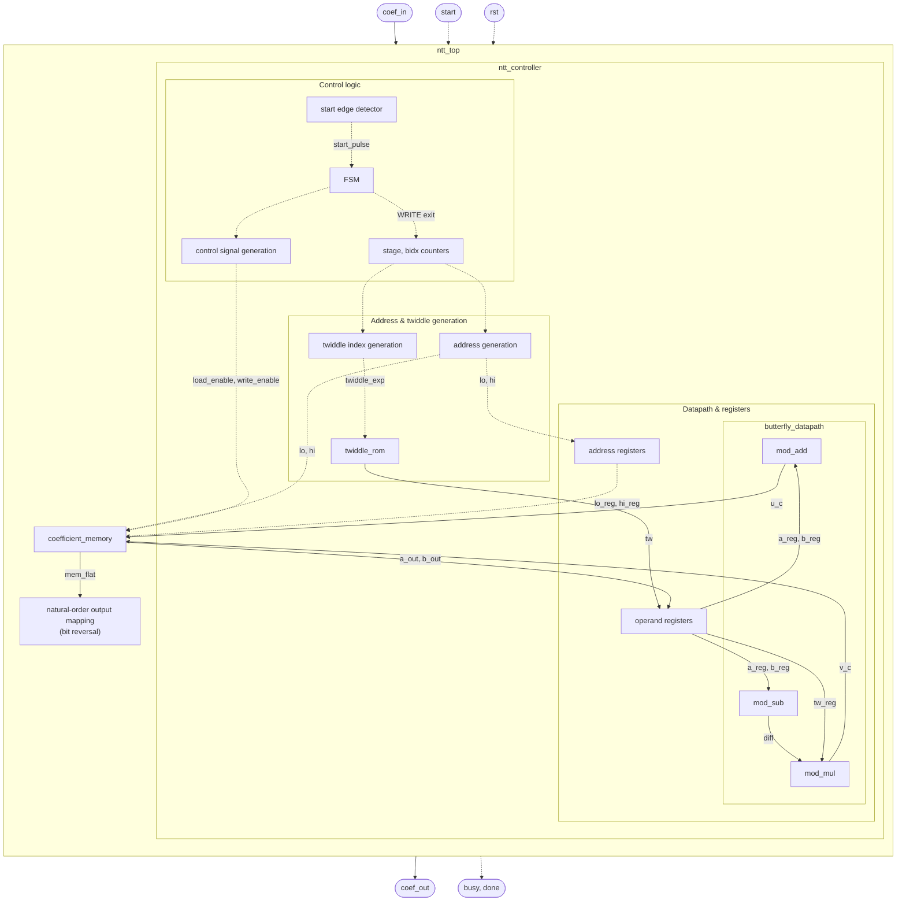
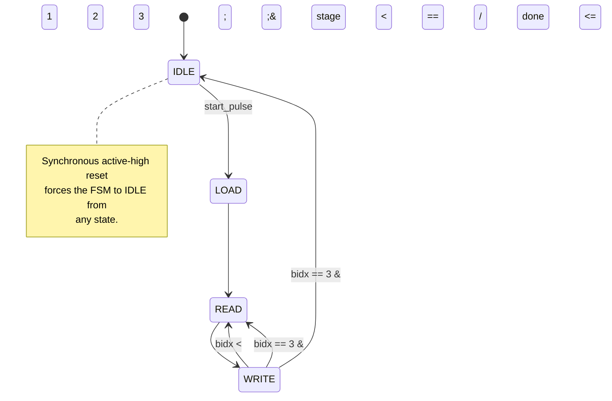
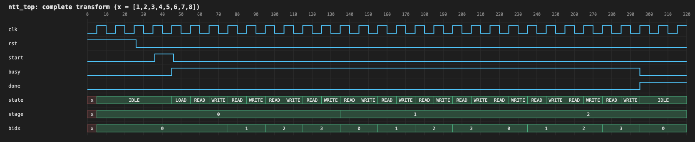
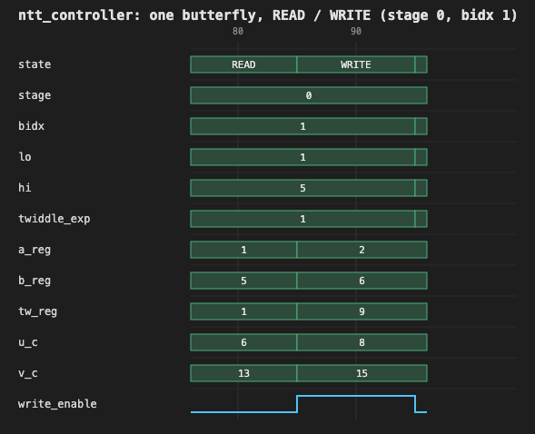
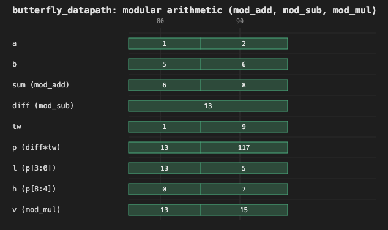

# 8-Point NTT Accelerator

This project implements an 8-point Number Theoretic Transform (NTT) accelerator in Verilog-2001 for the [ARCH Lab hardware task](https://archlabs.us/apply/task26fhe/). The design is simulated using Icarus Verilog.

The initial implementation uses a single reusable butterfly datapath for all three stages of the transform, rather than separate hardware for each stage. A ROM stores the twiddle factors, while a finite-state machine (FSM) controls the transform sequence. In addition to this implementation, the project includes three experiments investigating inverse NTT support, larger transform sizes, and pipelined execution.

The NTT is the finite-field counterpart of the Fast Fourier Transform (FFT). It is widely used in polynomial multiplication, where two polynomials are transformed, multiplied coefficient-wise in the transform domain, and then inverse-transformed. With suitable transform parameters, this reduces the computational complexity from $O(n^2)$ for direct multiplication to $O(n\log n)$.

Unlike FFT implementations that use floating-point arithmetic, an NTT operates over a finite field using integer arithmetic and modular reduction. This avoids floating-point rounding errors and makes NTTs particularly useful in lattice-based cryptography and Fully Homomorphic Encryption (FHE), where efficient polynomial arithmetic is essential. See the task's *Why NTT Matters in Hardware* section for further motivation.

## Table of contents

- [Mathematical foundation](#mathematical-foundation)
- [NTT algorithm and butterfly convention](#ntt-algorithm-and-butterfly-convention)
- [Top-level interface](#top-level-interface)
- [Architecture](#architecture)
- [Transform execution](#transform-execution)
- [Implementation details](#implementation-details)
- [Design decisions and trade-offs](#design-decisions-and-trade-offs)
- [Input and output format](#input-and-output-format)
- [Project structure](#project-structure)
- [Simulation and verification](#simulation-and-verification)
- [Simulation waveforms](#simulation-waveforms)
- [Verification results](#verification-results)
- [Limitations and Future Work](#limitations-and-future-work)
- [Experiments and evaluation](#experiments-and-evaluation)
- [Assignment coverage](#assignment-coverage)

## Mathematical foundation

The implementation computes an 8-point Number Theoretic Transform (NTT) over the finite field $\mathbb{Z}/17\mathbb{Z}$, using the following parameters:

| Parameter | Value |
|---|---|
| Transform size | $N = 8$ |
| Modulus | $q = 17$ |
| Primitive root of unity | $\omega = 9$ |

### Primitive root of unity

An N-point NTT requires a primitive Nth root of unity modulo $q$. Such a root satisfies:

$$
\omega^N \equiv 1 \pmod q
$$

and no smaller positive exponent produces 1.

For this transform, $\omega=9$ satisfies:

$$
9^8 \equiv 1 \pmod{17}
$$

while $9^1$, $9^2$, and $9^4$ are not congruent to 1 modulo 17. Therefore, 9 has multiplicative order exactly 8 and is a valid primitive eighth root of unity.

Its successive powers modulo 17 are:

```text
ω^0..ω^8 mod 17 = [1, 9, 13, 15, 16, 8, 4, 2, 1]
```

The existence of an element of order 8 is consistent with the structure of the multiplicative group of a finite field. Since 17 is prime, its nonzero residues form a multiplicative group of order $17-1=16$. By Lagrange's theorem, the order of any element must divide 16. Since $8$ divides $16$, an element of order 8 can exist modulo 17. The calculation above establishes that 9 is such an element.

More generally, for a prime modulus $q$, the condition $N\mid(q-1)$ is necessary for an Nth primitive root of unity to exist.

### Direct NTT definition

For an input sequence of eight coefficients $x[0],\ldots,x[7]$, the forward NTT produces eight output coefficients:

$$
X[k]=\sum_{j=0}^{7}x[j]\omega^{jk}\pmod{17},
\qquad 0\leq k<8
$$

Here, $j$ indexes the input coefficients, $k$ identifies the output coefficient, and powers of $\omega$ provide the corresponding transform factors. All arithmetic is performed modulo 17.

This mathematical definition specifies the transform independently of the algorithm used to evaluate it.

## NTT algorithm and butterfly convention

The direct definition describes each output as a sum involving all eight input coefficients. A radix-2 factorization evaluates the same transform through smaller operations called butterflies.

This implementation uses the **decimation-in-frequency (DIF)** form of the radix-2 Cooley-Tukey algorithm. DIF decomposes the transform by separating even-indexed and odd-indexed output components.

For two input values $a$ and $b$, the corresponding butterfly is:

$$
u=(a+b)\pmod{17}
$$

$$
v=(a-b)\omega^e\pmod{17}
$$

where $e$ is the twiddle-factor exponent determined by the stage and butterfly position.

The sum contributes to the even-indexed output branch, while the twiddle-multiplied difference contributes to the odd-indexed output branch. Repeating this decomposition produces the complete transform through $\log_2 N$ stages.

This is the standard radix-2 DIF factorization used in the Cooley-Tukey FFT. See [Burrus, *Fast Fourier Transforms*, Section 8: The Cooley-Tukey FFT Algorithm](https://eng.libretexts.org/Bookshelves/Electrical_Engineering/Signal_Processing_and_Modeling/Fast_Fourier_Transforms_%28Burrus%29/08%3A_The_Cooley-Tukey_Fast_Fourier_Transform_Algorithm/8.02%3A_Basic_Cooley-Tukey_FFT).

The same factorization applies to the NTT by performing the operations over a finite field and replacing complex roots of unity with powers of $\omega=9$ in $\mathbb{Z}/17\mathbb{Z}$. See [Optimization and implementation of the number theoretic transform butterfly unit for large integer multiplication (2021)](https://www.sciencedirect.com/science/article/pii/S2214212621000909) for further discussion of NTT butterfly arithmetic and implementation.

### Three stages and twiddle exponents

For an 8-point transform, radix-2 decomposition requires:

$$
\log_2 8=3
$$

stages. The butterfly distance decreases from 4 to 2 to 1, with four butterflies at each stage.

| Stage | Distance | Butterfly pairs | Twiddle exponents |
|---|---:|---|---|
| 1 | 4 | (0,4), (1,5), (2,6), (3,7) | 0, 1, 2, 3 |
| 2 | 2 | (0,2), (1,3), (4,6), (5,7) | 0, 2, 0, 2 |
| 3 | 1 | (0,1), (2,3), (4,5), (6,7) | 0, 0, 0, 0 |

The complete transform therefore consists of 12 butterfly operations across three stages.

### Bit-reversed output ordering

A characteristic of radix-2 DIF is that, when the input coefficients are in natural order, the final transform coefficients are produced in bit-reversed order.

For an 8-point transform, the three-bit reversal gives the following correspondence:

| Natural output index | Position in bit-reversed sequence |
|---:|---:|
| 0 | 0 |
| 1 | 4 |
| 2 | 2 |
| 3 | 6 |
| 4 | 1 |
| 5 | 5 |
| 6 | 3 |
| 7 | 7 |

Consequently, the final DIF stage produces:

$$
[X[0],X[4],X[2],X[6],X[1],X[5],X[3],X[7]]
$$

Reordering these coefficients according to their natural indices gives the conventional NTT output:

$$
[X[0],X[1],X[2],X[3],X[4],X[5],X[6],X[7]]
$$

This ordering follows from the recursive even/odd decomposition of the output indices in radix-2 DIF.

### Worked example

Consider the input sequence:

$$
x=[1,2,3,4,5,6,7,8]
$$

Applying the three DIF stages produces the following intermediate sequences:

| Step | Values |
|---|---|
| Stage 1 | `[6, 8, 10, 12, 13, 15, 16, 8]` |
| Stage 2 | `[16, 3, 13, 16, 12, 6, 14, 6]` |
| Stage 3 (bit-reversed order) | `[2, 13, 12, 14, 1, 6, 3, 8]` |

Using the bit-reversed index correspondence established above, the natural-order transform output is:

$$
X=[2,1,12,3,13,6,14,8]
$$

These values agree with the direct NTT definition for the same input.

## Top-level interface

The `ntt_top` module accepts eight 5-bit input coefficients packed into a 40-bit bus and returns the eight NTT coefficients in natural order through another 40-bit bus.

| Signal | Direction | Width | Description |
|---|---|---:|---|
| `clk` | Input | 1 | System clock |
| `rst` | Input | 1 | Synchronous active-high reset |
| `start` | Input | 1 | Transform start request |
| `coef_in` | Input | 40 | Eight packed 5-bit input coefficients |
| `busy` | Output | 1 | High while a transform is in progress |
| `done` | Output | 1 | Asserted when the transform completes |
| `coef_out` | Output | 40 | Eight packed 5-bit output coefficients |

## Architecture

The design uses an iterative architecture with a single shared butterfly datapath and one in-place coefficient memory. Rather than instantiating separate arithmetic units for every butterfly, the same datapath is reused for all 12 butterflies across the three NTT stages.

`ntt_top` instantiates two sub-blocks, `ntt_controller` and `coefficient_memory`, and additionally implements the natural-order output mapping itself:

- **`ntt_controller`**: Controls the transform, generates coefficient addresses and twiddle indices, and schedules the butterfly operations. It contains the twiddle ROM and the shared butterfly datapath.
- **`coefficient_memory`**: Stores the input coefficients, intermediate stage results, and final (bit-reversed) output in one in-place bank.
- **Natural-order output mapping**: A combinational bit-reversal permutation inside `ntt_top` itself (not inside `coefficient_memory`) that reorders the memory contents into `coef_out`.

```text
ntt_top
├── ntt_controller
│   ├── start edge detector        (start_d, start_pulse)
│   ├── FSM state register         (state: IDLE/LOAD/READ/WRITE)
│   ├── stage counter              (stage)
│   ├── butterfly counter          (bidx)
│   ├── address-generation logic   (half, shift_amt, group, j -> lo, hi)
│   ├── twiddle-index generation   (j, stage -> twiddle_exp)
│   ├── twiddle_rom
│   ├── operand registers          (a_reg, b_reg, tw_reg)
│   ├── address registers          (lo_reg, hi_reg)
│   ├── butterfly_datapath         (combinational outputs u_c, v_c feed coefficient_memory directly)
│   │   ├── mod_add
│   │   ├── mod_sub
│   │   └── mod_mul
│   └── control-signal generation  (busy, done, load_enable, write_enable)
├── coefficient_memory
│   └── mem[0:7]  (8 × 5-bit, in-place, single-cycle load + dual read/write ports)
└── natural-order output mapping    (bit-reversal permutation, in ntt_top)
```

Address-generation and twiddle-index generation are shown as separate entries because the controller computes them for different purposes (memory addresses versus a ROM index), but they are not independent combinational blocks: the twiddle-index calculation reuses `j` and `stage`, both already produced while computing `lo`/`hi`.

The following diagram shows the main data and control connections.



Solid arrows represent coefficient or arithmetic data. Dashed arrows represent control and address signals.

This diagram describes the baseline implementation in `rtl/`. The experimental implementations use separate architectures or control extensions, as described in the corresponding experiment sections.

The main responsibilities are:

- **`ntt_top`** connects the controller and coefficient memory, exposes the external interface, wires `coef_in` directly into `coefficient_memory` (the controller never sees the coefficient values, only `load_enable`), and applies the bit-reversal permutation to `coefficient_memory`'s combinational `mem_flat` output to produce natural-order `coef_out`.
- **`ntt_controller`** contains the `start_edge` detector, the FSM state register, the `stage`/`bidx` counters, the address and twiddle index generation logic, the twiddle ROM, the operand/address registers, the shared butterfly datapath, and the combinational control signal generation for `busy`/`load_enable`/`write_enable` (`done` is registered alongside `state`). The datapath's combinational `u_c`/`v_c` outputs feed `coefficient_memory`'s write-data ports directly.
- **`coefficient_memory`** is a single in-place bank containing eight 5-bit coefficients. It loads all eight inputs in one clock cycle directly from `coef_in` (an unrolled loop over all eight words in the same always block, gated by `load_enable`; there is no separate load counter), provides two continuously-addressed combinational read ports (`a_out`/`b_out` at `lo`/`hi`), writes two coefficients per cycle (`mem[lo_reg]`, `mem[hi_reg]`) when `write_enable` is asserted, and continuously exposes its full contents as `mem_flat` for `ntt_top`'s output mapping.
- **`twiddle_rom`** provides the precomputed values of $\omega^e \bmod 17$.
- **`butterfly_datapath`** contains one shared combinational adder, subtractor, and multiplier. The adder and subtractor operate on the same input pair; the subtraction result is multiplied by the twiddle factor.

The butterfly datapath has no internal registers. Its inputs (`a_reg`, `b_reg`, `tw_reg`) are captured by registers in the controller. Its outputs (`u_c`, `v_c`) are combinational: they settle during the `WRITE` cycle and are written directly into `coefficient_memory`.

**Reset.** `rst` is a synchronous, active-high input to `ntt_controller`. The diagram shows it as a single arrow into the `ntt_controller` block rather than wiring it to every internal register individually. On the clock edge after `rst` is asserted, the controller's single always block clears `state` to `S_IDLE`, `stage` to 0, `bidx` to 0, `done` to 0, and `start_d` to 0. See [Reset and handshake behavior](#reset-and-handshake-behavior) for the full handshake table.

## Transform execution

The controller executes the NTT by processing one butterfly at a time. Each of the three stages contains four butterflies, giving a total of 12 butterfly operations.

### Butterfly operation

The radix-2 DIF butterfly computes:

$$
u=(a+b)\bmod 17
$$

$$
v=(a-b)\omega^e\bmod 17
$$

where $a$ and $b$ are the selected coefficient pair, and $\omega^e$ is the corresponding twiddle factor.

The shared datapath computes both results combinationally:

1. `mod_add` calculates the sum $u$.
2. `mod_sub` calculates the difference $a-b$ modulo 17.
3. `mod_mul` multiplies the difference by the selected twiddle factor to produce $v$.

The controller writes both results directly back to their respective memory locations; there is no intermediate register that captures them first.

### Butterfly schedule

The controller uses two counters:

- `stage` identifies the current NTT stage, ranging from 0 to 2.
- `bidx` identifies the butterfly within the current stage, ranging from 0 to 3.

The schedule is:

| Stage | Distance | Butterfly pairs | Twiddle exponents |
|---|---:|---|---|
| 1 | 4 | (0,4), (1,5), (2,6), (3,7) | 0, 1, 2, 3 |
| 2 | 2 | (0,2), (1,3), (4,6), (5,7) | 0, 2, 0, 2 |
| 3 | 1 | (0,1), (2,3), (4,5), (6,7) | 0, 0, 0, 0 |

Each stage processes four butterflies. Once all four have completed, the controller advances to the next stage. After the fourth butterfly of the third stage, the transform is complete.

### Controller state machine

Four states control the execution:

| State | Operation |
|---|---|
| `IDLE` | Wait for a start request |
| `LOAD` | Write all eight input coefficients into memory |
| `READ` | Read the selected coefficient pair and twiddle factor |
| `WRITE` | Let the butterfly datapath settle combinationally, write both results back to memory, and advance the schedule |

The execution sequence is:



The `READ` and `WRITE` states repeat for each butterfly. The controller does not begin the next butterfly until the current butterfly's results have been written to memory.

The `stage` and `bidx` counters are advanced as part of the `WRITE` state's exit logic. This avoids introducing additional FSM states or clock cycles just for schedule bookkeeping.

### Cycle-by-cycle operation

Each butterfly takes two clock cycles:

1. **READ:** The controller reads the two coefficients from memory, selects the twiddle factor from the ROM, and captures these values into `a_reg`, `b_reg`, and `tw_reg`.
2. **WRITE:** The combinational butterfly datapath, driven by the operands just captured, settles over this cycle and produces `u_c`/`v_c`. The controller writes them directly into the two selected memory locations at the end of the cycle, and advances the schedule.

## Implementation details

This section describes how the architecture is realized in RTL, including the arithmetic circuits, memory organization, address generation, and control behavior.

### Modular arithmetic

All three arithmetic units operate on canonical 5-bit residues in the range $[0,16]$, the same canonical range required by [Mathematical foundation](#mathematical-foundation). They do not normalize arbitrary 5-bit values and their inputs must already be reduced modulo 17.

**Addition**

The adder calculates $a+b$. Since both inputs are at most 16, the maximum sum is 32, so a 6-bit intermediate result is sufficient. The result is reduced by subtracting 17 when the sum is greater than or equal to 17. One correction is sufficient.

**Subtraction**

The subtractor calculates $a-b$:

- If $a\geq b$, the difference is already in the valid range: $(a-b)\bmod 17=a-b$.
- If $a<b$, it adds 17 to the difference: $(a-b)\bmod 17=a+17-b$.

**Multiplication**

The multiplier first calculates the 9-bit product:

$$
p=a\times b
$$

Because the modulus is 17 and $17=2^4+1$, we can use:

$$
16\equiv -1\pmod{17}
$$

Split the product into its upper bits and lower nibble:

$$
p=16h+l
$$

where $h=p[8:4]$ and $l=p[3:0]$.

Therefore:

$$
p\equiv l-h\pmod{17}
$$

The product is reduced by calculating $l-h$ and adding 17 if the result is negative. This avoids a general-purpose division or modulo operator. The reduction relies on the specific modulus $q=17$ and does not directly generalize to arbitrary primes.

### In-place coefficient memory

The design uses one 8×5-bit memory bank, `mem[0:7]`, throughout the transform.

The same bank stores:

- The eight input coefficients after `LOAD`.
- The intermediate results after each NTT stage.
- The final bit-reversed output after the last stage.

Each butterfly reads two locations and writes the two corresponding results back to those locations.

This in-place organization is safe for the selected schedule. Within each stage, the four butterflies operate on disjoint pairs of addresses. The stages execute sequentially, so a stage finishes all its writes before the next stage begins. There are therefore no read-after-write conflicts in this schedule.

### Address and twiddle-index generation

The controller calculates the coefficient addresses and twiddle exponent from `stage` and `bidx`. It uses shifts and bit masks rather than division, modulo operations, or a fixed 12-entry address lookup table.

For this 8-point transform:

```text
half        = 4 >> stage
group       = bidx >> (2 - stage)
j           = bidx & (half - 1)
lo          = group * (2 * half) + j
hi          = lo + half
twiddle_exp = (j << stage) & 7
```

`lo` and `hi` identify the two coefficient locations used by the current butterfly. `twiddle_exp` selects the corresponding twiddle factor.

The formula is based on the radix-2 DIF schedule and can be adapted to other power-of-two transform sizes. However, this implementation is fixed to $N=8$; the constants are hardcoded and the design is not parameterized.

### Twiddle ROM

The design uses a combinational ROM containing the eight precomputed powers of the primitive root:

$$
[1,9,13,15,16,8,4,2]
$$

A 3-bit exponent selects the corresponding value of $\omega^e\bmod17$. The selected value is captured by the controller during `READ` and used by the multiplier during `WRITE`.

### Bit widths

The arithmetic widths are determined by the maximum possible values when the inputs are canonical residues in $[0,16]$.

| Quantity | Maximum value | Required width |
|---|---:|---:|
| Input coefficient | 16 | 5 bits |
| Addition intermediate | 32 | 6 bits |
| Multiplication intermediate | 256 | 9 bits |
| Generated twiddle exponent | 3 | 2 bits |
| Twiddle ROM address | 7 | 3 bits |

The current $N=8$ schedule generates exponents from 0 to 3, requiring two bits to represent the used exponent values. The ROM has eight entries and therefore uses a three-bit address. The implementation retains this three-bit ROM interface.

### Reset and handshake behavior

The design uses a synchronous, active-high reset. When `rst` is asserted, the FSM returns to `IDLE` regardless of its current state.

The memory write enables are also gated with the live reset signal, preventing a load or butterfly write from committing on an edge where reset is asserted.

The `start` input is edge-detected using a delayed copy of the signal:

$$
start\_pulse=start\land\neg start_d
$$

This means a continuously asserted `start` signal triggers only one transform. A start pulse received while the controller is busy is ignored.

The handshake signals behave as follows:

| Signal or behavior | Implementation |
|---|---|
| Start request | Rising-edge detection |
| Start while busy | Ignored |
| Start held high | One transform only |
| Reset | Synchronous, active-high |
| `busy` | High whenever the FSM is not in `IDLE` |
| `done` | Asserted on completion and held until the next accepted transform |

`busy` is combinationally derived from the FSM state. `done` is registered: it is cleared when a new transform is accepted and asserted on the final `WRITE` edge.

### Latency

The transform requires:

- 1 cycle to load the eight input coefficients.
- 12 butterflies.
- 2 cycles per butterfly.

Therefore:

$$
1+(12\times2)=25\text{ cycles}
$$

The measured latency is 25 busy cycles, from the `start` edge to the final `WRITE` edge. See [Verification results](#verification-results).

## Design decisions and trade-offs

The architecture makes several trade-offs between hardware resource usage, execution latency, and implementation complexity. The choices below reflect the fixed 8-point transform parameters and the requirement to implement the transform using reusable hardware.

### Single shared butterfly versus parallel units

The design uses one shared butterfly datapath consisting of a modular adder, modular subtractor, and multiplier. This datapath is reused for all 12 butterfly operations across the three transform stages.

The main advantage is reduced arithmetic hardware. Instead of implementing four butterfly units to process the four disjoint pairs in a stage simultaneously, the controller reuses the same arithmetic resources sequentially. This keeps the datapath small and avoids the need for multiple simultaneous memory accesses.

The trade-off is execution latency. Each butterfly requires two controller cycles (`READ` and `WRITE`), resulting in 25 busy cycles per transform, including the initial `LOAD` cycle.

Four parallel butterfly units could reduce execution time by processing an entire stage concurrently. However, this would require four sets of arithmetic resources and a memory organization capable of supplying and storing multiple coefficient pairs simultaneously. This alternative is not implemented or evaluated in this design.

### Sequential execution

The controller executes each butterfly through a strict `READ → WRITE` sequence. Each operation completes its memory updates before the next butterfly begins.

This approach simplifies operand capture, result storage, and memory access scheduling. It also avoids managing overlapping operations that may depend on the same shared datapath or memory resources.

The trade-off is that the datapath remains idle during some controller phases, and successive butterfly operations cannot overlap. This limits throughput but keeps the control logic and resource requirements relatively simple.

### Four-state FSM versus additional bookkeeping states

The controller uses four states: `IDLE`, `LOAD`, `READ`, and `WRITE`. Stage and butterfly progression are handled by the `stage` and `bidx` counters within the existing state transitions, rather than introducing separate FSM states for counter updates.

The `bidx` counter advances after each completed butterfly. When the final butterfly of a stage is written, `bidx` is reset and `stage` advances. After the final butterfly of the final stage, the controller returns to `IDLE` and asserts `done`.

### Single in-place bank versus double buffering

All eight coefficients are stored in a single 8×5-bit memory bank, requiring only 40 bits of coefficient storage.

The DIF schedule pairs disjoint coefficient locations within each stage. Consequently, each butterfly reads two locations and writes its two results back to those same locations. No other butterfly in that stage accesses either location, so the operations can safely update the bank in place.

A double-buffered architecture would require two 8×5-bit banks, increasing coefficient storage to 80 bits, together with additional bank-selection logic. Double buffering can be useful when separate input and output storage is required, but it is unnecessary for this sequential in-place schedule.

### Algorithmic address generation versus a lookup table

The butterfly addresses and twiddle exponents are generated algorithmically from the current stage and butterfly index using shift, mask, and arithmetic operations.

This avoids storing a fixed table containing all 12 butterfly address pairs and makes the relationship between the DIF schedule and the hardware control explicit. It also provides a more general approach than explicitly encoding every operation in a lookup table.

A lookup table could simplify control for a fixed schedule, but would explicitly encode the address and exponent sequence. The current implementation favors algorithmic generation, although the address-generation logic is specialized for the 8-point design.

### Precomputed twiddle ROM versus runtime computation

The twiddle factors are stored as constants in a ROM, avoiding runtime modular exponentiation.

This is appropriate because the transform size, modulus, and primitive root are fixed. All required powers can be calculated before implementation, allowing the controller to select the appropriate value directly using the generated twiddle exponent.

The ROM contains the eight powers of the selected primitive root, while the current DIF schedule uses only exponents 0 through 3. Storing the complete set keeps the ROM representation straightforward and makes all powers available explicitly.

### Specialized modular reduction versus general modulo arithmetic

The multiplier uses the identity:

$$
16\equiv-1\pmod{17}
$$

For a product represented as:

$$
p=16h+l
$$

the reduction becomes:

$$
p\equiv l-h\pmod{17}
$$

The implementation therefore subtracts the upper portion of the product from the lower portion and adds 17 when the difference is negative. This avoids a general-purpose modulo operation and exploits the specific structure of the selected modulus.

The trade-off is limited generality. This reduction is specialized for modulus 17 and cannot be applied unchanged to arbitrary primes. Supporting other moduli would require a different reduction method. See [Limitations and Future Work](#limitations-and-future-work).

### Fixed-width arithmetic

The design uses fixed-width unsigned vectors rather than integer or floating-point arithmetic. Since every coefficient is maintained in the canonical range 0 to 16, five bits are sufficient to represent each stored coefficient.

The intermediate widths are selected to accommodate the maximum values before modular reduction:

- **Addition:** The maximum sum is 16 + 16 = 32, requiring 6 bits.
- **Subtraction:** The difference is handled using the implementation's conditional correction by 17.
- **Multiplication:** The maximum product is 16 × 16 = 256, requiring 9 bits.

These widths avoid unnecessary datapath width while preserving the complete intermediate arithmetic range. They are specific to the selected modulus and operand range.

### Natural-order output through bit reversal

The iterative DIF algorithm produces its final coefficients in bit-reversed order. Rather than performing an additional memory-reordering pass, the design maps the internal memory locations to natural coefficient order through fixed output indexing.

For an 8-point transform, the three-bit index is reversed when selecting the output coefficient:

$$
coef\_out[k]=mem[bitrev3(k)]
$$

This keeps the internal transform schedule unchanged and avoids additional clock cycles and memory writes for output reordering. The trade-off is that the output mapping is tied to the fixed 8-point transform size.

## Input and output format

Both `coef_in` and `coef_out` pack eight 5-bit coefficients into a 40-bit bus. Coefficients are packed least-significant first:

$$
coef\_in[5k+:5]=x[k]
$$

For example, to drive the input vector $x[0..7]$:

```verilog
coef_in = {
    x[7], x[6], x[5], x[4],
    x[3], x[2], x[1], x[0]
};
```

The output bus uses the same packing convention:

$$
coef\_out[5k+:5]=X[k]
$$

The output is already in natural order. The controller performs the transform using the radix-2 DIF schedule, which produces results in bit-reversed order. `ntt_top` applies the output permutation:

$$
coef\_out[5k+:5]=mem[bitrev3(k)]
$$

where `bitrev3` reverses the three bits of the index.

**Input contract**

Every input coefficient must be a canonical residue in $[0,16]$. The hardware does not normalize invalid inputs. Although a 5-bit field can represent values from 0 to 31, values from 17 to 31 are outside the supported input domain.

The testbench reads input and expected-output vectors from decimal text files, with one coefficient per line and eight lines per vector:

- `reference/test_vectors/input_<name>.txt`
- `reference/test_vectors/expected_<name>.txt`

The list of vector names is read from `tb/vector_names.txt`, which is generated from the input-vector files present rather than being hardcoded.

For each vector, the testbench also reads the expected intermediate memory contents after each DIF stage:

- `reference/stage_checkpoints/stage1_<name>.txt`
- `reference/stage_checkpoints/stage2_<name>.txt`
- `reference/stage_checkpoints/stage3_<name>.txt`

This allows the testbench to check not only the final transform output but also the intermediate results produced at each stage.

## Project structure

The repository separates the baseline RTL implementation, its testbenches and reference code, the independent experiments, execution scripts, synthesis reports, and waveform artifacts.

```text
ntt_accelerator/
├── README.md
├── .gitignore
├── rtl/                            # Baseline Verilog implementation
│   ├── ntt_top.v                   # Top-level module and output bit reversal
│   ├── ntt_controller.v            # FSM, address/twiddle generation, registers
│   ├── coefficient_memory.v        # In-place 8×5-bit coefficient memory
│   ├── butterfly_datapath.v        # Shared combinational butterfly
│   ├── modular_arithmetic.v        # mod_add, mod_sub, mod_mul
│   └── twiddle_rom.v               # Twiddle-factor lookup table
├── tb/                             # Baseline testbenches and fixtures
│   ├── tb_ntt_top.v                # Transform, intermediate, sequencing, timing checks
│   ├── tb_modular_arithmetic.v     # Exhaustive 17×17 arithmetic checks
│   ├── tb_control.v                # Reset and start/busy/done tests
│   ├── tb_negative.v               # Invalid-input and timeout tests
│   ├── vector_names.txt            # Generated test-vector manifest
│   └── fixtures/                   # Malformed, short, and out-of-range inputs
├── reference/                      # Baseline independent mathematical reference code
│   ├── ntt_reference_model.py      # Direct NTT definition and vector generation
│   ├── ntt_math_validation.py      # Independent mathematical validation
│   ├── export_stage_checkpoints.py # Generates intermediate-stage checkpoints
│   ├── test_vectors/               # 31 input/expected-output vector pairs
│   └── stage_checkpoints/          # Expected memory contents after each stage
├── experiments/                    # Independent extensions; baseline is never modified
│   ├── intt/                       # Experiment 1: inverse NTT
│   │   ├── rtl/                    # ntt_controller.v, ntt_top.v, twiddle_rom.v
│   │   ├── tb/tb_intt.v
│   │   └── reference/              # intt_reference_model.py, intt_math_validation.py, test_vectors/
│   ├── ntt16/                      # Experiment 2: N=16 transform
│   │   ├── rtl/                    # ntt_controller16.v, ntt_top16.v, coefficient_memory16.v, twiddle_rom16.v
│   │   ├── tb/                     # tb_ntt16.v, vector_names16.txt
│   │   └── reference/              # ntt16_reference_model.py, ntt16_math_validation.py, export_stage_checkpoints16.py, test_vectors/, stage_checkpoints/
│   └── pipelined/                  # Experiment 3: pipelined execution
│       ├── rtl/                    # ntt_controller_pipelined.v, ntt_top_pipelined.v
│       ├── tb/tb_pipelined.v
│       └── reference/pipelined_schedule_model.py
├── scripts/
│   ├── run_all_tests.sh            # Compiles and runs all four baseline testbenches
│   ├── run_intt.sh                 # Runs the INTT experiment's RTL and Python checks
│   ├── run_ntt16.sh                # Runs the N=16 experiment's RTL and Python checks
│   ├── run_pipelined.sh            # Runs the pipelined experiment's RTL and Python checks
│   ├── run_all_experiments.sh      # Runs the baseline suite plus all three experiments
│   ├── setup_toolchain.sh          # Locates and sources OSS CAD Suite (yosys, nextpnr-ecp5)
│   └── run_synthesis.sh            # Runs ECP5 synth_ecp5 -nodsp + nextpnr-ecp5 place-and-route for the baseline and every experiment
├── toolchain/
│   └── versions.txt                # Exact tool versions the committed reports/ results were generated with
├── reports/                        # Raw Yosys/nextpnr-ecp5 scripts and output
│   ├── baseline/synth.ys, synth_report.txt, nextpnr_report.txt
│   ├── intt/synth.ys, synth_report.txt, nextpnr_report.txt
│   ├── ntt16/synth.ys, synth_report.txt, nextpnr_report.txt
│   └── pipelined/synth.ys, synth_report.txt, nextpnr_report.txt
├── waves/                          # Waveform capture and inspection artifacts
│   ├── dump_waveforms.v            # Standalone VCD capture harness
│   ├── render_waveforms.py         # Generates waveform screenshots from VCD
│   ├── ntt_top.vcd                 # Recorded full-transform waveform
│   └── trace.log                   # Per-cycle execution trace
└── docs/
    └── images/                     # Waveform screenshots used in this README
```

The main directories have distinct responsibilities:

- `rtl/` contains the baseline synthesizable Verilog implementation.
- `tb/` contains the baseline testbenches that exercise `rtl/`, along with fixtures used by negative tests.
- `reference/` contains the baseline's Python reference implementations, mathematical checks, and expected test data.
- `experiments/` contains the three independent extensions (INTT, N=16, pipelined), each with its own `rtl/`, `tb/`, and `reference/` subdirectories, mirroring the baseline's layout. None of these modify `rtl/`.
- `scripts/` contains the scripts used to run the baseline suite, each experiment's suite, the combined regression, the toolchain setup, and the synthesis flow.
- `toolchain/` records the exact tool versions the committed `reports/` results were generated with (see [Reproducing the FPGA synthesis results](#reproducing-the-fpga-synthesis-results)).
- `reports/` contains the ECP5 synthesis/place-and-route scripts and output for the baseline and each experiment.
- `waves/` contains the standalone waveform-capture harness, recorded VCD, and trace-generation utilities.
- `docs/images/` contains the rendered waveform screenshots included in this documentation.

## Simulation and verification

### Prerequisites

The project requires:

- Icarus Verilog (`iverilog` and `vvp`).
- Python 3.

**Tested versions:** Icarus Verilog 13.0 (stable) and Python 3.11.13.

### Running the test suite

The complete RTL test suite can be executed using:

```bash
cd ntt_accelerator
./scripts/run_all_tests.sh
```

The script compiles and runs all four Verilog testbenches and aggregates their pass/fail results.

### Verification strategy

Verification is performed at four levels. Each level checks a different aspect of the implementation, from the mathematical transform to the behavior of the RTL controller.

**1. Mathematical validation**

`reference/ntt_math_validation.py` performs independent Python checks without involving the RTL.

It validates:

- The multiplicative order of the selected root of unity.
- The radix-2 DIF butterfly schedule.
- The bit-reversal permutation.
- The modular arithmetic operations.
- The on-disk test vectors in `reference/test_vectors/`, checking each one's expected output against both the direct NTT definition and independently derived DIF computations.

This establishes that the mathematical conventions and expected intermediate values used by the project are internally consistent. It does not read `reference/stage_checkpoints/`; those files are consumed only by `tb_ntt_top.v` for the RTL-level intermediate-stage checks described below.

**2. Independent reference-model comparison**

`reference/ntt_reference_model.py` implements the NTT directly from its mathematical definition:

$$
X[k]=\sum_{j=0}^{7}x[j]\omega^{jk}\pmod{17}
$$

It does not implement the DIF butterfly schedule or reuse the RTL's address-generation logic.

The direct transform is compared against the DIF-based implementation for all 31 test vectors. Because the two approaches calculate the transform differently, their agreement provides an independent check of the algorithm and output ordering.

**3. RTL functional verification**

`tb/tb_ntt_top.v` exercises the actual `ntt_top` module through its external interface.

For all 31 test vectors, it checks:

- The final NTT coefficients against the expected outputs.
- The coefficient memory contents after each of the three DIF stages.
- The coefficient addresses selected for every butterfly.
- The twiddle exponent used by every butterfly.
- The expected execution sequence and transform timing.

The intermediate-stage checks are particularly useful because they can identify errors in the butterfly schedule or address generation even when examining only the final output might not reveal where the error occurred.

**4. Control and negative testing**

The remaining testbenches check behavior that is not covered by the normal transform-vector sweep.

- `tb/tb_control.v` tests reset behavior, start-edge detection, and the `busy`/`done` handshake.
- `tb/tb_negative.v` tests that its own file-reading logic (not the RTL) correctly classifies missing, malformed, wrong-count, and out-of-range input fixtures as setup errors. The hardware itself does not parse or validate input files. Separately, it verifies that the DUT's `done` output never asserts and the FSM stays in `IDLE` during a bounded polling window while reset is held.

Together, these tests cover both normal operation and the handling of invalid or incomplete test inputs.

### Run the full RTL verification suite

Compiles and runs all four testbenches against `rtl/` in order and
aggregates pass/fail, using the command shown above. The script resolves
the repository root from its own location and changes into it before
running, so it can be invoked from any working directory. For example,
`bash /path/to/ntt_accelerator/scripts/run_all_tests.sh` from elsewhere
works the same way. This matters because the testbenches open fixture
and vector files using paths relative to the repository root, which the
script's own `cd` guarantees regardless of where it was invoked from.
Successful output looks like this:

```text
=== NTT accelerator verification suite ===

--- tb_modular_arithmetic ---
...
PASSED: tb_modular_arithmetic

--- tb_ntt_top ---
...
PASSED: tb_ntt_top

--- tb_control ---
...
PASSED: tb_control

--- tb_negative ---
...
PASSED: tb_negative

=== summary ===
ALL TESTBENCHES PASSED
```

(each `...` stands for that testbench's own per-check output, left out
here for space). Success means `ALL TESTBENCHES PASSED` and exit code
`0`.

### Run the independent mathematical validation

```bash
cd ntt_accelerator/reference
python3 ntt_math_validation.py
```

This is read-only with respect to `test_vectors/`. It never
regenerates or repairs a vector file; a missing or corrupted one just
gets reported as a failure. Success means `RESULT: PASS (0 failures)`
and exit code `0`.

### Regenerating test vectors or stage checkpoints (not part of ordinary validation)

These are one-time generation steps. They're not run automatically by
the validator or the test suite, and you don't need them to validate
what's already committed. They do need to run in order, since each step
depends on the previous one's output:

1. `ntt_reference_model.py` generates the `input_*.txt`/`expected_*.txt`
   vector files from the direct NTT definition.
2. `export_stage_checkpoints.py` reads those input files and generates
   the intermediate stage checkpoint files and the `tb/vector_names.txt`
   manifest.
3. `tb_ntt_top.v` (run via `run_all_tests.sh`) loads all of the above
   and verifies the actual RTL against them.

```bash
cd ntt_accelerator/reference
python3 ntt_reference_model.py          # (re)generates test_vectors/
python3 export_stage_checkpoints.py     # (re)generates stage_checkpoints/ and tb/vector_names.txt
```

## Simulation waveforms

The waveform artifacts provide a signal-level view of the actual RTL execution. They complement the automated verification results by showing how the controller, memory, and arithmetic datapath behave during a transform.

### Capturing a transform

`waves/dump_waveforms.v` is a standalone simulation harness, separate from the four automated testbenches. It instantiates the actual `ntt_top` module and drives one complete transform using the worked-example input:

$$
x=[1,2,3,4,5,6,7,8]
$$

The harness records the signal transitions throughout the execution and writes them to `waves/ntt_top.vcd`. The same simulation also produces `waves/trace.log`, a per-cycle text trace of the execution.

The VCD is retained in the repository so that the recorded signal transitions can be independently inspected using GTKWave or another compatible waveform viewer.

### Complete transform



This waveform shows `clk`, `rst`, `start`, `busy`, `done`, and the controller's `state`, `stage`, and `bidx` signals across the complete transform.

It shows that:

- `busy` rises after the accepted start request and remains asserted throughout the 25-cycle execution.
- `done` is asserted on the final `WRITE` edge, when `busy` returns low.
- `stage` progresses through 0, 1, and 2.
- `bidx` progresses from 0 to 3 within each stage.

### Single butterfly operation



This waveform focuses on stage 0, `bidx = 1`, and shows the controller's `READ → WRITE` sequence.

The signals include `state`, `stage`, `bidx`, `lo`, `hi`, `twiddle_exp`, `a_reg`, `b_reg`, `tw_reg`, `u_c`, `v_c`, and `write_enable`. Note that `a_reg`/`b_reg`/`tw_reg` still show the *previous* butterfly's (`bidx = 0`) operands throughout `READ`. They are only captured with the new, correct operands at the `READ`→`WRITE` edge which is why `u_c`/`v_c` read the previous butterfly's stale result during `READ` and the correct new result only once `WRITE` begins.

The sequence shows how the controller:

1. Captures the selected operands and twiddle factor during `READ`.
2. Lets the combinational butterfly datapath settle on the newly captured operands during `WRITE`, and asserts `write_enable` to commit both results (`u_c`, `v_c`) directly to memory at the end of that same cycle.

The same registers and combinational butterfly datapath are reused for all 12 operations, illustrating the iterative reuse of the hardware rather than separate per-butterfly units.

### Modular arithmetic datapath



This waveform zooms into the arithmetic operations performed during the same butterfly.

It shows:

- `a` and `b`, the shared operands supplied to the adder and subtractor.
- `sum`, the result from `mod_add`.
- `diff`, the result from `mod_sub`.
- `tw`, the multiplier's twiddle-factor input.
- `p`, the raw 9-bit multiplication result.
- `l` and `h`, the lower-nibble and upper-bit portions of the product.
- `v`, the final modulo-17 multiplication result.

The waveform illustrates the specialized modulo-17 reduction:

$$
p=16h+l\equiv l-h\pmod{17}
$$

The final result is obtained from `l-h`, with 17 added when the difference is negative, rather than using a general-purpose modulo operation.

### Inspecting the recorded waveform

To inspect the recorded execution in GTKWave:

```bash
cd ntt_accelerator
gtkwave waves/ntt_top.vcd
```

To regenerate the waveform and trace artifacts, run the standalone simulation harness:

```bash
iverilog -g2001 -Wall -o /tmp/dump.vvp \
    rtl/*.v waves/dump_waveforms.v

vvp /tmp/dump.vvp
```

The accompanying `waves/trace.log` provides a textual view of the same execution. It contains 25 busy-cycle entries before the final output comparison, consistent with the measured transform latency. Its final `coef_out` also matches the worked example's natural-order NTT output.

## Verification results

The accelerator was verified using a combination of RTL simulation and independent mathematical validation. The RTL testbenches exercise the implemented hardware, while the Python validation checks the transform mathematics and reference results independently. All reported checks completed successfully with zero failures.

### Test results

The following results were obtained from the current verification run:

| Check | Count | Failures |
|---|---:|---:|
| Exhaustive modular arithmetic (289 operand pairs, 6 checks per pair) | 1,734 | 0 |
| Test-vector outputs, intermediate-stage results, and sequencing | 3,511 | 0 |
| Control, reset, start, and done (7 directed scenarios) | 111 | 0 |
| Negative tests, testbench setup errors, and watchdog timeout checks (6 scenarios) | 7 | 0 |
| **RTL suite total** | **5,363** | **0** |
| Mathematical validation (`ntt_math_validation.py`) | **3,579** | **0** |

**Simulation environment:**
- Simulator: Icarus Verilog 13.0 (stable).
- Reference validation: Python 3.11.13.
- RTL language standard: Verilog-2001.

### RTL verification coverage

The RTL verification is divided into four testbenches, each targeting a different part of the design.

**1. Modular arithmetic (`tb_modular_arithmetic.v`)**

The modular arithmetic unit is tested exhaustively over all possible pairs of canonical coefficients in the range 0 to 16. This gives 17 × 17 = 289 operand pairs.

Each pair is checked against six arithmetic conditions covering modular addition, subtraction, and multiplication, including the specialized modulo-17 reduction. This produces 1,734 checks in total.

**2. Transform execution (`tb_ntt_top.v`)**

The top-level testbench runs all 31 input vectors through the complete 8-point transform. It checks the final output against the expected results and verifies intermediate-stage memory contents against independently generated stage checkpoints.

It also checks the butterfly address and twiddle-factor sequence to ensure that the controller follows the intended DIF schedule.

Across the 31 transforms, the controller executes 12 butterflies per transform, giving 372 butterfly operations. All 372 operations are sequenced correctly, and the corresponding intermediate-stage and final results pass verification.

**3. Control and handshake (`tb_control.v`)**

Directed scenarios exercise the controller's reset and handshake behavior. These checks cover start acceptance, busy-state behavior, completion signaling, and the controller's response to reset.

They verify that the control logic follows the expected state transitions and that `busy` and `done` behave correctly throughout a transform. One scenario (`T8`) measures the transform's busy-cycle latency directly, counting clock edges with `busy == 1` from the accepted start edge through the final `WRITE` edge and asserts it equals the documented 25 cycles.

**4. Negative and setup-error tests (`tb_negative.v`)**

The negative tests cover missing files, malformed input, incorrect coefficient counts, out-of-range values, and timeout handling.

An important distinction is that the file-related cases exercise the testbench's own input-file handling logic, not the RTL. The hardware itself does not parse or validate input files. A separate reset-held scenario exercises the actual DUT and checks that `done` remains deasserted and the FSM stays in `IDLE`.

### Independent mathematical validation

The Python validation script (`reference/ntt_math_validation.py`) performs 3,579 checks independently of the RTL simulation.

It validates the mathematical properties used by the implementation, including the primitive-root properties of the selected transform parameters, the DIF butterfly schedule, the bit-reversal mapping, and modular arithmetic behavior. It also checks the on-disk test vectors in `reference/test_vectors/` against the mathematical reference results.

The stage checkpoint files in `reference/stage_checkpoints/` are generated separately by `export_stage_checkpoints.py` and consumed by the top-level RTL testbench. They are not read by `ntt_math_validation.py`.

The mathematical validation and RTL simulation therefore provide complementary evidence: the Python checks validate the mathematical reference, while the RTL testbenches verify that the hardware implementation follows the intended operations and produces the expected results.

### Measured Performance and Synthesis Results

The N=8 baseline is evaluated in terms of computational performance, FPGA resource utilization, and functional correctness. The evaluation examines the number of clock cycles required to complete an NTT, the resulting execution time and transform throughput, the maximum operating frequency and critical-path characteristics, and the hardware resources required to implement the design. Functional verification results are also included to establish the correctness of the measured implementation.

Transform latency and functional verification results are obtained through RTL simulation. Hardware resource utilization and timing characteristics are evaluated using an ECP5-targeted synthesis and place-and-route flow. The design is synthesized with Yosys using `synth_ecp5 -nodsp`, targeting the **LFE5U-85F FPGA, CABGA381 package, speed grade 6**, and subsequently placed and routed using `nextpnr-ecp5`. Execution time and transform throughput are calculated using the simulated cycle count and the post-route maximum operating frequency. These timing and resource results are tool-based implementation estimates rather than measurements from physical FPGA hardware.

The synthesis flow is defined in `reports/baseline/synth.ys` and executed through `scripts/run_synthesis.sh`; see [Reproducing the FPGA synthesis results](#reproducing-the-fpga-synthesis-results) for the toolchain setup and version-reproducibility details.

| Category | Metric | Result |
|---|---|---:|
| Performance | Transform latency | 25 cycles |
| Performance | Execution time | 364.8 ns |
| Performance | Fmax | 68.53 MHz |
| Timing | Critical path delay | 14.59 ns |
| Timing | Logic delay | 5.06 ns |
| Timing | Routing delay | 9.53 ns |
| Resources | LUTs | 309 |
| Resources | FFs | 69 |
| Resources | DSP blocks | 0 |
| Resources | EBR / Block RAM | 0 |
| Throughput | Transforms per second | ≈2.74 million |
| Verification | Test vectors | 31 |
| Verification | Butterfly operations | 372 |
| Verification | Failed checks | 0 |

The 14.59 ns critical path starts at `a_reg`, passes through the combinational logic of `mod_sub` and `mod_mul`, and terminates at a write-data flip-flop in `coefficient_memory`. This path reflects the direct connection between the butterfly datapath and coefficient memory: the result is computed and written in the same cycle, without an intermediate result register. The multiplier is implemented entirely in FPGA fabric, with no DSP hard-macro boundary.

### Reproducing the FPGA synthesis results

The FPGA synthesis and place-and-route results were obtained using OSS CAD Suite, targeting the Lattice ECP5 LFE5U-85F FPGA.

Install [OSS CAD Suite](https://github.com/YosysHQ/oss-cad-suite-build), then initialize the toolchain:

```bash
source scripts/setup_toolchain.sh
```

By default, the script searches for OSS CAD Suite in `~/tools/oss-cad-suite`, `~/oss-cad-suite`, `/opt/oss-cad-suite`, and `/usr/local/oss-cad-suite`. If installed elsewhere, specify its location:

```bash
OSS_CAD_SUITE=/path/to/oss-cad-suite source scripts/setup_toolchain.sh
```

Run the synthesis flow for the baseline and all experiments:

```bash
bash scripts/run_synthesis.sh
```

The script regenerates the synthesis and place-and-route reports under `reports/`, checks that the required tools are available, and warns if the detected Yosys version differs from the version recorded in `toolchain/versions.txt`.

The exact synthesis and timing results may vary between toolchain versions. `toolchain/versions.txt` records the versions used to generate the committed results. Reproducing them exactly requires matching these versions, the target device, and the implementation settings.

**Note:** Sourcing OSS CAD Suite also puts its bundled Icarus Verilog and Python ahead of system-installed versions on `PATH`. Run RTL simulation scripts (`scripts/run_all_tests.sh` and related scripts) in a separate shell where OSS CAD Suite has not been sourced, to use the separately installed versions recorded in `toolchain/versions.txt`.

## Limitations and Future Work

The initial implementation satisfies the core requirements of the 8-point forward NTT task. However, its functionality and architecture leave several possible extensions to explore. These include inverse transform support, larger transform sizes, and improved execution throughput through pipelining.

There are still several areas that could be explored further:

- **Configurable transform sizes:** The larger-transform experiment extends the implementation to N=16. Supporting arbitrary transform sizes would require further generalization of the address generation, twiddle-factor storage, and controller.
- **Combined architectural extensions:** The inverse NTT, N=16, and pipelined implementations are separate experimental variants. Combining these capabilities into a unified, configurable accelerator remains future work.
- **Further architectural optimization:** Additional work could investigate alternative butterfly architectures, memory organizations, and pipeline configurations to improve throughput and resource efficiency, particularly for larger transform sizes.

These extensions provide opportunities to develop the accelerator beyond the initial task requirements while retaining the original implementation as a reference for evaluating subsequent designs.

## Experiments and evaluation

Three experiments extend the N=8 baseline: inverse transform support, a larger transform size (N=16), and pipelined execution. Each experiment is maintained independently under `experiments/`, with its own controller and top-level module.

All three experiments follow the baseline's synthesis and evaluation methodology. Each is independently evaluated for functional correctness, transform latency, FPGA resource utilization, and timing performance.

### Synthesis scripts

Each design has a corresponding synthesis script under `reports/`, which specifies the RTL files to include and the appropriate top-level module. For example, the INTT synthesis script is `reports/intt/synth.ys`:

```text
read_verilog -sv ../../rtl/modular_arithmetic.v
read_verilog -sv ../../rtl/butterfly_datapath.v
read_verilog -sv ../../rtl/coefficient_memory.v
read_verilog -sv ../../experiments/intt/rtl/twiddle_rom.v
read_verilog -sv ../../experiments/intt/rtl/ntt_controller.v
read_verilog -sv ../../experiments/intt/rtl/ntt_top.v
hierarchy -top ntt_top
synth_ecp5 -top ntt_top -nodsp -json ntt_top.json
stat
```

The other scripts follow the same structure, loading each design's own RTL files and selecting its corresponding top-level module (`ntt_top`, `ntt_top16`, or `ntt_top_pipelined`). Running `bash scripts/run_synthesis.sh` executes the evaluation flow for all four designs and regenerates their corresponding reports under `reports/`.

### Experiment 1: Inverse NTT (INTT)

**Objective**

Extend the accelerator to support inverse NTT while preserving forward-transform behavior and reusing the existing butterfly datapath and coefficient memory.

**Design changes**

The inverse transform retains the forward transform's DIF butterfly schedule and address generation, but uses inverse twiddle factors followed by a normalization pass.

For \(q=17\) and \(N=8\):

- Inverse primitive root: \(\omega^{-1}=2\).
- Normalization factor: \(N^{-1}=15 \pmod{17}\).
- Inverse twiddle table: `[1, 2, 4, 8, 16, 15, 13, 9]`.

The implementation adds an inverse-mode input, inverse twiddle support, and a normalization phase that multiplies each output coefficient by 15 modulo 17. Normalization reuses the existing butterfly datapath and coefficient memory, without introducing a separate arithmetic unit or additional memory.

**Verification**

An independent Python reference model and RTL simulation were used to verify mathematical correctness and controller behavior.

| Verification | Result |
|---|---:|
| Python mathematical checks | 1,661 passed |
| RTL checks | 335 passed |
| Forward test vectors | 31/31 passed |
| Inverse test vectors | 31/31 passed |
| Round-trip tests | 16/16 passed |
| Normalization locations | 8/8 verified |

Additional tests cover mode stability, start requests while busy, and reset during normalization.

**Results**

| Metric | Baseline | INTT |
|---|---:|---:|
| Forward latency | 25 cycles | 25 cycles |
| Inverse latency | — | 41 cycles |
| Maximum frequency | 68.53 MHz | 62.83 MHz |
| Critical-path delay | 14.59 ns | 15.92 ns |
| LUTs | 309 | 334 |
| Flip-flops | 69 | 74 |
| DSP blocks | 0 | 0 |
| EBR blocks | 0 | 0 |
| Forward execution time | 364.8 ns | 397.9 ns |
| Inverse execution time | — | 652.6 ns |
| Forward throughput | ≈2.74M transforms/s | ≈2.51M transforms/s |

The forward transform retains its 25-cycle schedule, confirming that inverse support does not add cycles to existing forward operations. The inverse transform requires 41 cycles because the eight-coefficient normalization pass executes sequentially after the 12 butterflies.

Compared with the baseline, INTT adds 25 LUTs (+8.1%) and 5 flip-flops (+7.2%), primarily for inverse-mode control, twiddle selection, and normalization. It reuses the existing arithmetic datapath and coefficient memory. The maximum frequency decreases by approximately 8.3%, with critical-path delay increasing from 14.59 ns to 15.92 ns. The additional selection logic contributes to this increase.

**Run commands**

```bash
# Python mathematical validation
cd experiments/intt/reference
python3 intt_reference_model.py
python3 intt_math_validation.py

# RTL verification
cd ../../..
bash scripts/run_intt.sh

# Full regression
bash scripts/run_all_experiments.sh

# Synthesis comparison
bash scripts/run_synthesis.sh
```

### Experiment 2: Larger Transform Size (N=16)

**Objective**

Evaluate how increasing the transform size from N=8 to N=16 affects execution latency, hardware resource utilization, and timing performance while retaining the baseline architecture.

**Design changes**

The N=16 implementation extends the radix-2 DIF schedule to four stages, with eight butterflies per stage.

For \(q=17\) and \(N=16\):

- Primitive root: \(\omega=3\), with \(3^{16}\equiv1\pmod{17}\) and \(3^8\not\equiv1\pmod{17}\).
- Twiddle table: `[1, 3, 9, 10, 13, 5, 15, 11, 16, 14, 8, 7, 4, 12, 2, 6]`.

The implementation, isolated under `experiments/ntt16/`, introduces:

- `coefficient_memory16.v`: expands coefficient storage from 8 to 16 entries, with 4-bit addresses.
- `twiddle_rom16.v`: provides 16 twiddle factors using a 4-bit address.
- `ntt_controller16.v`: extends address generation and scheduling to four stages and eight butterflies per stage.
- `ntt_top16.v`: integrates the N=16 components, using an 80-bit coefficient interface and 4-bit output bit reversal.

The existing `butterfly_datapath.v` and `modular_arithmetic.v` are reused unchanged. Since the modular arithmetic operates on coefficients in the range 0–16, it does not need to change when the transform size increases.

**Verification**

An independent Python reference model and RTL simulation were used to verify the implementation.

| Verification | Result |
|---|---:|
| Python mathematical checks | 5,014 passed |
| RTL checks | 8,399 passed |
| Test vectors | 39/39 passed |
| Intermediate-stage checkpoints | All four stages verified |
| Butterfly operations | All 32 per transform verified |

Test vectors include zero, boundary, impulse, alternating, increasing, decreasing, and seeded-random inputs. The testbench also checks start requests while busy and reset during a transform.

**Results**

| Metric | N=8 baseline | N=16 |
|---|---:|---:|
| Transform size | 8 | 16 |
| Stages | 3 | 4 |
| Butterfly operations | 12 | 32 |
| Transform latency | 25 cycles | 65 cycles |
| Coefficient memory | 40 bits | 80 bits |
| Maximum frequency | 68.53 MHz | 66.98 MHz |
| Critical-path delay | 14.59 ns | 14.92 ns |
| LUTs | 309 | 514 |
| Flip-flops | 69 | 112 |
| DSP blocks | 0 | 0 |
| EBR blocks | 0 | 0 |
| Execution time | 364.8 ns | 970.4 ns |
| Transform throughput | ≈2.74M/s | ≈1.03M/s |

Both implementations use the same two-cycle-per-butterfly schedule. Consequently, latency follows \(1+2B\), where \(B\) is the number of butterfly operations: 25 cycles for N=8 and 65 cycles for N=16. The N=16 testbench independently confirms the 65-cycle latency across all 39 test vectors.

Doubling the transform size increases the butterfly count by 2.67× and latency by 2.6×. LUT usage increases by 66.3%, while flip-flop usage increases by 62.3%. These increases are smaller than the growth in butterfly operations because the arithmetic datapath is shared and reused sequentially. Most additional hardware is associated with the larger coefficient memory, wider addressing, and expanded control logic.

Maximum frequency decreases by approximately 2.3%, with critical-path delay increasing from 14.59 ns to 14.92 ns. Despite the relatively small timing difference, the larger transform takes longer to execute because it requires substantially more butterfly operations.

**Run commands**

```bash
# Python mathematical validation
cd experiments/ntt16/reference
python3 ntt16_reference_model.py
python3 ntt16_math_validation.py

# RTL verification
cd ../../..
bash scripts/run_ntt16.sh

# Full regression
bash scripts/run_all_experiments.sh

# Synthesis comparison
bash scripts/run_synthesis.sh
```

### Experiment 3: Pipelined NTT Accelerator

**Objective**

Investigate whether overlapping independent butterfly operations can reduce N=8 NTT execution latency while preserving the baseline's mathematical behavior. The experiment also examines the memory dependencies that limit pipeline scheduling between DIF stages.

**Pipeline architecture**

Within each DIF stage, the four butterflies access disjoint coefficient-address pairs, allowing a new butterfly to be issued every cycle while previous operations are still in flight.

The implementation uses three pipeline stages:

1. **Issue:** Generates the butterfly addresses and twiddle exponent, then registers the operands, twiddle factor, and destination addresses.
2. **Compute:** Uses the shared `butterfly_datapath.v` to calculate the butterfly outputs.
3. **Write:** Commits the results to coefficient memory.

Valid bits (`valid1` and `valid2`) accompany the pipeline data to ensure that only valid operations can write to memory.

The existing `coefficient_memory.v` is reused without modification. Its independent combinational read ports and registered write ports allow a new butterfly to be issued while an earlier result is being written.

**Stage-boundary hazard handling**

Although butterflies within a stage access disjoint addresses, dependencies can occur when moving between stages. Issuing a new butterfly before an earlier write has completed could cause it to read stale coefficient values.

To prevent this, the controller compares the candidate butterfly's read addresses against the outstanding write destinations of both in-flight pipeline entries. Issuing is stalled only when an address conflict is detected, avoiding an unnecessary full pipeline drain at every stage boundary.

For the N=8 schedule, only the transition from stage 0 to stage 1 produces an actual conflict. Consequently, exactly one stall cycle is required per transform; the stage 1-to-stage 2 transition requires no stall.

A separate completion tag (`last1`/`last2`) tracks the final butterfly through the pipeline. The `done` signal is asserted on the same clock edge as the final memory write.

**Verification**

The implementation was verified using an independent Python schedule model and RTL simulation.

| Verification | Result |
|---|---:|
| Python schedule-model checks | 192 passed |
| RTL checks | 2,747 passed |
| Test vectors | 31/31 passed |
| Intermediate-stage checkpoints | All 3 stages verified |
| Issue-to-write tracking | All operations matched in order |
| Concurrent access checks | All address conflicts prevented |
| Stall count | Exactly 1 per transform |

The Python model independently reproduces the issue policy and verifies that all 12 butterflies are issued and written in the correct order. It also checks the resulting NTT values against the direct-NTT reference and intermediate-stage checkpoints.

The RTL testbench additionally verifies valid-bit propagation, concurrent issue/write safety, stage-boundary stalls, and completion timing. Directed tests cover start requests while busy, reset during pipeline execution, and restarting after reset.

**Performance and hardware results**

Latency is measured in busy cycles using the same convention as the baseline and the previous experiments. The measured latency is identical across all 31 test vectors.

| Metric | Baseline N=8 | Pipelined N=8 |
|---|---:|---:|
| Transform size | 8 | 8 |
| Butterfly operations | 12 | 12 |
| Pipeline stages | — | 3 |
| Per-butterfly pipeline latency | — | 3 cycles |
| Initiation interval (within a stage) | — | 1 cycle |
| Stall cycles | — | 1 |
| Transform latency | 25 cycles | 16 cycles |
| Maximum frequency | 68.53 MHz | 74.02 MHz |
| Critical-path delay | 14.59 ns | 13.51 ns |
| Logic delay | 5.06 ns | 5.78 ns |
| Routing delay | 9.53 ns | 7.73 ns |
| LUTs | 309 | 332 |
| Flip-flops | 69 | 90 |
| DSP blocks | 0 | 0 |
| EBR blocks | 0 | 0 |
| Execution time | 364.8 ns | 216.2 ns |
| Transform throughput | ≈2.74M/s | ≈4.63M/s |

The three-cycle pipeline latency describes the time taken by an individual butterfly to pass through issue, compute, and writeback. The one-cycle initiation interval describes how frequently new butterflies can be accepted within a DIF stage. These are different properties: the pipeline overlaps successive operations rather than reducing the latency of an individual butterfly.

The total transform latency is:

\[
1\;(\text{LOAD})+12\;(\text{issues})+
1\;(\text{stall})+2\;(\text{final drain})
=16\text{ cycles}
\]

Compared with the current baseline, pipelining reduces transform latency from 25 to 16 cycles, giving a **1.56× improvement in cycle count**. It also increases the maximum operating frequency from 68.53 MHz to 74.02 MHz, approximately 8.0%.

The frequency improvement comes from keeping computation and writeback in separate pipeline stages, rather than combining the combinational butterfly calculation and memory write in the same cycle as the optimized baseline. This results in a shorter critical path.

Together, the reduced cycle count and higher operating frequency decrease execution time from 364.8 ns to 216.2 ns, giving a **1.69× speedup** and increasing estimated transform throughput from approximately 2.74 million to 4.63 million transforms per second.

This improvement comes at a resource cost: LUT usage increases by 7.4% and flip-flop usage by 30.4%. The additional registers store in-flight operands, results, addresses, and pipeline-control information. The experiment therefore demonstrates a trade-off between hardware resources and execution performance.

**Run commands**

```bash
# Python schedule-model validation
cd experiments/pipelined/reference
python3 pipelined_schedule_model.py

# RTL verification
cd ../../..
bash scripts/run_pipelined.sh

# Full regression
bash scripts/run_all_experiments.sh

# Synthesis comparison
bash scripts/run_synthesis.sh
```

### Overall comparison

| Metric | Baseline | Experiment 1 (INTT) | Experiment 2 (N=16) | Experiment 3 (Pipelined) |
|---|---:|---:|---:|---:|
| Transform size | 8 | 8 | 16 | 8 |
| Transform direction | Forward only | Forward + inverse | Forward only | Forward only |
| Butterfly operations | 12 | 12 | 32 | 12 |
| Normalization operations | N/A | 8 | N/A | N/A |
| Forward execution latency (busy cycles) | 25 | 25 | 65 | 16 |
| Inverse execution latency (busy cycles) | N/A | 41 | N/A | N/A |
| Hardware pipeline stages | N/A | N/A | N/A | 3 |
| Initiation interval (within a DIF stage) | N/A | N/A | N/A | 1 cycle |
| Stall cycles | N/A | N/A | N/A | 1 |
| Maximum frequency | 68.53 MHz | 62.83 MHz | 66.98 MHz | 74.02 MHz |
| Critical-path delay | 14.59 ns | 15.92 ns | 14.92 ns | 13.51 ns |
| LUTs | 309 | 334 | 514 | 332 |
| Flip-flops | 69 | 74 | 112 | 90 |
| DSP blocks | 0 | 0 | 0 | 0 |
| BRAM blocks | 0 | 0 | 0 | 0 |
| Forward latency (ns) | 364.8 ns | 397.9 ns | 970.4 ns | 216.2 ns |
| Forward throughput | ≈2.74M NTTs/s | ≈2.51M NTTs/s | ≈1.03M NTTs/s | ≈4.63M NTTs/s |

## Assignment coverage

| Requirement | Implemented as |
|---|---|
| 8-point transform, 8 in / 8 out | `coef_in[39:0]` / `coef_out[39:0]`, 8×5-bit packed |
| N=8, q=17, ω=9 | Fixed by memory depth, ROM contents, and address-generation width |
| Single iterative butterfly | One `butterfly_datapath` instance, reused for all 12 butterflies |
| ROM-based precomputed twiddles | `twiddle_rom.v`, 8 literal constants |
| FSM-based control | `ntt_controller.v`, 5-state FSM |
| Correct address/twiddle generation | Shift/mask formula, independently re-derived and matched in `ntt_math_validation.py` |
| Modular arithmetic | `modular_arithmetic.v`, exhaustively checked over all 289 canonical operand pairs; additional mathematical validation performed by `ntt_math_validation.py` |
| Working testbench | `tb/tb_ntt_top.v` + 3 supporting testbenches, `scripts/run_all_tests.sh` |
| Text-file input loading | `$fscanf`-based readers in `tb_ntt_top.v`, against `reference/test_vectors/` |
| Correct output verification | 31/31 test vectors match, independently cross-checked against the direct NTT definition |
| Open-source simulation | Icarus Verilog 13.0 |
