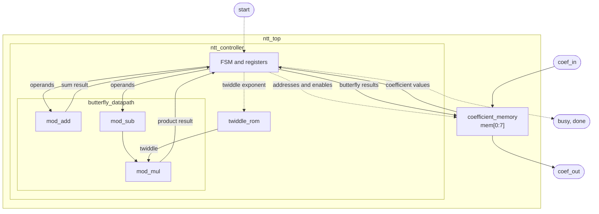
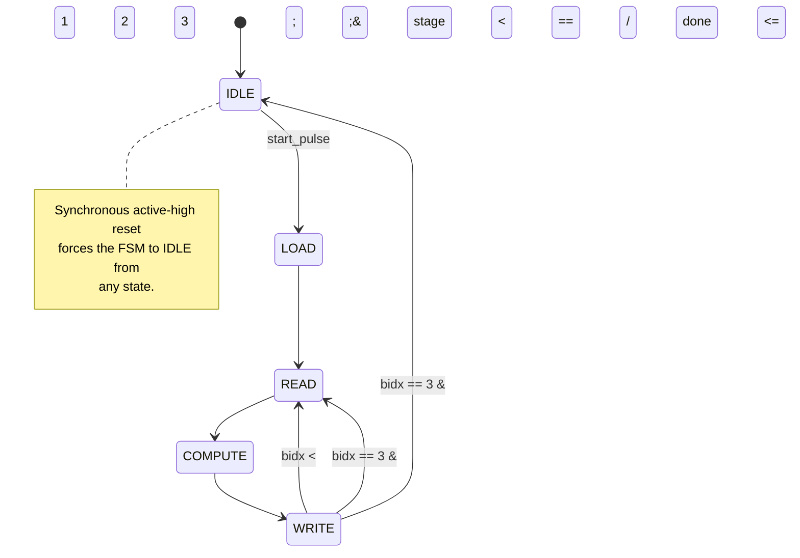

# 8-Point NTT Accelerator

This project implements an 8-point Number Theoretic Transform (NTT) accelerator in Verilog-2001 for the [ARCH Lab hardware task](https://archlabs.us/apply/task26fhe/). The design is simulated using Icarus Verilog.

The accelerator uses a single reusable butterfly datapath for all three stages of the transform, rather than separate hardware for each stage. A ROM stores the twiddle factors, while a finite-state machine (FSM) controls the transform sequence.

The NTT is the finite-field counterpart of the Fast Fourier Transform (FFT). It is widely used in polynomial multiplication, where two polynomials are transformed, multiplied coefficient-wise in the transform domain, and then inverse-transformed. With suitable transform parameters, this reduces the computational complexity from $O(n^2)$ for direct multiplication to $O(n\log n)$.

Unlike FFT implementations that use floating-point arithmetic, an NTT operates over a finite field using integer arithmetic and modular reduction. This avoids floating-point rounding errors and makes NTTs particularly useful in lattice-based cryptography and Fully Homomorphic Encryption (FHE), where efficient polynomial arithmetic is essential. See the task's *Why NTT Matters in Hardware* section for further motivation.

## Table of contents

- [Mathematical foundation](#mathematical-foundation)
- [NTT algorithm and butterfly convention](#ntt-algorithm-and-butterfly-convention)
- [Top-level interface](#top-level-interface)
- [Architecture](#architecture)
- [Transform execution](#transform-execution)
- [Implementation details](#implementation-details)
- [Design decisions and trade-offs](#design-decisions-and-trade-offs)
- [Input and output format](#input-and-output-format)
- [Project structure](#project-structure)
- [Simulation and verification](#simulation-and-verification)
- [Simulation waveforms](#simulation-waveforms)
- [Verification results](#verification-results)
- [Limitations and future extensions](#limitations-and-future-extensions)
- [Assignment coverage](#assignment-coverage)
- [Experiments and evaluation](#experiments-and-evaluation)

## Mathematical foundation

The implementation computes an 8-point Number Theoretic Transform (NTT) over the finite field $\mathbb{Z}/17\mathbb{Z}$, using the following parameters:

| Parameter | Value |
|---|---|
| Transform size | $N = 8$ |
| Modulus | $q = 17$ |
| Primitive root of unity | $\omega = 9$ |

### Primitive root of unity

An N-point NTT requires a primitive Nth root of unity modulo $q$. Such a root satisfies:

$$
\omega^N \equiv 1 \pmod q
$$

and no smaller positive exponent produces 1.

For this transform, $\omega=9$ satisfies:

$$
9^8 \equiv 1 \pmod{17}
$$

while $9^1$, $9^2$, and $9^4$ are not congruent to 1 modulo 17. Therefore, 9 has multiplicative order exactly 8 and is a valid primitive eighth root of unity.

Its successive powers modulo 17 are:

```text
ω^0..ω^8 mod 17 = [1, 9, 13, 15, 16, 8, 4, 2, 1]
```

The existence of an element of order 8 is consistent with the structure of the multiplicative group of a finite field. Since 17 is prime, its nonzero residues form a multiplicative group of order $17-1=16$. By Lagrange's theorem, the order of any element must divide 16. Since $8$ divides $16$, an element of order 8 can exist modulo 17. The calculation above establishes that 9 is such an element.

More generally, for a prime modulus $q$, the condition $N\mid(q-1)$ is necessary for an Nth primitive root of unity to exist.

### Direct NTT definition

For an input sequence of eight coefficients $x[0],\ldots,x[7]$, the forward NTT produces eight output coefficients:

$$
X[k]=\sum_{j=0}^{7}x[j]\omega^{jk}\pmod{17},
\qquad 0\leq k<8
$$

Here, $j$ indexes the input coefficients, $k$ identifies the output coefficient, and powers of $\omega$ provide the corresponding transform factors. All arithmetic is performed modulo 17.

This mathematical definition specifies the transform independently of the algorithm used to evaluate it.

## NTT algorithm and butterfly convention

The direct definition describes each output as a sum involving all eight input coefficients. A radix-2 factorization evaluates the same transform through smaller operations called butterflies.

This implementation uses the **decimation-in-frequency (DIF)** form of the radix-2 Cooley-Tukey algorithm. DIF decomposes the transform by separating even-indexed and odd-indexed output components.

For two input values $a$ and $b$, the corresponding butterfly is:

$$
u=(a+b)\pmod{17}
$$

$$
v=(a-b)\omega^e\pmod{17}
$$

where $e$ is the twiddle-factor exponent determined by the stage and butterfly position.

The sum contributes to the even-indexed output branch, while the twiddle-multiplied difference contributes to the odd-indexed output branch. Repeating this decomposition produces the complete transform through $\log_2 N$ stages.

This is the standard radix-2 DIF factorization used in the Cooley-Tukey FFT. See [Burrus, *Fast Fourier Transforms*, Section 8: The Cooley-Tukey FFT Algorithm](https://eng.libretexts.org/Bookshelves/Electrical_Engineering/Signal_Processing_and_Modeling/Fast_Fourier_Transforms_%28Burrus%29/08%3A_The_Cooley-Tukey_Fast_Fourier_Transform_Algorithm/8.02%3A_Basic_Cooley-Tukey_FFT).

The same factorization applies to the NTT by performing the operations over a finite field and replacing complex roots of unity with powers of $\omega=9$ in $\mathbb{Z}/17\mathbb{Z}$. See [Optimization and implementation of the number theoretic transform butterfly unit for large integer multiplication (2021)](https://www.sciencedirect.com/science/article/pii/S2214212621000909) for further discussion of NTT butterfly arithmetic and implementation.

### Three stages and twiddle exponents

For an 8-point transform, radix-2 decomposition requires:

$$
\log_2 8=3
$$

stages. The butterfly distance decreases from 4 to 2 to 1, with four butterflies at each stage.

| Stage | Distance | Butterfly pairs | Twiddle exponents |
|---|---:|---|---|
| 1 | 4 | (0,4), (1,5), (2,6), (3,7) | 0, 1, 2, 3 |
| 2 | 2 | (0,2), (1,3), (4,6), (5,7) | 0, 2, 0, 2 |
| 3 | 1 | (0,1), (2,3), (4,5), (6,7) | 0, 0, 0, 0 |

The complete transform therefore consists of 12 butterfly operations across three stages.

### Bit-reversed output ordering

A characteristic of radix-2 DIF is that, when the input coefficients are in natural order, the final transform coefficients are produced in bit-reversed order.

For an 8-point transform, the three-bit reversal gives the following correspondence:

| Natural output index | Position in bit-reversed sequence |
|---:|---:|
| 0 | 0 |
| 1 | 4 |
| 2 | 2 |
| 3 | 6 |
| 4 | 1 |
| 5 | 5 |
| 6 | 3 |
| 7 | 7 |

Consequently, the final DIF stage produces:

$$
[X[0],X[4],X[2],X[6],X[1],X[5],X[3],X[7]]
$$

Reordering these coefficients according to their natural indices gives the conventional NTT output:

$$
[X[0],X[1],X[2],X[3],X[4],X[5],X[6],X[7]]
$$

This ordering follows from the recursive even/odd decomposition of the output indices in radix-2 DIF.

### Worked example

Consider the input sequence:

$$
x=[1,2,3,4,5,6,7,8]
$$

Applying the three DIF stages produces the following intermediate sequences:

| Step | Values |
|---|---|
| Stage 1 | `[6, 8, 10, 12, 13, 15, 16, 8]` |
| Stage 2 | `[16, 3, 13, 16, 12, 6, 14, 6]` |
| Stage 3 (bit-reversed order) | `[2, 13, 12, 14, 1, 6, 3, 8]` |

Using the bit-reversed index correspondence established above, the natural-order transform output is:

$$
X=[2,1,12,3,13,6,14,8]
$$

These values agree with the direct NTT definition for the same input.

## Top-level interface

The `ntt_top` module accepts eight 5-bit input coefficients packed into a 40-bit bus and returns the eight NTT coefficients in natural order through another 40-bit bus.

| Signal | Direction | Width | Description |
|---|---|---:|---|
| `clk` | Input | 1 | System clock |
| `rst` | Input | 1 | Synchronous active-high reset |
| `start` | Input | 1 | Transform start request |
| `coef_in` | Input | 40 | Eight packed 5-bit input coefficients |
| `busy` | Output | 1 | High while a transform is in progress |
| `done` | Output | 1 | Asserted when the transform completes |
| `coef_out` | Output | 40 | Eight packed 5-bit output coefficients |

## Architecture

The design uses an iterative architecture with a single shared butterfly datapath and one in-place coefficient memory. Rather than instantiating separate arithmetic units for every butterfly, the same datapath is reused for all 12 butterflies across the three NTT stages.

The design consists of two main blocks:

- **`ntt_controller`**: Controls the transform, generates coefficient addresses and twiddle indices, and schedules the butterfly operations.
- **`coefficient_memory`**: Stores the input coefficients, intermediate stage results, and final output.

The controller contains the twiddle ROM and the shared butterfly datapath.

```text
ntt_top
├── ntt_controller
│   ├── FSM and control registers
│   ├── twiddle_rom
│   └── butterfly_datapath
│       ├── mod_add
│       ├── mod_sub
│       └── mod_mul
└── coefficient_memory
    └── mem[0:7]  (8 × 5-bit)
```

The following diagram shows the main data and control connections.



Solid arrows represent coefficient or arithmetic data. Dashed arrows represent control and address signals.

The main responsibilities are:

- **`ntt_top`** connects the controller and coefficient memory, exposes the external interface, and applies the bit-reversal permutation to produce natural-order output.
- **`ntt_controller`** contains the FSM, stage and butterfly counters, address and twiddle-index generation logic, and registers used to capture butterfly inputs and outputs.
- **`coefficient_memory`** is a single in-place bank containing eight 5-bit coefficients. It supports loading all eight inputs and reading or writing the two coefficients involved in a butterfly.
- **`twiddle_rom`** provides the precomputed values of $\omega^e \bmod 17$.
- **`butterfly_datapath`** contains one shared combinational adder, subtractor, and multiplier. The adder and subtractor operate on the same input pair; the subtraction result is multiplied by the twiddle factor.

The butterfly datapath has no internal registers. Its inputs and outputs are captured by registers in the controller.

## Transform execution

The controller executes the NTT by processing one butterfly at a time. Each of the three stages contains four butterflies, giving a total of 12 butterfly operations.

### Butterfly operation

The radix-2 DIF butterfly computes:

$$
u=(a+b)\bmod 17
$$

$$
v=(a-b)\omega^e\bmod 17
$$

where $a$ and $b$ are the selected coefficient pair, and $\omega^e$ is the corresponding twiddle factor.

The shared datapath computes both results combinationally:

1. `mod_add` calculates the sum $u$.
2. `mod_sub` calculates the difference $a-b$ modulo 17.
3. `mod_mul` multiplies the difference by the selected twiddle factor to produce $v$.

The controller captures the two results and writes them back to their respective memory locations.

### Butterfly schedule

The controller uses two counters:

- `stage` identifies the current NTT stage, ranging from 0 to 2.
- `bidx` identifies the butterfly within the current stage, ranging from 0 to 3.

The schedule is:

| Stage | Distance | Butterfly pairs | Twiddle exponents |
|---|---:|---|---|
| 1 | 4 | (0,4), (1,5), (2,6), (3,7) | 0, 1, 2, 3 |
| 2 | 2 | (0,2), (1,3), (4,6), (5,7) | 0, 2, 0, 2 |
| 3 | 1 | (0,1), (2,3), (4,5), (6,7) | 0, 0, 0, 0 |

Each stage processes four butterflies. Once all four have completed, the controller advances to the next stage. After the fourth butterfly of the third stage, the transform is complete.

### Controller state machine

Five states control the execution:

| State | Operation |
|---|---|
| `IDLE` | Wait for a start request |
| `LOAD` | Write all eight input coefficients into memory |
| `READ` | Read the selected coefficient pair and twiddle factor |
| `COMPUTE` | Capture the butterfly results |
| `WRITE` | Write both results back to memory and advance the schedule |

The execution sequence is:



The `READ`, `COMPUTE`, and `WRITE` states repeat for each butterfly. The controller does not begin the next butterfly until the current butterfly's results have been written to memory.

The `stage` and `bidx` counters are advanced as part of the `WRITE` state's exit logic. This avoids introducing additional FSM states or clock cycles just for schedule bookkeeping.

### Cycle-by-cycle operation

Each butterfly takes three clock cycles:

1. **READ:** The controller reads the two coefficients from memory, selects the twiddle factor from the ROM, and captures these values into `a_reg`, `b_reg`, and `tw_reg`.
2. **COMPUTE:** The combinational butterfly datapath calculates the sum and twiddle-multiplied difference. The controller captures the results into `u_reg` and `v_reg`.
3. **WRITE:** The controller writes `u_reg` and `v_reg` back to the two selected memory locations.

This sequence ensures that each butterfly completes before the next one begins. There are no overlapping butterfly operations or pending writes when a subsequent butterfly starts.

## Implementation details

This section describes how the architecture is realized in RTL, including the arithmetic circuits, memory organization, address generation, and control behavior.

### Modular arithmetic

All three arithmetic units operate on canonical 5-bit residues in the range $[0,16]$, the same canonical range required by [Mathematical foundation](#mathematical-foundation). They do not normalize arbitrary 5-bit values and their inputs must already be reduced modulo 17.

**Addition**

The adder calculates $a+b$. Since both inputs are at most 16, the maximum sum is 32, so a 6-bit intermediate result is sufficient. The result is reduced by subtracting 17 when the sum is greater than or equal to 17. One correction is sufficient.

**Subtraction**

The subtractor calculates $a-b$. If $a\geq b$, the difference is already in the valid range. Otherwise, it adds 17 to the difference:

$$
(a-b)\bmod 17 =
\begin{cases}
a-b, & a\geq b\\
a+17-b, & a<b
\end{cases}
$$

**Multiplication**

The multiplier first calculates the 9-bit product:

$$
p=a\times b
$$

Because the modulus is 17 and $17=2^4+1$, we can use:

$$
16\equiv -1\pmod{17}
$$

Split the product into its upper bits and lower nibble:

$$
p=16h+l
$$

where $h=p[8:4]$ and $l=p[3:0]$.

Therefore:

$$
p\equiv l-h\pmod{17}
$$

The product is reduced by calculating $l-h$ and adding 17 if the result is negative. This avoids a general-purpose division or modulo operator. The reduction relies on the specific modulus $q=17$ and does not directly generalize to arbitrary primes.

### In-place coefficient memory

The design uses one 8×5-bit memory bank, `mem[0:7]`, throughout the transform.

The same bank stores:

- The eight input coefficients after `LOAD`.
- The intermediate results after each NTT stage.
- The final bit-reversed output after the last stage.

Each butterfly reads two locations and writes the two corresponding results back to those locations.

This in-place organization is safe for the selected schedule. Within each stage, the four butterflies operate on disjoint pairs of addresses. The stages execute sequentially, so a stage finishes all its writes before the next stage begins. There are therefore no read-after-write conflicts in this schedule.

### Address and twiddle-index generation

The controller calculates the coefficient addresses and twiddle exponent from `stage` and `bidx`. It uses shifts and bit masks rather than division, modulo operations, or a fixed 12-entry address lookup table.

For this 8-point transform:

```text
half        = 4 >> stage
group       = bidx >> (2 - stage)
j           = bidx & (half - 1)
lo          = group * (2 * half) + j
hi          = lo + half
twiddle_exp = (j << stage) & 7
```

`lo` and `hi` identify the two coefficient locations used by the current butterfly. `twiddle_exp` selects the corresponding twiddle factor.

The formula is based on the radix-2 DIF schedule and can be adapted to other power-of-two transform sizes. However, this implementation is fixed to $N=8$; the constants are hardcoded and the design is not parameterized.

### Twiddle ROM

The design uses a combinational ROM containing the eight precomputed powers of the primitive root:

$$
[1,9,13,15,16,8,4,2]
$$

A 3-bit exponent selects the corresponding value of $\omega^e\bmod17$. The selected value is captured by the controller during `READ` and used by the multiplier during `COMPUTE`.

### Bit widths

The arithmetic widths are determined by the maximum possible values when the inputs are canonical residues in $[0,16]$.

| Quantity | Maximum value | Required width |
|---|---:|---:|
| Input coefficient | 16 | 5 bits |
| Addition intermediate | 32 | 6 bits |
| Multiplication intermediate | 256 | 9 bits |
| Twiddle exponent | 7 | 3 bits |

The twiddle exponent is calculated from `j` and `stage`. Since $j<4>>stage$, the shifted value remains below 4 for this schedule, so the 3-bit exponent is sufficient.

### Reset and handshake behavior

The design uses a synchronous, active-high reset. When `rst` is asserted, the FSM returns to `IDLE` regardless of its current state.

The memory write enables are also gated with the live reset signal, preventing a load or butterfly write from committing on an edge where reset is asserted.

The `start` input is edge-detected using a delayed copy of the signal:

$$
start\_pulse=start\land\neg start_d
$$

This means a continuously asserted `start` signal triggers only one transform. A start pulse received while the controller is busy is ignored.

The handshake signals behave as follows:

| Signal or behavior | Implementation |
|---|---|
| Start request | Rising-edge detection |
| Start while busy | Ignored |
| Start held high | One transform only |
| Reset | Synchronous, active-high |
| `busy` | High whenever the FSM is not in `IDLE` |
| `done` | Asserted on completion and held until the next accepted transform |

`busy` is combinationally derived from the FSM state. `done` is registered: it is cleared when a new transform is accepted and asserted on the final `WRITE` edge.

### Latency

The transform requires:

- 1 cycle to load the eight input coefficients.
- 12 butterflies.
- 3 cycles per butterfly.

Therefore:

$$
1+(12\times3)=37\text{ cycles}
$$

The measured latency is 37 busy cycles, from the accepted-start edge to the final `WRITE` edge. This was independently checked using a busy-cycle counter and the distance between the accepted-start and completion edges. See [Verification results](#verification-results).

## Design decisions and trade-offs

The architecture makes several deliberate trade-offs between hardware resource usage, execution latency, and implementation complexity. The choices below reflect the fixed 8-point transform parameters and the requirement to implement the transform using reusable hardware.

### Single shared butterfly versus parallel units

The design uses one shared butterfly datapath consisting of a modular adder, modular subtractor, and multiplier. This datapath is reused for all 12 butterfly operations across the three transform stages.

The main advantage is reduced arithmetic hardware. Instead of implementing four butterfly units to process the four disjoint pairs in a stage simultaneously, the controller reuses the same arithmetic resources sequentially. This keeps the datapath small and avoids the need for multiple simultaneous memory accesses.

The trade-off is execution latency: each butterfly requires three controller cycles (`READ`, `COMPUTE`, and `WRITE`), resulting in 37 busy cycles per transform, including the initial `LOAD` cycle.

Four parallel butterfly units could reduce the execution time by processing an entire stage concurrently. However, this would require four sets of arithmetic resources and a memory organization capable of supplying and storing multiple coefficient pairs simultaneously. The parallel alternative was not synthesized or measured, so this comparison is architectural rather than a measured PPA result.

### Sequential execution versus pipelining

The controller executes each butterfly through a strict `READ → COMPUTE → WRITE` sequence. Each operation completes its memory updates before the next butterfly begins.

This approach simplifies operand capture, result storage, and memory access scheduling. It also avoids the need to manage overlapping operations that may depend on the same shared datapath or memory resources.

A pipelined implementation could improve throughput by overlapping operations, but would require additional pipeline registers, control logic, and careful handling of memory dependencies. Since the current design prioritizes resource reuse and straightforward control over maximum throughput, the additional complexity was not introduced.

### Five-state FSM versus additional bookkeeping states

The controller uses five states: `IDLE`, `LOAD`, `READ`, `COMPUTE`, and `WRITE`. Stage and butterfly progression are handled by the `stage` and `bidx` counters within the existing state transitions, rather than introducing separate FSM states for counter updates.

The `bidx` counter advances after each completed butterfly. When the final butterfly of a stage is written, `bidx` is reset and `stage` advances. After the final butterfly of the final stage, the controller returns to `IDLE` and asserts `done`.

Keeping this bookkeeping within the `WRITE` exit logic avoids additional state transitions and keeps the FSM focused on the actual datapath operations. Every state in this controller occupies exactly one clock cycle, so a dedicated counter-update state reachable only through its own transition would add one clock cycle per occurrence, not just a theoretical risk of one. Separate counter-update states could make individual control actions more explicit, but would increase execution latency without providing a functional benefit for this design.

### Single in-place bank versus double buffering

All eight coefficients are stored in a single 8×5-bit memory bank, requiring only 40 bits of coefficient storage.

The DIF schedule pairs disjoint coefficient locations within each stage. Consequently, each butterfly reads two locations and writes its two results back to those same locations. No other butterfly in that stage accesses either location, so the operations can safely update the bank in place.

A double-buffered architecture would require two 8×5-bit banks, increasing coefficient storage to 80 bits, together with additional bank-selection logic. It would be useful in an architecture that overlaps stages or requires separate input and output storage, but provides no execution-time advantage in the current sequential design.

### Algorithmic address generation versus a lookup table

The butterfly addresses and twiddle exponents are generated algorithmically from the current stage and butterfly index using shift, mask, and arithmetic operations.

This avoids storing a fixed table containing all 12 butterfly address pairs and makes the relationship between the DIF schedule and the hardware control explicit. The same generation approach also provides a starting point for supporting larger power-of-two transform sizes.

A lookup table would be simpler for a fixed schedule, but would explicitly encode the address and exponent sequence. The current implementation favors algorithmic generation, although the address-generation logic and supported transform size remain specialized for the 8-point design.

### Precomputed twiddle ROM versus runtime computation

The twiddle factors are stored as constants in a ROM, avoiding runtime modular exponentiation.

This is appropriate because the transform size, modulus, and primitive root are fixed. All required powers can be calculated before implementation, allowing the controller to select the appropriate value directly using the generated twiddle exponent.

The ROM contains the eight powers of the selected primitive root, while the current DIF schedule uses only exponents 0 through 3. Storing the complete set keeps the ROM representation straightforward and leaves the available powers explicit.

### Specialized modular reduction versus general modulo arithmetic

The multiplier uses the identity:

$$
16\equiv-1\pmod{17}
$$

For a product represented as:

$$
p=16h+l
$$

the reduction becomes:

$$
p\equiv l-h\pmod{17}
$$

The implementation therefore subtracts the upper portion of the product from the lower portion and adds 17 when the difference is negative. This avoids a general-purpose modulo operation and exploits the specific structure of the selected modulus.

The trade-off is limited generality: this reduction is specialized for modulus 17 and cannot be applied unchanged to arbitrary primes. Supporting other moduli would require a different reduction method. See [Limitations and future extensions](#limitations-and-future-extensions).

### Fixed-width arithmetic

The design uses fixed-width unsigned vectors rather than integer or floating-point arithmetic. Since every coefficient is maintained in the canonical range 0 to 16, five bits are sufficient to represent each stored coefficient.

The intermediate widths are selected to accommodate the maximum values before modular reduction:

- Addition: the maximum sum is 16 + 16 = 32, requiring 6 bits.
- Subtraction: the difference is handled using the implementation's conditional correction by 17.
- Multiplication: the maximum product is 16 × 16 = 256, requiring 9 bits.

These widths avoid unnecessary datapath width while preserving the complete intermediate arithmetic range. They are specific to the selected modulus and operand range.

### Natural-order output through bit reversal

The iterative DIF algorithm produces its final coefficients in bit-reversed order. Rather than performing an additional memory-reordering pass, the design maps the internal memory locations to natural coefficient order through fixed output indexing.

For an 8-point transform, the three-bit index is reversed when selecting the output coefficient:

$$
\text{coef\_out}[k]=\text{mem}[\operatorname{bitrev}_3(k)]
$$

This keeps the internal transform schedule unchanged and avoids additional clock cycles and memory writes for output reordering. The trade-off is that the output mapping is tied to the fixed 8-point transform size.

## Input and output format

Both `coef_in` and `coef_out` pack eight 5-bit coefficients into a 40-bit bus. Coefficients are packed least-significant first:

$$
coef\_in[5k+:5]=x[k]
$$

For example, to drive the input vector $x[0..7]$:

```verilog
coef_in = {
    x[7], x[6], x[5], x[4],
    x[3], x[2], x[1], x[0]
};
```

The output bus uses the same packing convention:

$$
coef\_out[5k+:5]=X[k]
$$

The output is already in natural order. The controller performs the transform using the radix-2 DIF schedule, which produces results in bit-reversed order. `ntt_top` applies the output permutation:

$$
coef\_out[5k+:5]=mem[bitrev3(k)]
$$

where `bitrev3` reverses the three bits of the index.

**Input contract**

Every input coefficient must be a canonical residue in $[0,16]$. The hardware does not normalize invalid inputs. Although a 5-bit field can represent values from 0 to 31, values from 17 to 31 are outside the supported input domain.

The testbench reads input and expected-output vectors from decimal text files, with one coefficient per line and eight lines per vector:

- `reference/test_vectors/input_<name>.txt`
- `reference/test_vectors/expected_<name>.txt`

The list of vector names is read from `tb/vector_names.txt`, which is generated from the input-vector files present rather than being hardcoded.

For each vector, the testbench also reads the expected intermediate memory contents after each DIF stage:

- `reference/stage_checkpoints/stage1_<name>.txt`
- `reference/stage_checkpoints/stage2_<name>.txt`
- `reference/stage_checkpoints/stage3_<name>.txt`

This allows the testbench to check not only the final transform output but also the intermediate results produced at each stage.

## Project structure

The repository is organized into five main directories, separating the RTL implementation, testbenches, mathematical reference code, execution scripts, and waveform artifacts.

```text
ntt_accelerator/
├── README.md
├── .gitignore
├── rtl/                            # Verilog implementation
│   ├── ntt_top.v                   # Top-level module and output bit reversal
│   ├── ntt_controller.v            # FSM, address/twiddle generation, registers
│   ├── coefficient_memory.v        # In-place 8×5-bit coefficient memory
│   ├── butterfly_datapath.v        # Shared combinational butterfly
│   ├── modular_arithmetic.v        # mod_add, mod_sub, mod_mul
│   └── twiddle_rom.v               # Twiddle-factor lookup table
├── tb/                             # Verilog testbenches and fixtures
│   ├── tb_ntt_top.v                # Transform, intermediate, sequencing, timing checks
│   ├── tb_modular_arithmetic.v     # Exhaustive 17×17 arithmetic checks
│   ├── tb_control.v                # Reset and start/busy/done tests
│   ├── tb_negative.v               # Invalid-input and timeout tests
│   ├── vector_names.txt            # Generated test-vector manifest
│   └── fixtures/                   # Malformed, short, and out-of-range inputs
├── reference/                      # Independent mathematical reference code
│   ├── ntt_reference_model.py      # Direct NTT definition and vector generation
│   ├── ntt_math_validation.py      # Independent mathematical validation
│   ├── export_stage_checkpoints.py # Generates intermediate-stage checkpoints
│   ├── test_vectors/               # 31 input/expected-output vector pairs
│   └── stage_checkpoints/          # Expected memory contents after each stage
├── scripts/
│   └── run_all_tests.sh            # Compiles and runs all four testbenches
├── waves/                          # Waveform capture and inspection artifacts
│   ├── dump_waveforms.v            # Standalone VCD capture harness
│   ├── render_waveforms.py         # Generates waveform screenshots from VCD
│   ├── ntt_top.vcd                 # Recorded full-transform waveform
│   └── trace.log                   # Per-cycle execution trace
└── docs/
    └── images/                     # Waveform screenshots used in this README
```

The main directories have distinct responsibilities:

- `rtl/` contains the synthesizable Verilog implementation.
- `tb/` contains the testbenches that exercise the RTL, along with fixtures used by negative tests.
- `reference/` contains the Python reference implementations, mathematical checks, and expected test data.
- `scripts/` contains the script used to run the complete RTL test suite.
- `waves/` contains the standalone waveform-capture harness, recorded VCD, and trace-generation utilities.
- `docs/images/` contains the rendered waveform screenshots included in this documentation.

## Simulation and verification

### Prerequisites

The project requires:

- Icarus Verilog (`iverilog` and `vvp`).
- Python 3.

**Tested versions:** Icarus Verilog 13.0 (stable) and Python 3.11.13.

### Running the test suite

The complete RTL test suite can be executed using:

```bash
cd ntt_accelerator
./scripts/run_all_tests.sh
```

The script compiles and runs all four Verilog testbenches and aggregates their pass/fail results.

### Verification strategy

Verification is performed at four levels. Each level checks a different aspect of the implementation, from the mathematical transform to the behavior of the RTL controller.

**1. Mathematical validation**

`reference/ntt_math_validation.py` performs independent Python checks without involving the RTL.

It validates:

- The multiplicative order of the selected root of unity.
- The radix-2 DIF butterfly schedule.
- The bit-reversal permutation.
- The modular arithmetic operations.
- The on-disk test vectors in `reference/test_vectors/`, checking each one's expected output against both the direct NTT definition and independently-derived DIF computations.

This establishes that the mathematical conventions and expected intermediate values used by the project are internally consistent. It does not read `reference/stage_checkpoints/`; those files are consumed only by `tb_ntt_top.v` for the RTL-level intermediate-stage checks described below.

**2. Independent reference-model comparison**

`reference/ntt_reference_model.py` implements the NTT directly from its mathematical definition:

$$
X[k]=\sum_{j=0}^{7}x[j]\omega^{jk}\pmod{17}
$$

It does not implement the DIF butterfly schedule or reuse the RTL's address-generation logic.

The direct transform is compared against the DIF-based implementation for all 31 test vectors. Because the two approaches calculate the transform differently, their agreement provides an independent check of the algorithm and output ordering.

**3. RTL functional verification**

`tb/tb_ntt_top.v` exercises the actual `ntt_top` module through its external interface.

For all 31 test vectors, it checks:

- The final NTT coefficients against the expected outputs.
- The coefficient memory contents after each of the three DIF stages.
- The coefficient addresses selected for every butterfly.
- The twiddle exponent used by every butterfly.
- The expected execution sequence and transform timing.

The intermediate-stage checks are particularly useful because they can identify errors in the butterfly schedule or address generation even when examining only the final output might not reveal where the error occurred.

**4. Control and negative testing**

The remaining testbenches check behavior that is not covered by the normal transform-vector sweep.

- `tb/tb_control.v` tests reset behavior, start-edge detection, and the `busy`/`done` handshake.
- `tb/tb_negative.v` tests that its own file-reading logic (not the RTL) correctly classifies missing, malformed, wrong-count, and out-of-range input fixtures as setup errors — the hardware itself does not parse or validate input files. Separately, it verifies that the DUT's `done` output never asserts and the FSM stays in `IDLE` during a bounded polling window while reset is held.

Together, these tests cover both normal operation and the handling of invalid or incomplete test inputs.

### Run the full RTL verification suite

```bash
cd ntt_accelerator
./scripts/run_all_tests.sh
```

Compiles and runs all four testbenches against `rtl/` in order and
aggregates pass/fail. It needs to run with `ntt_accelerator/` as the
working directory (the script `cd`s there itself), since the
testbenches open input and fixture files using relative paths.
Successful output looks like this:

```text
=== NTT accelerator verification suite ===

--- tb_modular_arithmetic ---
...
PASSED: tb_modular_arithmetic

--- tb_ntt_top ---
...
PASSED: tb_ntt_top

--- tb_control ---
...
PASSED: tb_control

--- tb_negative ---
...
PASSED: tb_negative

=== summary ===
ALL TESTBENCHES PASSED
```

(each `...` stands for that testbench's own per-check output, left out
here for space). Success means `ALL TESTBENCHES PASSED` and exit code
`0`.

### Run the independent mathematical validation

```bash
cd ntt_accelerator/reference
python3 ntt_math_validation.py
```

This is read-only with respect to `test_vectors/`. It never
regenerates or repairs a vector file; a missing or corrupted one just
gets reported as a failure. Success means `RESULT: PASS (0 failures)`
and exit code `0`.

### Regenerating test vectors or stage checkpoints (not part of ordinary validation)

These are one-time generation steps. They're not run automatically by
the validator or the test suite, and you don't need them to validate
what's already committed. They do need to run in order, since each step
depends on the previous one's output:

1. `ntt_reference_model.py` generates the `input_*.txt`/`expected_*.txt`
   vector files from the direct NTT definition.
2. `export_stage_checkpoints.py` reads those input files and generates
   the intermediate stage checkpoint files and the `tb/vector_names.txt`
   manifest.
3. `tb_ntt_top.v` (run via `run_all_tests.sh`) loads all of the above
   and verifies the actual RTL against them.

```bash
cd ntt_accelerator/reference
python3 ntt_reference_model.py          # (re)generates test_vectors/
python3 export_stage_checkpoints.py     # (re)generates stage_checkpoints/ and tb/vector_names.txt
```

## Simulation waveforms

The waveform artifacts provide a signal-level view of the actual RTL execution. They complement the automated verification results by showing how the controller, memory, and arithmetic datapath behave during a transform.

### Capturing a transform

`waves/dump_waveforms.v` is a standalone simulation harness, separate from the four automated testbenches. It instantiates the actual `ntt_top` module and drives one complete transform using the worked-example input:

$$
x=[1,2,3,4,5,6,7,8]
$$

The harness records the signal transitions throughout the execution and writes them to `waves/ntt_top.vcd`. The same simulation also produces `waves/trace.log`, a per-cycle text trace of the execution.

The VCD is retained in the repository so that the recorded signal transitions can be independently inspected using GTKWave or another compatible waveform viewer.

### Complete transform


This waveform shows `clk`, `rst`, `start`, `busy`, `done`, and the controller's `state`, `stage`, and `bidx` signals across the complete transform.

It shows that:

- `busy` rises after the accepted start request and remains asserted throughout the 37-cycle execution.
- `done` is asserted on the final `WRITE` edge, when `busy` returns low.
- `stage` progresses through 0, 1, and 2.
- `bidx` progresses from 0 to 3 within each stage.

### Single butterfly operation


This waveform focuses on stage 0, `bidx = 1`, and shows the controller's `READ → COMPUTE → WRITE` sequence.

The signals include `state`, `stage`, `bidx`, `lo`, `hi`, `twiddle_exp`, `a_reg`, `b_reg`, `tw_reg`, `u_reg`, `v_reg`, and `write_enable`.

The sequence shows how the controller:

1. Captures the selected operands and twiddle factor during `READ`.
2. Captures the butterfly results during `COMPUTE`.
3. Asserts `write_enable` during `WRITE` to commit both results to memory.

The same registers and combinational butterfly datapath are reused for all 12 operations, illustrating the iterative reuse of the hardware rather than separate per-butterfly units.

### Modular arithmetic datapath


This waveform zooms into the arithmetic operations performed during the same butterfly.

It shows:

- `a` and `b`, the shared operands supplied to the adder and subtractor.
- `sum`, the result from `mod_add`.
- `diff`, the result from `mod_sub`.
- `tw`, the multiplier's twiddle-factor input.
- `p`, the raw 9-bit multiplication result.
- `l` and `h`, the lower-nibble and upper-bit portions of the product.
- `v`, the final modulo-17 multiplication result.

The waveform illustrates the specialized modulo-17 reduction:

$$
p=16h+l\equiv l-h\pmod{17}
$$

The final result is obtained from `l-h`, with 17 added when the difference is negative, rather than using a general-purpose modulo operation.

### Inspecting the recorded waveform

To inspect the recorded execution in GTKWave:

```bash
cd ntt_accelerator
gtkwave waves/ntt_top.vcd
```

To regenerate the waveform and trace artifacts, run the standalone simulation harness:

```bash
iverilog -g2001 -Wall -o /tmp/dump.vvp \
    rtl/*.v waves/dump_waveforms.v

vvp /tmp/dump.vvp
```

The accompanying `waves/trace.log` provides a textual view of the same execution. It contains 37 busy-cycle entries before the final output comparison, consistent with the measured transform latency. Its final `coef_out` also matches the worked example's natural-order NTT output.

## Verification results

The accelerator was verified using a combination of RTL simulation and independent mathematical validation. The RTL testbenches exercise the implemented hardware, while the Python validation checks the transform mathematics and reference results independently. All reported checks completed successfully with zero failures.

### Test results

The following results were obtained from the current verification run:

| Check | Count | Failures |
|---|---:|---:|
| Exhaustive modular arithmetic (289 operand pairs, 6 checks per pair) | 1,734 | 0 |
| Test-vector outputs, intermediate-stage results, and sequencing | 3,511 | 0 |
| Control, reset, start, and done (7 directed scenarios) | 111 | 0 |
| Negative tests, setup errors, and timeout handling (6 scenarios) | 7 | 0 |
| **RTL suite total** | **5,363** | **0** |
| Mathematical validation (`ntt_math_validation.py`) | **3,579** | **0** |

**Simulation environment:**
- Simulator: Icarus Verilog 13.0 (stable).
- Reference validation: Python 3.11.13.
- RTL language standard: Verilog-2001.

### RTL verification coverage

The RTL verification is divided into four testbenches, each targeting a different part of the design.

**1. Modular arithmetic (`tb_modular_arithmetic.v`)**

The modular arithmetic unit is tested exhaustively over all possible pairs of canonical coefficients in the range 0 to 16. This gives 17 × 17 = 289 operand pairs.

Each pair is checked against six arithmetic conditions covering modular addition, subtraction, and multiplication, including the specialized modulo-17 reduction. This produces 1,734 checks in total.

**2. Transform execution (`tb_ntt_top.v`)**

The top-level testbench runs all 31 input vectors through the complete 8-point transform. It checks the final output against the expected results and verifies intermediate-stage memory contents against independently generated stage checkpoints.

It also checks the butterfly address and twiddle-factor sequence to ensure that the controller follows the intended DIF schedule.

Across the 31 transforms, the controller executes 12 butterflies per transform, giving 372 butterfly operations. All 372 operations are sequenced correctly, and the corresponding intermediate-stage and final results pass verification.

**3. Control and handshake (`tb_control.v`)**

Directed scenarios exercise the controller's reset and handshake behavior. These checks cover start acceptance, busy-state behavior, completion signaling, and the controller's response to reset.

They verify that the control logic follows the expected state transitions and that `busy` and `done` behave correctly throughout a transform.

**4. Negative and setup-error tests (`tb_negative.v`)**

The negative tests cover missing files, malformed input, incorrect coefficient counts, out-of-range values, and timeout handling.

An important distinction is that the file-related cases exercise the testbench's own input-file handling logic, not the RTL. The hardware itself does not parse or validate input files. A separate reset-held scenario exercises the actual DUT and checks that `done` remains deasserted and the FSM stays in `IDLE`.

### Independent mathematical validation

The Python validation script (`reference/ntt_math_validation.py`) performs 3,579 checks independently of the RTL simulation.

It validates the mathematical properties used by the implementation, including the primitive-root properties of the selected transform parameters, the DIF butterfly schedule, the bit-reversal mapping, and modular arithmetic behavior. It also checks the on-disk test vectors in `reference/test_vectors/` against the mathematical reference results.

The stage checkpoint files in `reference/stage_checkpoints/` are generated separately by `export_stage_checkpoints.py` and consumed by the top-level RTL testbench. They are not read by `ntt_math_validation.py`.

The mathematical validation and RTL simulation therefore provide complementary evidence: the Python checks validate the mathematical reference, while the RTL testbenches verify that the hardware implementation follows the intended operations and produces the expected results.

### Measured transform latency

The implementation completes each transform in **37 busy cycles**, consistently across all 31 test vectors.

The latency follows directly from the controller's execution sequence:

| Operation | Cycles |
|---|---:|
| Initial input loading (`LOAD`) | 1 |
| Butterfly operations (`12 × 3 cycles`) | 36 |
| **Total busy cycles** | **37** |

Each butterfly uses three controller cycles: `READ`, `COMPUTE`, and `WRITE`. The same datapath is reused for all 12 operations rather than executing them in parallel.

The 37-cycle measurement is taken from the accepted start edge through the completion edge of the final `WRITE` operation. It represents the simulated controller latency for one transform, not a measured maximum operating frequency or physical hardware performance.

## Limitations and future extensions

The implementation is intentionally scoped to the fixed 8-point transform specified by the task. The following limitations describe what the current RTL does not support; they are not failures to meet the task requirements.

### Current limitations

- **Fixed transform parameters:** The transform size $N=8$, modulus $q=17$, and primitive root $\omega=9$ are hardcoded. The design is not parameterized for other transform sizes or moduli.
- **Canonical input requirement:** Each input coefficient must be in the range $0$ to $16$. Although the input interface uses 5-bit values, the hardware does not normalize values outside the canonical range before processing them.
- **Iterative execution:** A single butterfly datapath is reused sequentially for all 12 butterfly operations. The design does not execute multiple butterflies in parallel or pipeline successive operations. Each transform takes 37 busy cycles.
- **Forward transform only:** The implementation supports the forward NTT but does not include an inverse NTT (INTT).
- **No synthesis or physical implementation:** The design has been simulated and functionally verified, but has not been synthesized for an FPGA or ASIC. Consequently, no hardware area, maximum operating frequency, timing closure, or power measurements are reported.

**Possible future extensions.** The task's *Design Freedom* section identifies several possible directions for extending the implementation. These are opportunities for further development rather than requirements of the current submission.

### Inverse Number Theoretic Transform

An inverse transform would require using inverse powers of the primitive root and applying a final normalization factor.

For the current parameters:

$$
\omega^{-1}=2\pmod{17}
$$

because $9\times2\equiv1\pmod{17}$.

The inverse transform would also require scaling each output coefficient by the modular inverse of the transform length:

$$
N^{-1}=8^{-1}=15\pmod{17}
$$

because $8\times15\equiv1\pmod{17}$.

This would require an inverse-twiddle ROM or equivalent twiddle-generation logic, together with a final scaling operation for each output coefficient.

### Pipelined execution

The current controller completes each butterfly through separate `READ`, `COMPUTE`, and `WRITE` cycles before starting the next operation.

A pipelined implementation could overlap different execution phases of successive butterflies to improve throughput. However, this would require changes to the datapath and controller, including pipeline registers, resource scheduling, and appropriate handling of memory dependencies.

The current sequential execution avoids these complications by allowing only one butterfly operation to be active at a time.

### Larger transform sizes

The address-generation logic, coefficient memory, counters, and twiddle ROM could be extended to support larger power-of-two transform sizes.

The choice of modulus must also support the required transform length. For a radix-2 NTT of length $N$, the modulus must admit a primitive $N$-th root of unity, which requires:

$$
N\mid(q-1)
$$

For the current modulus $q=17$, the multiplicative group has order $q-1=16$. Therefore, a primitive 16th root of unity exists, making an $N=16$ transform mathematically possible without changing the modulus.

An $N=32$ transform would require a different modulus for which 32 divides $q-1$.

### Generalized modular multiplication

The current multiplier exploits the identity:

$$
16\equiv-1\pmod{17}
$$

This allows the product to be reduced using subtraction and conditional correction rather than a general-purpose modulo operation.

For other moduli, this specific reduction is not generally applicable. Supporting a wider range of primes would require a more general modular reduction method, such as Barrett or Montgomery reduction, selected according to the target modulus and hardware requirements.

## Assignment coverage

| Requirement | Implemented as |
|---|---|
| 8-point transform, 8 in / 8 out | `coef_in[39:0]` / `coef_out[39:0]`, 8×5-bit packed |
| N=8, q=17, ω=9 | Fixed by memory depth, ROM contents, and address-generation width |
| Single iterative butterfly | One `butterfly_datapath` instance, reused for all 12 butterflies |
| ROM-based precomputed twiddles | `twiddle_rom.v`, 8 literal constants |
| FSM-based control | `ntt_controller.v`, 5-state FSM |
| Correct address/twiddle generation | Shift/mask formula, independently re-derived and matched in `ntt_math_validation.py` |
| Modular arithmetic | `modular_arithmetic.v`, exhaustively checked over all 289 canonical operand pairs; additional mathematical validation performed by `ntt_math_validation.py` |
| Working testbench | `tb/tb_ntt_top.v` + 3 supporting testbenches, `scripts/run_all_tests.sh` |
| Text-file input loading | `$fscanf`-based readers in `tb_ntt_top.v`, against `reference/test_vectors/` |
| Correct output verification | 31/31 test vectors match, independently cross-checked against the direct NTT definition |
| Open-source simulation | Icarus Verilog 13.0 |

## Experiments and evaluation

The baseline implementation documented above is the required 8-point forward NTT accelerator. The following experiments extend it independently. All experimental RTL is kept under `experiments/`; the original baseline under `rtl/` remains unchanged.

Each experiment is implemented, verified, evaluated, and committed separately.

### Synthesis methodology

All designs use the same generic Yosys synthesis flow:

```text
hierarchy -top ntt_top
synth -top ntt_top
stat
```

No FPGA or ASIC target, timing constraints, or technology library is specified. Therefore, the reported results are generic synthesis statistics, not device-specific LUT, BRAM, or DSP utilization. Critical-path delay and maximum frequency are not measured.

Raw reports are stored under `reports/`. The same synthesis settings are used for baseline and experimental comparisons.

### Experiment 1: Inverse NTT (INTT)

**Objective**

Extend the accelerator to support inverse NTT while preserving forward-transform behavior and minimizing additional hardware through reuse of the existing butterfly datapath and coefficient memory.

**Design changes**

The inverse transform uses the same DIF butterfly schedule and address generation as the forward transform, with inverse twiddle factors and a final normalization pass.

For $q=17$ and $N=8$:

- Inverse primitive root: $\omega^{-1}=2$.
- Normalization factor: $N^{-1}=15 \pmod{17}$.
- Inverse twiddle table: `[1, 2, 4, 8, 16, 15, 13, 9]`.

The implementation adds:

- An inverse-mode input captured when a transform starts.
- An inverse twiddle table in the twiddle ROM.
- A normalization phase that scales all eight output coefficients by 15.

During normalization, the controller selects the butterfly's `v` output for both memory write ports. This is necessary because the ordinary `u` output is unscaled, whereas `v` contains the required multiplication by 15 modulo 17.

The existing butterfly datapath, modular arithmetic, and coefficient memory are reused. The changes are isolated in `experiments/intt/rtl/`; the baseline RTL is not modified.

**Verification**

The implementation was checked using an independent Python reference model and RTL simulation.

| Verification | Result |
|---|---:|
| Python mathematical validation | 1,661 checks, 0 failures |
| RTL verification | 335 checks, 0 failures |
| Forward test vectors | 31/31 passed |
| Inverse test vectors | 31/31 passed |
| Round-trip tests | 16/16 passed |
| Normalization checks | All 8 memory locations verified |

The tests also cover operation-mode stability, start requests while busy, and reset during normalization.

**Results**

Both implementations were synthesized using the same generic Yosys flow (`synth -top ntt_top; stat`). The results are compared below.

| Metric | Baseline | INTT implementation |
|---|---:|---:|
| Forward latency | 37 cycles | 37 cycles |
| Inverse latency | — | 61 cycles |
| Generic synthesis cells | 603 | 673 |
| — combinational cells | 364 | 417 |
| — multiplexers | 159 | 171 |
| — flip-flops | 80 | 85 |

The INTT implementation uses 70 more generic synthesis cells than the baseline, an increase of 11.6%. This comprises 53 additional combinational cells, 12 additional multiplexers, and 5 additional flip-flops. Forward-transform correctness and latency remain unchanged. The existing butterfly datapath and coefficient memory are reused, so no separate arithmetic datapath is required. Inverse-transform latency increases by 24 cycles because normalization is performed sequentially.

These five additional flip-flops are associated with the inverse-mode register (`mode_reg`), normalization control (`phase`), and the 3-bit normalization index (`nidx`) — the only new registers declared in the controller. No additional sequential datapath registers are required.

The module-level synthesis results show where the additional cells are used:

| Module | Baseline cells | INTT cells |
|---|---:|---:|
| Controller | 117 | 172 |
| Twiddle ROM | 7 | 20 |
| Coefficient memory | 242 | 242 |
| Modular arithmetic (combined) | 237 | 239 |

Nearly all of the overhead is in the controller (+55 cells, for the normalization-phase state machine and `phase`/`nidx` logic) and the twiddle ROM (+13 cells, for the added inverse-twiddle table and the `inv` select). The coefficient memory implementation remains unchanged, with the same synthesized cell count in both designs. The combined modular-arithmetic total shifts by 2 cells even though none of `mod_add.v`, `mod_sub.v`, or `mod_mul.v` were modified — a reminder that Yosys optimizes each module in the context of the whole design, so per-module counts are not strictly additive to the design total.

These figures are generic synthesis results rather than target-specific FPGA resource estimates. Physical timing and maximum operating frequency were not evaluated.

**Run commands**

```bash
# Python mathematical validation
cd experiments/intt/reference
python3 intt_reference_model.py
python3 intt_math_validation.py

# RTL verification
cd ../../..
bash scripts/run_intt.sh

# Full regression
bash scripts/run_all_experiments.sh

# Synthesis comparison
bash scripts/run_synthesis.sh
```

### Experiment 2: Larger Transform Size (N=16)

**Objective**

Evaluate how doubling the transform size from $N=8$ to $N=16$ affects the architecture, execution latency, and hardware resource requirements, while reusing the existing design approach.

**Design changes**

The $N=16$ transform reuses the same radix-2 DIF structure, FSM, and shared-datapath approach as the baseline, scaled to 4 stages of 8 butterflies each (32 butterflies total, versus 3 stages of 4 butterflies, 12 total, for $N=8$).

For $q=17$ and $N=16$:

- Primitive root: $\omega=3$, since $3^{16}\equiv1\pmod{17}$ and $3^8\not\equiv1\pmod{17}$ (order exactly 16).
- Twiddle table: `[1, 3, 9, 10, 13, 5, 15, 11, 16, 14, 8, 7, 4, 12, 2, 6]`.

The implementation, kept entirely under `experiments/ntt16/` with the baseline and INTT experiment untouched, adds:

- `coefficient_memory16.v` — a 16-entry coefficient memory (versus 8 entries), widening the read/write addresses from 3 to 4 bits.
- `twiddle_rom16.v` — a 16-entry twiddle ROM addressed by a 4-bit exponent (versus an 8-entry, 3-bit-addressed ROM).
- `ntt_controller16.v` — the same shift/mask address-generation construction as the baseline, generalized from a 2-bit to a 3-bit butterfly index and from 3 to 4 stages; the algebraic bound on the twiddle exponent (`j<half ⟹ j<<stage<N/2`) generalizes the same way.
- `ntt_top16.v` — the same assembly pattern as `ntt_top.v`, with an 80-bit coefficient bus and 4-bit output bit-reversal (versus 40 bits and 3-bit reversal).

`butterfly_datapath.v` and `modular_arithmetic.v` are reused unchanged directly from `rtl/`: both operate on operands in the canonical range 0–16 regardless of transform size, so nothing about doubling $N$ requires any arithmetic change.

**Verification**

The implementation was checked using an independent Python reference model and RTL simulation, following the same structure as the baseline and Experiment 1.

| Verification | Result |
|---|---:|
| Python mathematical validation | 5,014 checks, 0 failures |
| RTL verification | 11,135 checks, 0 failures |
| Test vectors | 39/39 passed |
| Intermediate-stage checkpoints | All 4 stages verified per vector |
| Butterfly schedule | All 32 butterflies/transform verified per vector |

Test vectors cover all-zero, all-one, an impulse at each of the 16 positions, all-maximum, alternating, increasing, decreasing, and boundary inputs, plus 16 seeded-random vectors. The RTL testbench also covers start requests while busy and reset mid-transform, mirroring the baseline's `tb_ntt_top.v` conventions.

**Results**

Both implementations were synthesized using the same generic Yosys flow (`synth -top <top>; stat`).

| Metric | N=8 baseline | N=16 implementation |
|---|---:|---:|
| Transform size | 8 | 16 |
| Number of stages | 3 | 4 |
| Butterfly operations | 12 | 32 |
| Transform latency | 37 cycles | 97 cycles |
| Coefficient memory entries | 8 | 16 |
| Coefficient memory bits | 40 | 80 |
| Generic synthesis cells | 603 | 952 |
| — combinational logic cells (excluding multiplexers) | 364 | 536 |
| — multiplexers | 159 | 293 |
| — flip-flops | 80 | 123 |

Latency is measured in busy cycles, from the accepted-start edge through the final `WRITE` cycle. A dedicated counter in `tb_ntt16.v` confirms exactly 97 cycles for each of the 39 test vectors. Both designs follow the same execution pattern: one `LOAD` cycle and three cycles (`READ`, `COMPUTE`, `WRITE`) per butterfly. Therefore, latency is $1+3B$, where $B$ is the number of butterfly operations: 37 cycles for $N=8$ and 97 cycles for $N=16$.

Doubling the transform size increases the butterfly count by 2.67× and latency by 2.62×, while generic synthesis cells increase by 57.9% and flip-flops by 53.8%. The smaller hardware increase results from reusing a single butterfly datapath sequentially; the additional hardware is primarily required for coefficient storage, addressing, and control.

Module-level cell counts (from the same reports) show where this overhead comes from:

| Module | N=8 baseline | N=16 implementation |
|---|---:|---:|
| Controller | 117 | 151 |
| Twiddle ROM | 7 | 16 |
| Coefficient memory | 242 | 548 |
| Modular arithmetic (combined) | 237 | 237 |
| Total | 603 | 952 |

Unlike Experiment 1, these module counts add up exactly to the reported design totals in both cases, with no synthesis-context-dependent drift. Most of the added cells are in the coefficient memory: its read ports (`mem[lo]`, `mem[hi]`) become 16-to-1 multiplexers instead of 8-to-1, and its storage doubles from 40 to 80 flip-flops. The 43 additional flip-flops in the design are fully accounted for by two sources, confirmed directly in the synthesized netlist (not just inferred from the RTL's declared registers): the coefficient memory's own flip-flop count goes from 40 to 80, and the controller's from 40 to 43, because `bidx`, `lo_reg`, and `hi_reg` each need one additional address bit. The controller and twiddle ROM grow modestly for the same reason — wider addresses and twiddle exponents — while the shared butterfly datapath and modular arithmetic are reused unchanged (confirmed by their identical cell counts above).

These figures are generic synthesis results rather than target-specific FPGA resource estimates. Physical timing and maximum operating frequency were not evaluated.

**Run commands**

```bash
# Python mathematical validation
cd experiments/ntt16/reference
python3 ntt16_reference_model.py
python3 ntt16_math_validation.py

# RTL verification
cd ../../..
bash scripts/run_ntt16.sh

# Full regression
bash scripts/run_all_experiments.sh

# Synthesis comparison
bash scripts/run_synthesis.sh
```
