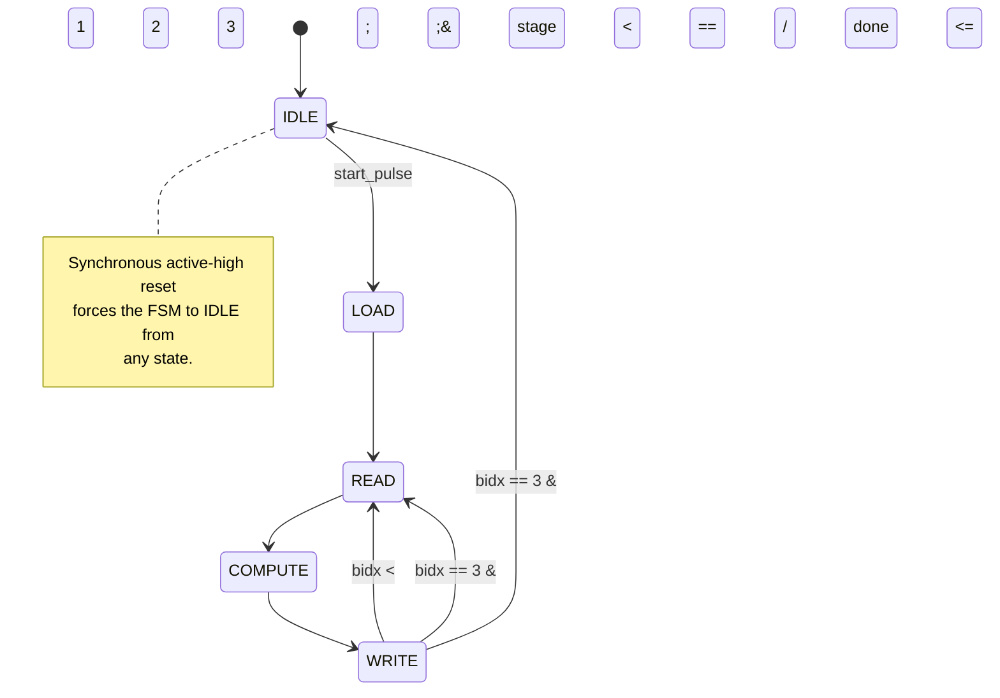

# 8-Point NTT Accelerator

This project implements an 8-point Number Theoretic Transform (NTT) accelerator in Verilog-2001 for the [ARCH Lab hardware task](https://archlabs.us/apply/task26fhe/). The design is simulated using Icarus Verilog.

The initial implementation uses a single reusable butterfly datapath for all three stages of the transform, rather than separate hardware for each stage. A ROM stores the twiddle factors, while a finite-state machine (FSM) controls the transform sequence. In addition to this implementation, the project includes three experiments investigating inverse NTT support, larger transform sizes, and pipelined execution.

The NTT is the finite-field counterpart of the Fast Fourier Transform (FFT). It is widely used in polynomial multiplication, where two polynomials are transformed, multiplied coefficient-wise in the transform domain, and then inverse-transformed, reducing complexity from $O(n^2)$ to $O(n\log n)$. Unlike FFT implementations that use floating-point arithmetic, an NTT operates over a finite field using integer arithmetic and modular reduction, which avoids floating-point rounding errors and makes NTTs particularly useful in lattice-based cryptography and Fully Homomorphic Encryption (FHE). See the task's *Why NTT Matters in Hardware* section for further motivation.

## Key implementation features

- Verilog-2001, simulated with Icarus Verilog.
- Single reusable butterfly datapath shared across all stages and butterflies.
- In-place coefficient memory (one 8×5-bit bank for input, intermediate, and output data).
- ROM-based, precomputed twiddle factors.
- FSM-based control (`IDLE → LOAD → READ → COMPUTE → WRITE`).
- Natural-order output via a fixed bit-reversal mapping at the output port.

## Top-level interface

The `ntt_top` module accepts eight 5-bit input coefficients packed into a 40-bit bus and returns the eight NTT coefficients in natural order through another 40-bit bus.

| Signal | Direction | Width | Description |
|---|---|---:|---|
| `clk` | Input | 1 | System clock |
| `rst` | Input | 1 | Synchronous active-high reset |
| `start` | Input | 1 | Transform start request |
| `coef_in` | Input | 40 | Eight packed 5-bit input coefficients |
| `busy` | Output | 1 | High while a transform is in progress |
| `done` | Output | 1 | Asserted when the transform completes |
| `coef_out` | Output | 40 | Eight packed 5-bit output coefficients |

Both `coef_in` and `coef_out` pack eight 5-bit coefficients into a 40-bit bus, least-significant first:

$$
coef\_in[5k+:5]=x[k] \qquad coef\_out[5k+:5]=X[k]
$$

For example, to drive the input vector $x[0..7]$:

```verilog
coef_in = {
    x[7], x[6], x[5], x[4],
    x[3], x[2], x[1], x[0]
};
```

Every input coefficient must be a canonical residue in $[0,16]$. The hardware does not normalize invalid inputs; although a 5-bit field can represent values from 0 to 31, values from 17 to 31 are outside the supported input domain. See [docs/verification.md](docs/verification.md) for the test-vector file format used to supply and check these coefficients.

## Hardware architecture

The design uses an iterative architecture with a single shared butterfly datapath and one in-place coefficient memory. Rather than instantiating separate arithmetic units for every butterfly, the same combinational datapath is reused for all 12 butterflies across the three NTT stages, with each butterfly's results written back into the same memory bank it read from.

```text
ntt_top
├── ntt_controller
│   ├── FSM and control registers
│   ├── twiddle_rom
│   └── butterfly_datapath
│       ├── mod_add
│       ├── mod_sub
│       └── mod_mul
└── coefficient_memory
    └── mem[0:7]  (8 × 5-bit)
```


Solid arrows represent coefficient or arithmetic data. Dashed arrows represent control and address signals.

This diagram describes the **baseline implementation under `rtl/`**. The INTT, N=16, and pipelined implementations are separate experiments with their own architectures — see [docs/experiments.md](docs/experiments.md) — and are not part of this diagram.

The main responsibilities are:

- **`ntt_top`** connects the controller and coefficient memory, exposes the external interface, and applies the natural-order output mapping ($coef\_out[5k+:5]=mem[bitrev3(k)]$, where `bitrev3` reverses the three bits of the index) to undo the DIF algorithm's bit-reversed result ordering.
- **`ntt_controller`** contains the FSM, stage and butterfly counters, address and twiddle-index generation logic, and the registers used to capture butterfly inputs and outputs.
- **`coefficient_memory`** is a single in-place bank containing eight 5-bit coefficients. It supports loading all eight inputs and reading or writing the two coefficients involved in a butterfly.
- **`twiddle_rom`** provides the precomputed values of $\omega^e \bmod 17$, selected by the controller.
- **`butterfly_datapath`** contains one shared combinational adder, subtractor, and multiplier. The adder and subtractor operate on the same input pair; the subtraction result is multiplied by the twiddle factor.

The butterfly datapath has no internal registers — its inputs and outputs are captured by registers in the controller. This single shared datapath is the central resource-sharing choice behind the design: all 12 butterflies across all three stages flow through the same adder/subtractor/multiplier, one at a time, rather than instantiating four (or more) butterfly units. See [docs/architecture.md](docs/architecture.md#design-decisions-and-trade-offs) for the trade-offs this implies.

## Transform execution

The controller executes the NTT by processing one butterfly at a time. Each of the three stages contains four butterflies, giving a total of 12 butterfly operations processed sequentially.

Five states control the execution:

| State | Operation |
|---|---|
| `IDLE` | Wait for a start request |
| `LOAD` | Write all eight input coefficients into memory |
| `READ` | Read the selected coefficient pair and twiddle factor |
| `COMPUTE` | Capture the butterfly results |
| `WRITE` | Write both results back to memory and advance the schedule |



The `READ`, `COMPUTE`, and `WRITE` states repeat for each butterfly, three clock cycles per butterfly:

1. **READ:** read the selected coefficient pair and twiddle factor.
2. **COMPUTE:** calculate and capture the butterfly results.
3. **WRITE:** write both results back to memory and advance the schedule.

The controller does not begin the next butterfly until the current one's results have been written to memory, so there are never overlapping butterfly operations or pending writes.

### Latency

With 1 cycle to load the eight input coefficients plus 12 butterflies at 3 cycles each:

`1 + (12 × 3) = 37 cycles`

The extra cycle is the initial `LOAD` cycle. The 37-cycle figure is the measured number of busy cycles from the accepted `start` edge to the final `WRITE` edge — see [docs/verification.md](docs/verification.md#measured-baseline-transform-latency) for how this was independently checked. For the full stage/butterfly schedule and the butterfly's arithmetic, see [NTT algorithm and butterfly convention](docs/architecture.md#ntt-algorithm-and-butterfly-convention) in the architecture document.

## Results overview

| Metric | Baseline | Exp. 1: INTT | Exp. 2: N=16 | Exp. 3: Pipelined |
|---|---:|---:|---:|---:|
| Transform size | 8 | 8 | 16 | 8 |
| Transform direction | Forward only | Forward + inverse | Forward only | Forward only |
| Execution latency (busy cycles) | 37 | 37 (fwd) / 61 (inv) | 97 | 16 |
| Generic synthesis cells | 603 | 673 | 952 | 661 |
| Flip-flops | 80 | 85 | 123 | 90 |

Generic synthesis cell counts are technology-independent Yosys statistics, not FPGA/ASIC resource, timing, or power measurements. Full results, methodology, and per-module breakdowns are in [docs/experiments.md](docs/experiments.md).

## Quick start

**Prerequisites:** Icarus Verilog (`iverilog`/`vvp`) and Python 3. Tested with Icarus Verilog 13.0 and Python 3.11.13.

```bash
# Run the baseline RTL test suite (5,363 checks)
bash scripts/run_all_tests.sh

# Run the baseline suite plus all three experiments
bash scripts/run_all_experiments.sh
```

See [docs/verification.md](docs/verification.md) for the full verification methodology, test counts, and waveform-inspection instructions.

## Repository structure

```text
ntt_accelerator/
├── rtl/            # Baseline Verilog implementation
├── tb/             # Baseline testbenches and fixtures
├── reference/      # Baseline independent Python reference/validation code
├── experiments/    # Independent extensions (intt/, ntt16/, pipelined/) -- baseline is never modified
├── scripts/        # Test, regression, and synthesis scripts
├── reports/        # Raw Yosys synthesis scripts and output
├── waves/          # Waveform capture harness, recorded VCD, and trace log
└── docs/           # Detailed documentation (this README links to all of it)
```

Each experiment directory (`experiments/intt/`, `experiments/ntt16/`, `experiments/pipelined/`) mirrors the baseline's own `rtl/`, `tb/`, and `reference/` layout and has its own `README.md`.

## Assignment coverage

The table below describes the **initial baseline implementation** only (`rtl/`); it does not cover the experimental extensions, which are evaluated separately in [docs/experiments.md](docs/experiments.md).

| Requirement | Implemented as |
|---|---|
| 8-point transform, 8 in / 8 out | `coef_in[39:0]` / `coef_out[39:0]`, 8×5-bit packed |
| N=8, q=17, ω=9 | Fixed by memory depth, ROM contents, and address-generation width |
| Single iterative butterfly | One `butterfly_datapath` instance, reused for all 12 butterflies |
| ROM-based precomputed twiddles | `twiddle_rom.v`, 8 literal constants |
| FSM-based control | `ntt_controller.v`, 5-state FSM |
| Correct address/twiddle generation | Shift/mask formula, independently re-derived and matched in `ntt_math_validation.py` |
| Modular arithmetic | `modular_arithmetic.v`, exhaustively checked over all 289 canonical operand pairs; additional mathematical validation performed by `ntt_math_validation.py` |
| Working testbench | `tb/tb_ntt_top.v` + 3 supporting testbenches, `scripts/run_all_tests.sh` |
| Text-file input loading | `$fscanf`-based readers in `tb_ntt_top.v`, against `reference/test_vectors/` |
| Correct output verification | 31/31 test vectors match, independently cross-checked against the direct NTT definition |
| Open-source simulation | Icarus Verilog 13.0 |

## Documentation

| Document | Covers |
|---|---|
| [docs/architecture.md](docs/architecture.md) | Mathematical foundation, DIF algorithm derivation, detailed butterfly/schedule mathematics, RTL implementation details (arithmetic, memory, address generation, reset/handshake), design trade-offs |
| [docs/verification.md](docs/verification.md) | Verification strategy, test counts and coverage, measured latency, test-vector/checkpoint generation, waveform inspection, reproduction commands |
| [docs/experiments.md](docs/experiments.md) | Why the experiments exist, shared synthesis methodology, overall comparison, main findings, future work |
| [experiments/intt/README.md](experiments/intt/README.md) | Experiment 1: inverse NTT — design, verification, synthesis results |
| [experiments/ntt16/README.md](experiments/ntt16/README.md) | Experiment 2: N=16 transform — design, verification, synthesis results |
| [experiments/pipelined/README.md](experiments/pipelined/README.md) | Experiment 3: pipelined execution — design, hazard detection, verification, synthesis results |
