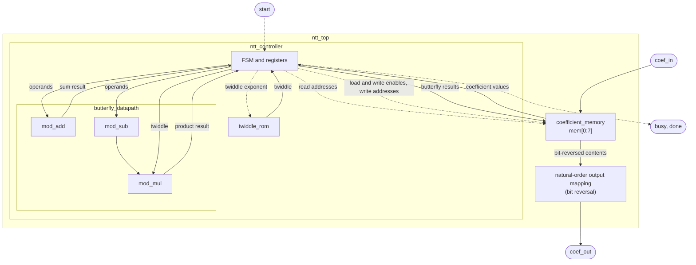
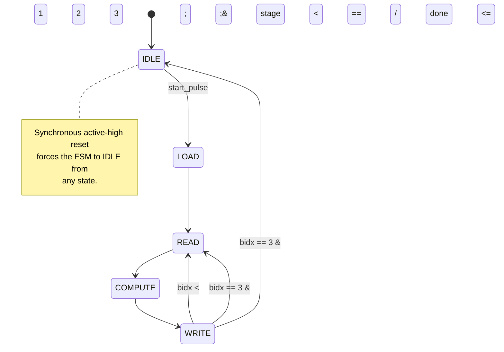
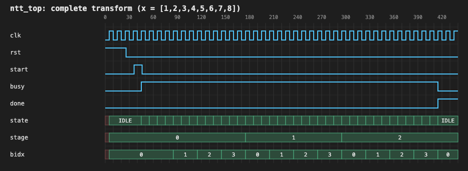
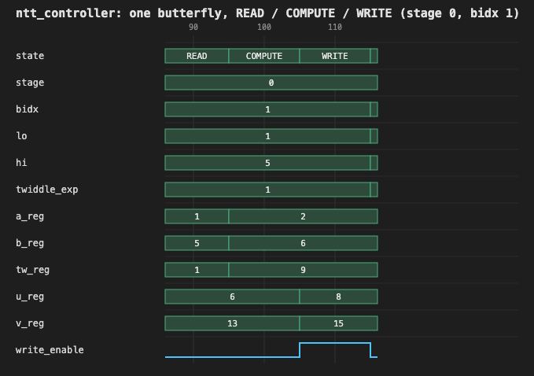
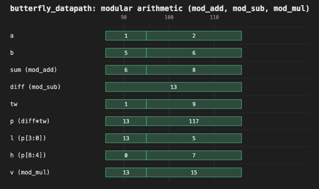

# 8-Point NTT Accelerator

This project implements an 8-point Number Theoretic Transform (NTT) accelerator in Verilog-2001 for the [ARCH Lab hardware task](https://archlabs.us/apply/task26fhe/). The design is simulated using Icarus Verilog.

The initial implementation uses a single reusable butterfly datapath for all three stages of the transform, rather than separate hardware for each stage. A ROM stores the twiddle factors, while a finite-state machine (FSM) controls the transform sequence. In addition to this implementation, the project includes three experiments investigating inverse NTT support, larger transform sizes, and pipelined execution.

The NTT is the finite-field counterpart of the Fast Fourier Transform (FFT). It is widely used in polynomial multiplication, where two polynomials are transformed, multiplied coefficient-wise in the transform domain, and then inverse-transformed. With suitable transform parameters, this reduces the computational complexity from $O(n^2)$ for direct multiplication to $O(n\log n)$.

Unlike FFT implementations that use floating-point arithmetic, an NTT operates over a finite field using integer arithmetic and modular reduction. This avoids floating-point rounding errors and makes NTTs particularly useful in lattice-based cryptography and Fully Homomorphic Encryption (FHE), where efficient polynomial arithmetic is essential. See the task's *Why NTT Matters in Hardware* section for further motivation.

## Table of contents

- [Mathematical foundation](#mathematical-foundation)
- [NTT algorithm and butterfly convention](#ntt-algorithm-and-butterfly-convention)
- [Top-level interface](#top-level-interface)
- [Architecture](#architecture)
- [Transform execution](#transform-execution)
- [Implementation details](#implementation-details)
- [Design decisions and trade-offs](#design-decisions-and-trade-offs)
- [Input and output format](#input-and-output-format)
- [Project structure](#project-structure)
- [Simulation and verification](#simulation-and-verification)
- [Simulation waveforms](#simulation-waveforms)
- [Verification results](#verification-results)
- [Limitations and Future Work](#limitations-and-future-work)
- [Experiments and evaluation](#experiments-and-evaluation)
- [Assignment coverage](#assignment-coverage)

## Mathematical foundation

The implementation computes an 8-point Number Theoretic Transform (NTT) over the finite field $\mathbb{Z}/17\mathbb{Z}$, using the following parameters:

| Parameter | Value |
|---|---|
| Transform size | $N = 8$ |
| Modulus | $q = 17$ |
| Primitive root of unity | $\omega = 9$ |

### Primitive root of unity

An N-point NTT requires a primitive Nth root of unity modulo $q$. Such a root satisfies:

$$
\omega^N \equiv 1 \pmod q
$$

and no smaller positive exponent produces 1.

For this transform, $\omega=9$ satisfies:

$$
9^8 \equiv 1 \pmod{17}
$$

while $9^1$, $9^2$, and $9^4$ are not congruent to 1 modulo 17. Therefore, 9 has multiplicative order exactly 8 and is a valid primitive eighth root of unity.

Its successive powers modulo 17 are:

```text
ω^0..ω^8 mod 17 = [1, 9, 13, 15, 16, 8, 4, 2, 1]
```

The existence of an element of order 8 is consistent with the structure of the multiplicative group of a finite field. Since 17 is prime, its nonzero residues form a multiplicative group of order $17-1=16$. By Lagrange's theorem, the order of any element must divide 16. Since $8$ divides $16$, an element of order 8 can exist modulo 17. The calculation above establishes that 9 is such an element.

More generally, for a prime modulus $q$, the condition $N\mid(q-1)$ is necessary for an Nth primitive root of unity to exist.

### Direct NTT definition

For an input sequence of eight coefficients $x[0],\ldots,x[7]$, the forward NTT produces eight output coefficients:

$$
X[k]=\sum_{j=0}^{7}x[j]\omega^{jk}\pmod{17},
\qquad 0\leq k<8
$$

Here, $j$ indexes the input coefficients, $k$ identifies the output coefficient, and powers of $\omega$ provide the corresponding transform factors. All arithmetic is performed modulo 17.

This mathematical definition specifies the transform independently of the algorithm used to evaluate it.

## NTT algorithm and butterfly convention

The direct definition describes each output as a sum involving all eight input coefficients. A radix-2 factorization evaluates the same transform through smaller operations called butterflies.

This implementation uses the **decimation-in-frequency (DIF)** form of the radix-2 Cooley-Tukey algorithm. DIF decomposes the transform by separating even-indexed and odd-indexed output components.

For two input values $a$ and $b$, the corresponding butterfly is:

$$
u=(a+b)\pmod{17}
$$

$$
v=(a-b)\omega^e\pmod{17}
$$

where $e$ is the twiddle-factor exponent determined by the stage and butterfly position.

The sum contributes to the even-indexed output branch, while the twiddle-multiplied difference contributes to the odd-indexed output branch. Repeating this decomposition produces the complete transform through $\log_2 N$ stages.

This is the standard radix-2 DIF factorization used in the Cooley-Tukey FFT. See [Burrus, *Fast Fourier Transforms*, Section 8: The Cooley-Tukey FFT Algorithm](https://eng.libretexts.org/Bookshelves/Electrical_Engineering/Signal_Processing_and_Modeling/Fast_Fourier_Transforms_%28Burrus%29/08%3A_The_Cooley-Tukey_Fast_Fourier_Transform_Algorithm/8.02%3A_Basic_Cooley-Tukey_FFT).

The same factorization applies to the NTT by performing the operations over a finite field and replacing complex roots of unity with powers of $\omega=9$ in $\mathbb{Z}/17\mathbb{Z}$. See [Optimization and implementation of the number theoretic transform butterfly unit for large integer multiplication (2021)](https://www.sciencedirect.com/science/article/pii/S2214212621000909) for further discussion of NTT butterfly arithmetic and implementation.

### Three stages and twiddle exponents

For an 8-point transform, radix-2 decomposition requires:

$$
\log_2 8=3
$$

stages. The butterfly distance decreases from 4 to 2 to 1, with four butterflies at each stage.

| Stage | Distance | Butterfly pairs | Twiddle exponents |
|---|---:|---|---|
| 1 | 4 | (0,4), (1,5), (2,6), (3,7) | 0, 1, 2, 3 |
| 2 | 2 | (0,2), (1,3), (4,6), (5,7) | 0, 2, 0, 2 |
| 3 | 1 | (0,1), (2,3), (4,5), (6,7) | 0, 0, 0, 0 |

The complete transform therefore consists of 12 butterfly operations across three stages.

### Bit-reversed output ordering

A characteristic of radix-2 DIF is that, when the input coefficients are in natural order, the final transform coefficients are produced in bit-reversed order.

For an 8-point transform, the three-bit reversal gives the following correspondence:

| Natural output index | Position in bit-reversed sequence |
|---:|---:|
| 0 | 0 |
| 1 | 4 |
| 2 | 2 |
| 3 | 6 |
| 4 | 1 |
| 5 | 5 |
| 6 | 3 |
| 7 | 7 |

Consequently, the final DIF stage produces:

$$
[X[0],X[4],X[2],X[6],X[1],X[5],X[3],X[7]]
$$

Reordering these coefficients according to their natural indices gives the conventional NTT output:

$$
[X[0],X[1],X[2],X[3],X[4],X[5],X[6],X[7]]
$$

This ordering follows from the recursive even/odd decomposition of the output indices in radix-2 DIF.

### Worked example

Consider the input sequence:

$$
x=[1,2,3,4,5,6,7,8]
$$

Applying the three DIF stages produces the following intermediate sequences:

| Step | Values |
|---|---|
| Stage 1 | `[6, 8, 10, 12, 13, 15, 16, 8]` |
| Stage 2 | `[16, 3, 13, 16, 12, 6, 14, 6]` |
| Stage 3 (bit-reversed order) | `[2, 13, 12, 14, 1, 6, 3, 8]` |

Using the bit-reversed index correspondence established above, the natural-order transform output is:

$$
X=[2,1,12,3,13,6,14,8]
$$

These values agree with the direct NTT definition for the same input.

## Top-level interface

The `ntt_top` module accepts eight 5-bit input coefficients packed into a 40-bit bus and returns the eight NTT coefficients in natural order through another 40-bit bus.

| Signal | Direction | Width | Description |
|---|---|---:|---|
| `clk` | Input | 1 | System clock |
| `rst` | Input | 1 | Synchronous active-high reset |
| `start` | Input | 1 | Transform start request |
| `coef_in` | Input | 40 | Eight packed 5-bit input coefficients |
| `busy` | Output | 1 | High while a transform is in progress |
| `done` | Output | 1 | Asserted when the transform completes |
| `coef_out` | Output | 40 | Eight packed 5-bit output coefficients |

## Architecture

The design uses an iterative architecture with a single shared butterfly datapath and one in-place coefficient memory. Rather than instantiating separate arithmetic units for every butterfly, the same datapath is reused for all 12 butterflies across the three NTT stages.

The design consists of two main blocks:

- **`ntt_controller`**: Controls the transform, generates coefficient addresses and twiddle indices, and schedules the butterfly operations.
- **`coefficient_memory`**: Stores the input coefficients, intermediate stage results, and final output.

The controller contains the twiddle ROM and the shared butterfly datapath.

```text
ntt_top
├── ntt_controller
│   ├── FSM and control registers
│   ├── twiddle_rom
│   └── butterfly_datapath
│       ├── mod_add
│       ├── mod_sub
│       └── mod_mul
└── coefficient_memory
    └── mem[0:7]  (8 × 5-bit)
```

The following diagram shows the main data and control connections.



Solid arrows represent coefficient or arithmetic data. Dashed arrows represent control and address signals.

This diagram describes the baseline implementation in `rtl/`. The experimental implementations use separate architectures or control extensions, as described in the corresponding experiment sections.

The main responsibilities are:

- **`ntt_top`** connects the controller and coefficient memory, exposes the external interface, and applies the bit-reversal permutation to produce natural-order output.
- **`ntt_controller`** contains the FSM, stage and butterfly counters, address and twiddle-index generation logic, and registers used to capture butterfly inputs and outputs.
- **`coefficient_memory`** is a single in-place bank containing eight 5-bit coefficients. It supports loading all eight inputs and reading or writing the two coefficients involved in a butterfly.
- **`twiddle_rom`** provides the precomputed values of $\omega^e \bmod 17$.
- **`butterfly_datapath`** contains one shared combinational adder, subtractor, and multiplier. The adder and subtractor operate on the same input pair; the subtraction result is multiplied by the twiddle factor.

The butterfly datapath has no internal registers. Its inputs and outputs are captured by registers in the controller.

## Transform execution

The controller executes the NTT by processing one butterfly at a time. Each of the three stages contains four butterflies, giving a total of 12 butterfly operations.

### Butterfly operation

The radix-2 DIF butterfly computes:

$$
u=(a+b)\bmod 17
$$

$$
v=(a-b)\omega^e\bmod 17
$$

where $a$ and $b$ are the selected coefficient pair, and $\omega^e$ is the corresponding twiddle factor.

The shared datapath computes both results combinationally:

1. `mod_add` calculates the sum $u$.
2. `mod_sub` calculates the difference $a-b$ modulo 17.
3. `mod_mul` multiplies the difference by the selected twiddle factor to produce $v$.

The controller captures the two results and writes them back to their respective memory locations.

### Butterfly schedule

The controller uses two counters:

- `stage` identifies the current NTT stage, ranging from 0 to 2.
- `bidx` identifies the butterfly within the current stage, ranging from 0 to 3.

The schedule is:

| Stage | Distance | Butterfly pairs | Twiddle exponents |
|---|---:|---|---|
| 1 | 4 | (0,4), (1,5), (2,6), (3,7) | 0, 1, 2, 3 |
| 2 | 2 | (0,2), (1,3), (4,6), (5,7) | 0, 2, 0, 2 |
| 3 | 1 | (0,1), (2,3), (4,5), (6,7) | 0, 0, 0, 0 |

Each stage processes four butterflies. Once all four have completed, the controller advances to the next stage. After the fourth butterfly of the third stage, the transform is complete.

### Controller state machine

Five states control the execution:

| State | Operation |
|---|---|
| `IDLE` | Wait for a start request |
| `LOAD` | Write all eight input coefficients into memory |
| `READ` | Read the selected coefficient pair and twiddle factor |
| `COMPUTE` | Capture the butterfly results |
| `WRITE` | Write both results back to memory and advance the schedule |

The execution sequence is:



The `READ`, `COMPUTE`, and `WRITE` states repeat for each butterfly. The controller does not begin the next butterfly until the current butterfly's results have been written to memory.

The `stage` and `bidx` counters are advanced as part of the `WRITE` state's exit logic. This avoids introducing additional FSM states or clock cycles just for schedule bookkeeping.

### Cycle-by-cycle operation

Each butterfly takes three clock cycles:

1. **READ:** The controller reads the two coefficients from memory, selects the twiddle factor from the ROM, and captures these values into `a_reg`, `b_reg`, and `tw_reg`.
2. **COMPUTE:** The combinational butterfly datapath calculates the sum and twiddle-multiplied difference. The controller captures the results into `u_reg` and `v_reg`.
3. **WRITE:** The controller writes `u_reg` and `v_reg` back to the two selected memory locations.

This sequence ensures that each butterfly completes before the next one begins. There are no overlapping butterfly operations or pending writes when a subsequent butterfly starts.

## Implementation details

This section describes how the architecture is realized in RTL, including the arithmetic circuits, memory organization, address generation, and control behavior.

### Modular arithmetic

All three arithmetic units operate on canonical 5-bit residues in the range $[0,16]$, the same canonical range required by [Mathematical foundation](#mathematical-foundation). They do not normalize arbitrary 5-bit values and their inputs must already be reduced modulo 17.

**Addition**

The adder calculates $a+b$. Since both inputs are at most 16, the maximum sum is 32, so a 6-bit intermediate result is sufficient. The result is reduced by subtracting 17 when the sum is greater than or equal to 17. One correction is sufficient.

**Subtraction**

The subtractor calculates $a-b$:

- If $a\geq b$, the difference is already in the valid range: $(a-b)\bmod 17=a-b$.
- If $a<b$, it adds 17 to the difference: $(a-b)\bmod 17=a+17-b$.

**Multiplication**

The multiplier first calculates the 9-bit product:

$$
p=a\times b
$$

Because the modulus is 17 and $17=2^4+1$, we can use:

$$
16\equiv -1\pmod{17}
$$

Split the product into its upper bits and lower nibble:

$$
p=16h+l
$$

where $h=p[8:4]$ and $l=p[3:0]$.

Therefore:

$$
p\equiv l-h\pmod{17}
$$

The product is reduced by calculating $l-h$ and adding 17 if the result is negative. This avoids a general-purpose division or modulo operator. The reduction relies on the specific modulus $q=17$ and does not directly generalize to arbitrary primes.

### In-place coefficient memory

The design uses one 8×5-bit memory bank, `mem[0:7]`, throughout the transform.

The same bank stores:

- The eight input coefficients after `LOAD`.
- The intermediate results after each NTT stage.
- The final bit-reversed output after the last stage.

Each butterfly reads two locations and writes the two corresponding results back to those locations.

This in-place organization is safe for the selected schedule. Within each stage, the four butterflies operate on disjoint pairs of addresses. The stages execute sequentially, so a stage finishes all its writes before the next stage begins. There are therefore no read-after-write conflicts in this schedule.

### Address and twiddle-index generation

The controller calculates the coefficient addresses and twiddle exponent from `stage` and `bidx`. It uses shifts and bit masks rather than division, modulo operations, or a fixed 12-entry address lookup table.

For this 8-point transform:

```text
half        = 4 >> stage
group       = bidx >> (2 - stage)
j           = bidx & (half - 1)
lo          = group * (2 * half) + j
hi          = lo + half
twiddle_exp = (j << stage) & 7
```

`lo` and `hi` identify the two coefficient locations used by the current butterfly. `twiddle_exp` selects the corresponding twiddle factor.

The formula is based on the radix-2 DIF schedule and can be adapted to other power-of-two transform sizes. However, this implementation is fixed to $N=8$; the constants are hardcoded and the design is not parameterized.

### Twiddle ROM

The design uses a combinational ROM containing the eight precomputed powers of the primitive root:

$$
[1,9,13,15,16,8,4,2]
$$

A 3-bit exponent selects the corresponding value of $\omega^e\bmod17$. The selected value is captured by the controller during `READ` and used by the multiplier during `COMPUTE`.

### Bit widths

The arithmetic widths are determined by the maximum possible values when the inputs are canonical residues in $[0,16]$.

| Quantity | Maximum value | Required width |
|---|---:|---:|
| Input coefficient | 16 | 5 bits |
| Addition intermediate | 32 | 6 bits |
| Multiplication intermediate | 256 | 9 bits |
| Generated twiddle exponent | 3 | 2 bits |
| Twiddle ROM address | 7 | 3 bits |

The current $N=8$ schedule generates exponents from 0 to 3, requiring two bits to represent the used exponent values. The ROM has eight entries and therefore uses a three-bit address. The implementation retains this three-bit ROM interface.

### Reset and handshake behavior

The design uses a synchronous, active-high reset. When `rst` is asserted, the FSM returns to `IDLE` regardless of its current state.

The memory write enables are also gated with the live reset signal, preventing a load or butterfly write from committing on an edge where reset is asserted.

The `start` input is edge-detected using a delayed copy of the signal:

$$
start\_pulse=start\land\neg start_d
$$

This means a continuously asserted `start` signal triggers only one transform. A start pulse received while the controller is busy is ignored.

The handshake signals behave as follows:

| Signal or behavior | Implementation |
|---|---|
| Start request | Rising-edge detection |
| Start while busy | Ignored |
| Start held high | One transform only |
| Reset | Synchronous, active-high |
| `busy` | High whenever the FSM is not in `IDLE` |
| `done` | Asserted on completion and held until the next accepted transform |

`busy` is combinationally derived from the FSM state. `done` is registered: it is cleared when a new transform is accepted and asserted on the final `WRITE` edge.

### Latency

The transform requires:

- 1 cycle to load the eight input coefficients.
- 12 butterflies.
- 3 cycles per butterfly.

Therefore:

$$
1+(12\times3)=37\text{ cycles}
$$

The measured latency is 37 busy cycles, from the accepted-start edge to the final `WRITE` edge. This was independently checked using a busy-cycle counter and the distance between the accepted-start and completion edges. See [Verification results](#verification-results).

## Design decisions and trade-offs

The architecture makes several trade-offs between hardware resource usage, execution latency, and implementation complexity. The choices below reflect the fixed 8-point transform parameters and the requirement to implement the transform using reusable hardware.

### Single shared butterfly versus parallel units

The design uses one shared butterfly datapath consisting of a modular adder, modular subtractor, and multiplier. This datapath is reused for all 12 butterfly operations across the three transform stages.

The main advantage is reduced arithmetic hardware. Instead of implementing four butterfly units to process the four disjoint pairs in a stage simultaneously, the controller reuses the same arithmetic resources sequentially. This keeps the datapath small and avoids the need for multiple simultaneous memory accesses.

The trade-off is execution latency. Each butterfly requires three controller cycles (`READ`, `COMPUTE`, and `WRITE`), resulting in 37 busy cycles per transform, including the initial `LOAD` cycle.

Four parallel butterfly units could reduce execution time by processing an entire stage concurrently. However, this would require four sets of arithmetic resources and a memory organization capable of supplying and storing multiple coefficient pairs simultaneously. This alternative is not implemented or evaluated in this design.

### Sequential execution

The controller executes each butterfly through a strict `READ → COMPUTE → WRITE` sequence. Each operation completes its memory updates before the next butterfly begins.

This approach simplifies operand capture, result storage, and memory access scheduling. It also avoids managing overlapping operations that may depend on the same shared datapath or memory resources.

The trade-off is that the datapath remains idle during some controller phases, and successive butterfly operations cannot overlap. This limits throughput but keeps the control logic and resource requirements relatively simple.

### Five-state FSM versus additional bookkeeping states

The controller uses five states: `IDLE`, `LOAD`, `READ`, `COMPUTE`, and `WRITE`. Stage and butterfly progression are handled by the `stage` and `bidx` counters within the existing state transitions, rather than introducing separate FSM states for counter updates.

The `bidx` counter advances after each completed butterfly. When the final butterfly of a stage is written, `bidx` is reset and `stage` advances. After the final butterfly of the final stage, the controller returns to `IDLE` and asserts `done`.

Keeping this bookkeeping within the `WRITE` exit logic avoids additional state transitions and keeps the FSM focused on the actual datapath operations. Each active operation state (`LOAD`, `READ`, `COMPUTE`, and `WRITE`) occupies one clock cycle, while `IDLE` persists until a start request is accepted. A dedicated counter-update state would introduce an additional clock cycle each time it is visited. Separate counter-update states could make individual control actions more explicit, but would increase execution latency without providing a functional benefit for this design.

### Single in-place bank versus double buffering

All eight coefficients are stored in a single 8×5-bit memory bank, requiring only 40 bits of coefficient storage.

The DIF schedule pairs disjoint coefficient locations within each stage. Consequently, each butterfly reads two locations and writes its two results back to those same locations. No other butterfly in that stage accesses either location, so the operations can safely update the bank in place.

A double-buffered architecture would require two 8×5-bit banks, increasing coefficient storage to 80 bits, together with additional bank-selection logic. Double buffering can be useful when separate input and output storage is required, but it is unnecessary for this sequential in-place schedule.

### Algorithmic address generation versus a lookup table

The butterfly addresses and twiddle exponents are generated algorithmically from the current stage and butterfly index using shift, mask, and arithmetic operations.

This avoids storing a fixed table containing all 12 butterfly address pairs and makes the relationship between the DIF schedule and the hardware control explicit. It also provides a more general approach than explicitly encoding every operation in a lookup table.

A lookup table could simplify control for a fixed schedule, but would explicitly encode the address and exponent sequence. The current implementation favors algorithmic generation, although the address-generation logic is specialized for the 8-point design.

### Precomputed twiddle ROM versus runtime computation

The twiddle factors are stored as constants in a ROM, avoiding runtime modular exponentiation.

This is appropriate because the transform size, modulus, and primitive root are fixed. All required powers can be calculated before implementation, allowing the controller to select the appropriate value directly using the generated twiddle exponent.

The ROM contains the eight powers of the selected primitive root, while the current DIF schedule uses only exponents 0 through 3. Storing the complete set keeps the ROM representation straightforward and makes all powers available explicitly.

### Specialized modular reduction versus general modulo arithmetic

The multiplier uses the identity:

$$
16\equiv-1\pmod{17}
$$

For a product represented as:

$$
p=16h+l
$$

the reduction becomes:

$$
p\equiv l-h\pmod{17}
$$

The implementation therefore subtracts the upper portion of the product from the lower portion and adds 17 when the difference is negative. This avoids a general-purpose modulo operation and exploits the specific structure of the selected modulus.

The trade-off is limited generality. This reduction is specialized for modulus 17 and cannot be applied unchanged to arbitrary primes. Supporting other moduli would require a different reduction method. See [Limitations and Future Work](#limitations-and-future-work).

### Fixed-width arithmetic

The design uses fixed-width unsigned vectors rather than integer or floating-point arithmetic. Since every coefficient is maintained in the canonical range 0 to 16, five bits are sufficient to represent each stored coefficient.

The intermediate widths are selected to accommodate the maximum values before modular reduction:

- **Addition:** The maximum sum is 16 + 16 = 32, requiring 6 bits.
- **Subtraction:** The difference is handled using the implementation's conditional correction by 17.
- **Multiplication:** The maximum product is 16 × 16 = 256, requiring 9 bits.

These widths avoid unnecessary datapath width while preserving the complete intermediate arithmetic range. They are specific to the selected modulus and operand range.

### Natural-order output through bit reversal

The iterative DIF algorithm produces its final coefficients in bit-reversed order. Rather than performing an additional memory-reordering pass, the design maps the internal memory locations to natural coefficient order through fixed output indexing.

For an 8-point transform, the three-bit index is reversed when selecting the output coefficient:

$$
coef\_out[k]=mem[bitrev3(k)]
$$

This keeps the internal transform schedule unchanged and avoids additional clock cycles and memory writes for output reordering. The trade-off is that the output mapping is tied to the fixed 8-point transform size.

## Input and output format

Both `coef_in` and `coef_out` pack eight 5-bit coefficients into a 40-bit bus. Coefficients are packed least-significant first:

$$
coef\_in[5k+:5]=x[k]
$$

For example, to drive the input vector $x[0..7]$:

```verilog
coef_in = {
    x[7], x[6], x[5], x[4],
    x[3], x[2], x[1], x[0]
};
```

The output bus uses the same packing convention:

$$
coef\_out[5k+:5]=X[k]
$$

The output is already in natural order. The controller performs the transform using the radix-2 DIF schedule, which produces results in bit-reversed order. `ntt_top` applies the output permutation:

$$
coef\_out[5k+:5]=mem[bitrev3(k)]
$$

where `bitrev3` reverses the three bits of the index.

**Input contract**

Every input coefficient must be a canonical residue in $[0,16]$. The hardware does not normalize invalid inputs. Although a 5-bit field can represent values from 0 to 31, values from 17 to 31 are outside the supported input domain.

The testbench reads input and expected-output vectors from decimal text files, with one coefficient per line and eight lines per vector:

- `reference/test_vectors/input_<name>.txt`
- `reference/test_vectors/expected_<name>.txt`

The list of vector names is read from `tb/vector_names.txt`, which is generated from the input-vector files present rather than being hardcoded.

For each vector, the testbench also reads the expected intermediate memory contents after each DIF stage:

- `reference/stage_checkpoints/stage1_<name>.txt`
- `reference/stage_checkpoints/stage2_<name>.txt`
- `reference/stage_checkpoints/stage3_<name>.txt`

This allows the testbench to check not only the final transform output but also the intermediate results produced at each stage.

## Project structure

The repository separates the baseline RTL implementation, its testbenches and reference code, the independent experiments, execution scripts, synthesis reports, and waveform artifacts.

```text
ntt_accelerator/
├── README.md
├── .gitignore
├── rtl/                            # Baseline Verilog implementation
│   ├── ntt_top.v                   # Top-level module and output bit reversal
│   ├── ntt_controller.v            # FSM, address/twiddle generation, registers
│   ├── coefficient_memory.v        # In-place 8×5-bit coefficient memory
│   ├── butterfly_datapath.v        # Shared combinational butterfly
│   ├── modular_arithmetic.v        # mod_add, mod_sub, mod_mul
│   └── twiddle_rom.v               # Twiddle-factor lookup table
├── tb/                             # Baseline testbenches and fixtures
│   ├── tb_ntt_top.v                # Transform, intermediate, sequencing, timing checks
│   ├── tb_modular_arithmetic.v     # Exhaustive 17×17 arithmetic checks
│   ├── tb_control.v                # Reset and start/busy/done tests
│   ├── tb_negative.v               # Invalid-input and timeout tests
│   ├── vector_names.txt            # Generated test-vector manifest
│   └── fixtures/                   # Malformed, short, and out-of-range inputs
├── reference/                      # Baseline independent mathematical reference code
│   ├── ntt_reference_model.py      # Direct NTT definition and vector generation
│   ├── ntt_math_validation.py      # Independent mathematical validation
│   ├── export_stage_checkpoints.py # Generates intermediate-stage checkpoints
│   ├── test_vectors/               # 31 input/expected-output vector pairs
│   └── stage_checkpoints/          # Expected memory contents after each stage
├── experiments/                    # Independent extensions; baseline is never modified
│   ├── intt/                       # Experiment 1: inverse NTT
│   │   ├── rtl/                    # ntt_controller.v, ntt_top.v, twiddle_rom.v
│   │   ├── tb/tb_intt.v
│   │   └── reference/              # intt_reference_model.py, intt_math_validation.py, test_vectors/
│   ├── ntt16/                      # Experiment 2: N=16 transform
│   │   ├── rtl/                    # ntt_controller16.v, ntt_top16.v, coefficient_memory16.v, twiddle_rom16.v
│   │   ├── tb/                     # tb_ntt16.v, vector_names16.txt
│   │   └── reference/              # ntt16_reference_model.py, ntt16_math_validation.py, export_stage_checkpoints16.py, test_vectors/, stage_checkpoints/
│   └── pipelined/                  # Experiment 3: pipelined execution
│       ├── rtl/                    # ntt_controller_pipelined.v, ntt_top_pipelined.v
│       ├── tb/tb_pipelined.v
│       └── reference/pipelined_schedule_model.py
├── scripts/
│   ├── run_all_tests.sh            # Compiles and runs all four baseline testbenches
│   ├── run_intt.sh                 # Runs the INTT experiment's RTL and Python checks
│   ├── run_ntt16.sh                # Runs the N=16 experiment's RTL and Python checks
│   ├── run_pipelined.sh            # Runs the pipelined experiment's RTL and Python checks
│   ├── run_all_experiments.sh      # Runs the baseline suite plus all three experiments
│   └── run_synthesis.sh            # Runs generic Yosys synthesis for the baseline and every experiment
├── reports/                        # Raw Yosys synthesis scripts and output
│   ├── baseline/synth.ys, synth_report.txt
│   ├── intt/synth.ys, synth_report.txt
│   ├── ntt16/synth.ys, synth_report.txt
│   └── pipelined/synth.ys, synth_report.txt
├── waves/                          # Waveform capture and inspection artifacts
│   ├── dump_waveforms.v            # Standalone VCD capture harness
│   ├── render_waveforms.py         # Generates waveform screenshots from VCD
│   ├── ntt_top.vcd                 # Recorded full-transform waveform
│   └── trace.log                   # Per-cycle execution trace
└── docs/
    └── images/                     # Waveform screenshots used in this README
```

The main directories have distinct responsibilities:

- `rtl/` contains the baseline synthesizable Verilog implementation.
- `tb/` contains the baseline testbenches that exercise `rtl/`, along with fixtures used by negative tests.
- `reference/` contains the baseline's Python reference implementations, mathematical checks, and expected test data.
- `experiments/` contains the three independent extensions (INTT, N=16, pipelined), each with its own `rtl/`, `tb/`, and `reference/` subdirectories, mirroring the baseline's layout. None of these modify `rtl/`.
- `scripts/` contains the scripts used to run the baseline suite, each experiment's suite, the combined regression, and the synthesis comparison.
- `reports/` contains the raw Yosys synthesis script and output for the baseline and each experiment.
- `waves/` contains the standalone waveform-capture harness, recorded VCD, and trace-generation utilities.
- `docs/images/` contains the rendered waveform screenshots included in this documentation.

## Simulation and verification

### Prerequisites

The project requires:

- Icarus Verilog (`iverilog` and `vvp`).
- Python 3.

**Tested versions:** Icarus Verilog 13.0 (stable) and Python 3.11.13.

### Running the test suite

The complete RTL test suite can be executed using:

```bash
cd ntt_accelerator
./scripts/run_all_tests.sh
```

The script compiles and runs all four Verilog testbenches and aggregates their pass/fail results.

### Verification strategy

Verification is performed at four levels. Each level checks a different aspect of the implementation, from the mathematical transform to the behavior of the RTL controller.

**1. Mathematical validation**

`reference/ntt_math_validation.py` performs independent Python checks without involving the RTL.

It validates:

- The multiplicative order of the selected root of unity.
- The radix-2 DIF butterfly schedule.
- The bit-reversal permutation.
- The modular arithmetic operations.
- The on-disk test vectors in `reference/test_vectors/`, checking each one's expected output against both the direct NTT definition and independently derived DIF computations.

This establishes that the mathematical conventions and expected intermediate values used by the project are internally consistent. It does not read `reference/stage_checkpoints/`; those files are consumed only by `tb_ntt_top.v` for the RTL-level intermediate-stage checks described below.

**2. Independent reference-model comparison**

`reference/ntt_reference_model.py` implements the NTT directly from its mathematical definition:

$$
X[k]=\sum_{j=0}^{7}x[j]\omega^{jk}\pmod{17}
$$

It does not implement the DIF butterfly schedule or reuse the RTL's address-generation logic.

The direct transform is compared against the DIF-based implementation for all 31 test vectors. Because the two approaches calculate the transform differently, their agreement provides an independent check of the algorithm and output ordering.

**3. RTL functional verification**

`tb/tb_ntt_top.v` exercises the actual `ntt_top` module through its external interface.

For all 31 test vectors, it checks:

- The final NTT coefficients against the expected outputs.
- The coefficient memory contents after each of the three DIF stages.
- The coefficient addresses selected for every butterfly.
- The twiddle exponent used by every butterfly.
- The expected execution sequence and transform timing.

The intermediate-stage checks are particularly useful because they can identify errors in the butterfly schedule or address generation even when examining only the final output might not reveal where the error occurred.

**4. Control and negative testing**

The remaining testbenches check behavior that is not covered by the normal transform-vector sweep.

- `tb/tb_control.v` tests reset behavior, start-edge detection, and the `busy`/`done` handshake.
- `tb/tb_negative.v` tests that its own file-reading logic (not the RTL) correctly classifies missing, malformed, wrong-count, and out-of-range input fixtures as setup errors. The hardware itself does not parse or validate input files. Separately, it verifies that the DUT's `done` output never asserts and the FSM stays in `IDLE` during a bounded polling window while reset is held.

Together, these tests cover both normal operation and the handling of invalid or incomplete test inputs.

### Run the full RTL verification suite

Compiles and runs all four testbenches against `rtl/` in order and
aggregates pass/fail, using the command shown above. The script resolves
the repository root from its own location and changes into it before
running, so it can be invoked from any working directory. For example,
`bash /path/to/ntt_accelerator/scripts/run_all_tests.sh` from elsewhere
works the same way. This matters because the testbenches open fixture
and vector files using paths relative to the repository root, which the
script's own `cd` guarantees regardless of where it was invoked from.
Successful output looks like this:

```text
=== NTT accelerator verification suite ===

--- tb_modular_arithmetic ---
...
PASSED: tb_modular_arithmetic

--- tb_ntt_top ---
...
PASSED: tb_ntt_top

--- tb_control ---
...
PASSED: tb_control

--- tb_negative ---
...
PASSED: tb_negative

=== summary ===
ALL TESTBENCHES PASSED
```

(each `...` stands for that testbench's own per-check output, left out
here for space). Success means `ALL TESTBENCHES PASSED` and exit code
`0`.

### Run the independent mathematical validation

```bash
cd ntt_accelerator/reference
python3 ntt_math_validation.py
```

This is read-only with respect to `test_vectors/`. It never
regenerates or repairs a vector file; a missing or corrupted one just
gets reported as a failure. Success means `RESULT: PASS (0 failures)`
and exit code `0`.

### Regenerating test vectors or stage checkpoints (not part of ordinary validation)

These are one-time generation steps. They're not run automatically by
the validator or the test suite, and you don't need them to validate
what's already committed. They do need to run in order, since each step
depends on the previous one's output:

1. `ntt_reference_model.py` generates the `input_*.txt`/`expected_*.txt`
   vector files from the direct NTT definition.
2. `export_stage_checkpoints.py` reads those input files and generates
   the intermediate stage checkpoint files and the `tb/vector_names.txt`
   manifest.
3. `tb_ntt_top.v` (run via `run_all_tests.sh`) loads all of the above
   and verifies the actual RTL against them.

```bash
cd ntt_accelerator/reference
python3 ntt_reference_model.py          # (re)generates test_vectors/
python3 export_stage_checkpoints.py     # (re)generates stage_checkpoints/ and tb/vector_names.txt
```

## Simulation waveforms

The waveform artifacts provide a signal-level view of the actual RTL execution. They complement the automated verification results by showing how the controller, memory, and arithmetic datapath behave during a transform.

### Capturing a transform

`waves/dump_waveforms.v` is a standalone simulation harness, separate from the four automated testbenches. It instantiates the actual `ntt_top` module and drives one complete transform using the worked-example input:

$$
x=[1,2,3,4,5,6,7,8]
$$

The harness records the signal transitions throughout the execution and writes them to `waves/ntt_top.vcd`. The same simulation also produces `waves/trace.log`, a per-cycle text trace of the execution.

The VCD is retained in the repository so that the recorded signal transitions can be independently inspected using GTKWave or another compatible waveform viewer.

### Complete transform



This waveform shows `clk`, `rst`, `start`, `busy`, `done`, and the controller's `state`, `stage`, and `bidx` signals across the complete transform.

It shows that:

- `busy` rises after the accepted start request and remains asserted throughout the 37-cycle execution.
- `done` is asserted on the final `WRITE` edge, when `busy` returns low.
- `stage` progresses through 0, 1, and 2.
- `bidx` progresses from 0 to 3 within each stage.

### Single butterfly operation



This waveform focuses on stage 0, `bidx = 1`, and shows the controller's `READ → COMPUTE → WRITE` sequence.

The signals include `state`, `stage`, `bidx`, `lo`, `hi`, `twiddle_exp`, `a_reg`, `b_reg`, `tw_reg`, `u_reg`, `v_reg`, and `write_enable`.

The sequence shows how the controller:

1. Captures the selected operands and twiddle factor during `READ`.
2. Captures the butterfly results during `COMPUTE`.
3. Asserts `write_enable` during `WRITE` to commit both results to memory.

The same registers and combinational butterfly datapath are reused for all 12 operations, illustrating the iterative reuse of the hardware rather than separate per-butterfly units.

### Modular arithmetic datapath



This waveform zooms into the arithmetic operations performed during the same butterfly.

It shows:

- `a` and `b`, the shared operands supplied to the adder and subtractor.
- `sum`, the result from `mod_add`.
- `diff`, the result from `mod_sub`.
- `tw`, the multiplier's twiddle-factor input.
- `p`, the raw 9-bit multiplication result.
- `l` and `h`, the lower-nibble and upper-bit portions of the product.
- `v`, the final modulo-17 multiplication result.

The waveform illustrates the specialized modulo-17 reduction:

$$
p=16h+l\equiv l-h\pmod{17}
$$

The final result is obtained from `l-h`, with 17 added when the difference is negative, rather than using a general-purpose modulo operation.

### Inspecting the recorded waveform

To inspect the recorded execution in GTKWave:

```bash
cd ntt_accelerator
gtkwave waves/ntt_top.vcd
```

To regenerate the waveform and trace artifacts, run the standalone simulation harness:

```bash
iverilog -g2001 -Wall -o /tmp/dump.vvp \
    rtl/*.v waves/dump_waveforms.v

vvp /tmp/dump.vvp
```

The accompanying `waves/trace.log` provides a textual view of the same execution. It contains 37 busy-cycle entries before the final output comparison, consistent with the measured transform latency. Its final `coef_out` also matches the worked example's natural-order NTT output.

## Verification results

The accelerator was verified using a combination of RTL simulation and independent mathematical validation. The RTL testbenches exercise the implemented hardware, while the Python validation checks the transform mathematics and reference results independently. All reported checks completed successfully with zero failures.

### Test results

The following results were obtained from the current verification run:

| Check | Count | Failures |
|---|---:|---:|
| Exhaustive modular arithmetic (289 operand pairs, 6 checks per pair) | 1,734 | 0 |
| Test-vector outputs, intermediate-stage results, and sequencing | 3,511 | 0 |
| Control, reset, start, and done (7 directed scenarios) | 111 | 0 |
| Negative tests, testbench setup errors, and watchdog timeout checks (6 scenarios) | 7 | 0 |
| **RTL suite total** | **5,363** | **0** |
| Mathematical validation (`ntt_math_validation.py`) | **3,579** | **0** |

**Simulation environment:**
- Simulator: Icarus Verilog 13.0 (stable).
- Reference validation: Python 3.11.13.
- RTL language standard: Verilog-2001.

### RTL verification coverage

The RTL verification is divided into four testbenches, each targeting a different part of the design.

**1. Modular arithmetic (`tb_modular_arithmetic.v`)**

The modular arithmetic unit is tested exhaustively over all possible pairs of canonical coefficients in the range 0 to 16. This gives 17 × 17 = 289 operand pairs.

Each pair is checked against six arithmetic conditions covering modular addition, subtraction, and multiplication, including the specialized modulo-17 reduction. This produces 1,734 checks in total.

**2. Transform execution (`tb_ntt_top.v`)**

The top-level testbench runs all 31 input vectors through the complete 8-point transform. It checks the final output against the expected results and verifies intermediate-stage memory contents against independently generated stage checkpoints.

It also checks the butterfly address and twiddle-factor sequence to ensure that the controller follows the intended DIF schedule.

Across the 31 transforms, the controller executes 12 butterflies per transform, giving 372 butterfly operations. All 372 operations are sequenced correctly, and the corresponding intermediate-stage and final results pass verification.

**3. Control and handshake (`tb_control.v`)**

Directed scenarios exercise the controller's reset and handshake behavior. These checks cover start acceptance, busy-state behavior, completion signaling, and the controller's response to reset.

They verify that the control logic follows the expected state transitions and that `busy` and `done` behave correctly throughout a transform.

**4. Negative and setup-error tests (`tb_negative.v`)**

The negative tests cover missing files, malformed input, incorrect coefficient counts, out-of-range values, and timeout handling.

An important distinction is that the file-related cases exercise the testbench's own input-file handling logic, not the RTL. The hardware itself does not parse or validate input files. A separate reset-held scenario exercises the actual DUT and checks that `done` remains deasserted and the FSM stays in `IDLE`.

### Independent mathematical validation

The Python validation script (`reference/ntt_math_validation.py`) performs 3,579 checks independently of the RTL simulation.

It validates the mathematical properties used by the implementation, including the primitive-root properties of the selected transform parameters, the DIF butterfly schedule, the bit-reversal mapping, and modular arithmetic behavior. It also checks the on-disk test vectors in `reference/test_vectors/` against the mathematical reference results.

The stage checkpoint files in `reference/stage_checkpoints/` are generated separately by `export_stage_checkpoints.py` and consumed by the top-level RTL testbench. They are not read by `ntt_math_validation.py`.

The mathematical validation and RTL simulation therefore provide complementary evidence: the Python checks validate the mathematical reference, while the RTL testbenches verify that the hardware implementation follows the intended operations and produces the expected results.

### Measured transform latency

The implementation completes each transform in **37 busy cycles**, consistently across all 31 test vectors.

The latency follows directly from the controller's execution sequence:

| Operation | Cycles |
|---|---:|
| Initial input loading (`LOAD`) | 1 |
| Butterfly operations (`12 × 3 cycles`) | 36 |
| **Total busy cycles** | **37** |

Each butterfly uses three controller cycles: `READ`, `COMPUTE`, and `WRITE`. The same datapath is reused for all 12 operations rather than executing them in parallel.

The 37-cycle measurement is taken from the accepted start edge through the completion edge of the final `WRITE` operation. It represents the simulated controller latency for one transform, not a measured maximum operating frequency or physical hardware performance.

## Limitations and Future Work

The initial implementation satisfies the core requirements of the 8-point forward NTT task. However, its functionality and architecture leave several possible extensions to explore. These include inverse transform support, larger transform sizes, and improved execution throughput through pipelining.

There are still several areas that could be explored further:

- **Configurable transform sizes:** The larger-transform experiment extends the implementation to N=16. Supporting arbitrary transform sizes would require further generalization of the address generation, twiddle-factor storage, and controller.
- **Combined architectural extensions:** The inverse NTT, N=16, and pipelined implementations are separate experimental variants. Combining these capabilities into a unified, configurable accelerator remains future work.
- **Target-specific hardware evaluation:** The synthesis experiments use generic Yosys statistics to compare the relative hardware complexity of the implementations. FPGA- or ASIC-specific resource utilization, critical-path delay, maximum operating frequency, and power consumption have not been evaluated. These would require a target device or technology library and an appropriate implementation flow.
- **Further architectural optimization:** Additional work could investigate alternative butterfly architectures, memory organizations, and pipeline configurations to improve throughput and resource efficiency, particularly for larger transform sizes.

These extensions provide opportunities to develop the accelerator beyond the initial task requirements while retaining the original implementation as a reference for evaluating subsequent designs.

## Experiments and evaluation

After completing the initial 8-point forward NTT implementation, three experiments were conducted to investigate possible extensions and architectural improvements. These explore inverse transform support, a larger transform size, and pipelined execution.

Each experiment builds on the original implementation's design approach while evaluating a separate architectural variant. The original RTL under `rtl/` remains unchanged, and each experimental implementation is maintained independently under `experiments/`.

The experiments evaluate functional correctness, execution latency, and generic synthesis resource counts. Their results are compared against the initial implementation to assess the impact of each extension.

Each experiment is implemented, verified, evaluated, and committed separately.

### Synthesis methodology

All designs use the same generic Yosys synthesis flow: load the design's source files with `read_verilog -sv`, then run `hierarchy -top <top>; synth -top <top>; stat`. For example, the baseline (`reports/baseline/synth.ys`):

```text
read_verilog -sv rtl/modular_arithmetic.v
read_verilog -sv rtl/twiddle_rom.v
read_verilog -sv rtl/butterfly_datapath.v
read_verilog -sv rtl/coefficient_memory.v
read_verilog -sv rtl/ntt_controller.v
read_verilog -sv rtl/ntt_top.v
hierarchy -top ntt_top
synth -top ntt_top
stat
```

Each experiment's `reports/<name>/synth.ys` follows the same flow, loading that experiment's own RTL files (plus the unmodified baseline files it reuses) and selecting its own top module (`ntt_top`, `ntt_top16`, or `ntt_top_pipelined`). Running `bash scripts/run_synthesis.sh` executes all four `synth.ys` scripts and regenerates their `synth_report.txt` files.

No FPGA or ASIC target, timing constraints, or technology library is specified. The reported results are therefore generic synthesis cell counts, not device-specific LUT, BRAM, or DSP utilization, ASIC physical area, critical-path delay, maximum operating frequency, or power consumption. None of these were measured.

Raw reports are stored under `reports/`. The same synthesis settings are used for baseline and experimental comparisons.

### Experiment 1: Inverse NTT (INTT)

**Objective**

Extend the accelerator to support inverse NTT while preserving forward-transform behavior and minimizing additional hardware through reuse of the existing butterfly datapath and coefficient memory.

**Design changes**

The inverse transform uses the same DIF butterfly schedule and address generation as the forward transform, with inverse twiddle factors and a final normalization pass.

For $q=17$ and $N=8$:

- Inverse primitive root: $\omega^{-1}=2$.
- Normalization factor: $N^{-1}=15 \pmod{17}$.
- Inverse twiddle table: `[1, 2, 4, 8, 16, 15, 13, 9]`.

The implementation adds:

- An inverse-mode input captured when a transform starts.
- An inverse twiddle table in the twiddle ROM.
- A normalization phase that scales all eight output coefficients by 15.

During normalization, the controller selects the butterfly's `v` output for both memory write ports. This is necessary because the ordinary `u` output is unscaled, whereas `v` contains the required multiplication by 15 modulo 17.

The existing butterfly datapath, modular arithmetic, and coefficient memory are reused. The changes are isolated in `experiments/intt/rtl/`; the baseline RTL is not modified.

**Verification**

The implementation was checked using an independent Python reference model and RTL simulation.

| Verification | Result |
|---|---:|
| Python mathematical validation | 1,661 checks, 0 failures |
| RTL verification | 335 checks, 0 failures |
| Forward test vectors | 31/31 passed |
| Inverse test vectors | 31/31 passed |
| Round-trip tests | 16/16 passed |
| Normalization checks | All 8 memory locations verified |

The tests also cover operation-mode stability, start requests while busy, and reset during normalization.

**Results**

Both implementations were synthesized using the same generic Yosys flow (`synth -top ntt_top; stat`). The results are compared below.

| Metric | Baseline | INTT implementation |
|---|---:|---:|
| Forward latency | 37 cycles | 37 cycles |
| Inverse latency | — | 61 cycles |
| Generic synthesis cells | 603 | 673 |
| — combinational cells | 364 | 417 |
| — multiplexers | 159 | 171 |
| — flip-flops | 80 | 85 |

The INTT implementation uses 70 more generic synthesis cells than the baseline, an increase of 11.6%. This comprises 53 additional combinational cells, 12 additional multiplexers, and 5 additional flip-flops. Forward-transform correctness and latency remain unchanged. The existing butterfly datapath and coefficient memory are reused, so no separate arithmetic datapath is required. Inverse-transform latency increases by 24 cycles because normalization is performed sequentially.

These five additional flip-flops are associated with the inverse-mode register (`mode_reg`), normalization control (`phase`), and the 3-bit normalization index (`nidx`), the only new registers declared in the controller. No additional sequential datapath registers are required.

The module-level synthesis results show where the additional cells are used:

| Module | Baseline cells | INTT cells |
|---|---:|---:|
| Controller | 117 | 172 |
| Twiddle ROM | 7 | 20 |
| Coefficient memory | 242 | 242 |
| Modular arithmetic (combined) | 237 | 239 |

Nearly all of the overhead is in the controller (+55 cells, for the normalization-phase state machine and `phase`/`nidx` logic) and the twiddle ROM (+13 cells, for the added inverse-twiddle table and the `inv` select). The coefficient memory implementation remains unchanged, with the same synthesized cell count in both designs. The combined modular-arithmetic count increases by two cells even though none of `mod_add.v`, `mod_sub.v`, or `mod_mul.v` were modified. This illustrates that unchanged RTL does not necessarily produce identical generic cell counts when synthesis is performed in different design contexts.

**Run commands**

```bash
# Python mathematical validation
cd experiments/intt/reference
python3 intt_reference_model.py
python3 intt_math_validation.py

# RTL verification
cd ../../..
bash scripts/run_intt.sh

# Full regression
bash scripts/run_all_experiments.sh

# Synthesis comparison
bash scripts/run_synthesis.sh
```

### Experiment 2: Larger Transform Size (N=16)

**Objective**

Evaluate how doubling the transform size from $N=8$ to $N=16$ affects the architecture, execution latency, and hardware resource requirements while retaining the existing design approach.

**Design changes**

The N=16 implementation extends the baseline's radix-2 DIF scheduling and shared-datapath approach to a specific 16-point configuration, using four stages of eight butterflies each.

For $q=17$ and $N=16$:

- Primitive root: $\omega=3$, since $3^{16}\equiv1\pmod{17}$ and $3^8\not\equiv1\pmod{17}$, confirming that its order is exactly 16.
- Twiddle table: `[1, 3, 9, 10, 13, 5, 15, 11, 16, 14, 8, 7, 4, 12, 2, 6]`.

The implementation, kept entirely under `experiments/ntt16/` with the baseline and INTT experiment untouched, adds:

- `coefficient_memory16.v`: a 16-entry coefficient memory, doubling the storage and widening the read/write addresses from 3 to 4 bits.
- `twiddle_rom16.v`: a 16-entry twiddle ROM addressed by a 4-bit exponent, compared with the baseline's 8-entry ROM and 3-bit address.
- `ntt_controller16.v`: generalizes the baseline's shift-and-mask address generation to four stages and eight butterflies per stage, using a 3-bit butterfly index.
- `ntt_top16.v`: follows the same assembly pattern as `ntt_top.v`, with an 80-bit coefficient bus and 4-bit output bit reversal, compared with 40 bits and 3-bit reversal in the baseline.

`butterfly_datapath.v` and `modular_arithmetic.v` are reused unchanged directly from `rtl/`. Both operate on operands in the canonical range 0–16, regardless of transform size, so increasing $N$ does not require changes to the arithmetic datapath.

**Verification**

The implementation was checked using an independent Python reference model and RTL simulation, following the same verification structure as the baseline and Experiment 1.

| Verification | Result |
|---|---:|
| Python mathematical validation | 5,014 checks, 0 failures |
| RTL verification | 11,135 checks, 0 failures |
| Test vectors | 39/39 passed |
| Intermediate-stage checkpoints | All 4 stages verified per vector |
| Butterfly schedule | All 32 butterflies per transform verified per vector |

Test vectors cover all-zero, all-one, an impulse at each of the 16 positions, all-maximum, alternating, increasing, decreasing, and boundary inputs, plus 16 seeded-random vectors. The RTL testbench also covers start requests while busy and reset mid-transform, following the baseline's `tb_ntt_top.v` conventions.

**Results**

Both implementations were synthesized using the same generic Yosys flow (`synth -top <top>; stat`).

| Metric | N=8 baseline | N=16 implementation |
|---|---:|---:|
| Transform size | 8 | 16 |
| Number of stages | 3 | 4 |
| Butterfly operations | 12 | 32 |
| Transform latency | 37 cycles | 97 cycles |
| Coefficient memory entries | 8 | 16 |
| Coefficient memory bits | 40 | 80 |
| Generic synthesis cells | 603 | 952 |
| Combinational logic cells (excluding multiplexers) | 364 | 536 |
| Multiplexers | 159 | 293 |
| Flip-flops | 80 | 123 |

Latency is measured in busy cycles, from the accepted-start edge through the final `WRITE` cycle. A dedicated counter in `tb_ntt16.v` confirms exactly 97 cycles for each of the 39 test vectors. Both designs follow the same execution pattern: one `LOAD` cycle and three cycles (`READ`, `COMPUTE`, `WRITE`) per butterfly. Therefore, latency is $1+3B$, where $B$ is the number of butterfly operations: 37 cycles for $N=8$ and 97 cycles for $N=16$.

Doubling the transform size increases the butterfly count by 2.67× and latency by 2.62×, while generic synthesis cells increase by 57.9% and flip-flops by 53.8%. The hardware increase is smaller than the increase in butterfly operations because the implementation reuses a single butterfly datapath sequentially. Most of the additional hardware is associated with coefficient storage, read-port logic, addressing, and control.

The module-level cell counts show how this overhead is distributed:

| Module | N=8 baseline | N=16 implementation |
|---|---:|---:|
| Controller | 117 | 151 |
| Twiddle ROM | 7 | 16 |
| Coefficient memory | 242 | 548 |
| Modular arithmetic (combined) | 237 | 237 |
| Total | 603 | 952 |

The largest increase occurs in the coefficient memory module. Its storage doubles from 40 to 80 bits, and its read ports (`mem[lo]` and `mem[hi]`) must select among 16 entries instead of 8, increasing read-selection logic accordingly. (Yosys is free to implement this selection however it maps most efficiently, so this does not necessarily correspond to a literal 16-to-1 multiplexer primitive in the synthesized netlist.)

The 43 additional flip-flops are accounted for by two sources, confirmed directly in the synthesized netlist. The coefficient memory's flip-flop count increases from 40 to 80, accounting for 40 additional flip-flops. The controller's flip-flop count increases from 40 to 43 because `bidx`, `lo_reg`, and `hi_reg` each require one additional address bit.

The controller and twiddle ROM also grow modestly due to wider addresses and twiddle exponents. The shared butterfly datapath and modular arithmetic are reused unchanged, as reflected in their identical combined synthesis cell counts.

The N=16 implementation retains the baseline's sequential butterfly execution model. Consequently, the larger transform increases execution time, while the shared datapath avoids the hardware cost of instantiating additional butterfly units.

**Run commands**

```bash
# Python mathematical validation
cd experiments/ntt16/reference
python3 ntt16_reference_model.py
python3 ntt16_math_validation.py

# RTL verification
cd ../../..
bash scripts/run_ntt16.sh

# Full regression
bash scripts/run_all_experiments.sh

# Synthesis comparison
bash scripts/run_synthesis.sh
```

### Experiment 3: Pipelined NTT Accelerator

**Objective**

Investigate whether pipelining the $N=8$ forward butterfly datapath reduces execution latency by overlapping independent butterflies within a DIF stage, while preserving the exact baseline mathematics. The experiment also determines the initiation interval permitted by the existing memory architecture rather than assuming that a new butterfly can be issued every cycle throughout the entire transform.

**Pipeline architecture**

Within each DIF stage, the four butterflies access disjoint coefficient-address pairs. This allows a new butterfly to be issued every cycle while earlier butterflies are still in flight. The pipeline has three stages, corresponding to the baseline's `READ`, `COMPUTE`, and `WRITE` phases, but overlaps their execution:

1. **Issue**: generates the address and twiddle exponent for the next butterfly using the same combinational formulas as the baseline's `ntt_controller.v`. The operands, twiddle factor, and destination addresses are registered.
2. **Compute**: the reused `butterfly_datapath.v` combinationally computes `u` and `v` from the registered operands and twiddle factor.
3. **Write**: writes `u` and `v` to their destination addresses, with writes enabled only for valid pipeline entries.

A valid bit is carried at each register boundary (`valid1` after issue and `valid2` after compute) and advances with the corresponding data. `write_enable` is driven directly by `valid2`, preventing invalid pipeline entries from modifying coefficient memory.

The existing `coefficient_memory.v` is reused without modification. It provides independent combinational read ports (`lo`/`hi`) and registered write ports (`lo_reg`/`hi_reg`), allowing an issue operation to overlap with an older write. Within each DIF stage, the four butterflies access disjoint address pairs. At stage boundaries, however, a new issue may conflict with a write from the preceding stage, so the controller performs explicit hazard checks before issuing the next butterfly.

**Stage-boundary overlap**

A fully conservative approach would drain the pipeline completely before advancing to the next stage. However, the dependency only requires delaying a new issue when its read addresses conflict with destinations that have not yet been written. A full pipeline drain is therefore unnecessary.

The controller checks the candidate butterfly's two read addresses (`lo` and `hi`) against the destination addresses of both in-flight entries (`lo1`/`hi1` for the compute-stage entry and `lo_reg`/`hi_reg` for the writing-stage entry). Issuing is stalled only when one of these addresses matches an outstanding write destination.

Tracing the N=8 schedule reveals that only one of the two stage boundaries contains an actual address conflict. Consequently, the controller introduces exactly one stall cycle per transform. The other stage boundary permits the next stage to begin issuing without a stall.

This behavior is verified independently by `pipelined_schedule_model.py` and directly by `tb_pipelined.v`. The Python model reproduces the issue policy and checks the resulting issue/write schedule. The RTL testbench verifies that concurrent issue and write operations never target the same address and that exactly one stall occurs for every tested vector.

Completion is tracked using a second tag (`last1`/`last2`) that advances through the same pipeline stages as the data and identifies the final butterfly. `done` is asserted on the same clock edge as the final memory write, ensuring that completion is aligned with the final writeback rather than requiring an additional confirmation cycle.

**Verification**

| Verification | Result |
|---|---:|
| Python schedule-model validation | 192 checks, 0 failures |
| RTL verification | 2,747 checks, 0 failures |
| Test vectors | 31/31 passed |
| Intermediate-stage checkpoints | All 3 stages verified per vector |
| Issue/write destination tracking | Every write matched to its issuing butterfly using an issue-order FIFO |
| Concurrent access safety | All simultaneous issue/write operations verified to use disjoint addresses |
| Stall count | Exactly 1 stall cycle per transform |

`experiments/pipelined/reference/pipelined_schedule_model.py` independently models the controller's issue policy. It issues the next butterfly in fixed schedule order as soon as neither of its read addresses conflicts with an outstanding write in either pipeline slot. It computes the issue and write cycle for all 12 butterflies and verifies that no butterfly is lost, duplicated, or written out of order.

The model also checks that the resulting NTT values match the direct-NTT reference and the on-disk stage checkpoints for all 31 test vectors.

The RTL testbench (`tb_pipelined.v`) reuses the baseline's schedule-expectation tables and stage-checkpoint files because the mathematical operation is unchanged. It adds pipeline-specific checks, including an issue-order FIFO that matches every write to its originating butterfly, verification that `write_enable` only asserts for valid entries, concurrent-access checks, and stall-count verification. Directed tests also cover start requests while busy, reset during pipeline execution, and starting a new transform after reset.

Stage-checkpoint verification uses the number of committed writes to determine when each stage has completed. This ensures that a stage is checked only after all its writes have reached coefficient memory, even when the controller has already advanced to the next stage.

**Performance**

Latency is measured in busy cycles using the same convention as the baseline and Experiment 2. A dedicated counter confirms that the execution latency is data-independent across all 31 test vectors.

| Metric | Baseline N=8 | Pipelined N=8 |
|---|---:|---:|
| Transform size | 8 | 8 |
| Butterfly operations | 12 | 12 |
| Pipeline stages | N/A | 3 (issue, compute, write) |
| Per-butterfly pipeline latency | N/A | 3 cycles |
| Initiation interval (within a DIF stage) | N/A | 1 cycle |
| Stall cycles | N/A | 1 |
| Execution latency (busy cycles) | 37 | 16 |
| Average cycles per butterfly (whole transform) | 3.08 (37/12) | 1.33 (16/12) |
| Average throughput | 0.324 butterflies/cycle | 0.750 butterflies/cycle |

Per-butterfly pipeline latency is the time taken for one butterfly to pass through issue, compute, and writeback. The initiation interval (II) describes how frequently a new butterfly can be accepted. These are different measurements: the pipeline latency is three cycles, while the initiation interval is one cycle within a DIF stage.

The initiation interval of one cycle is maintained throughout the issue window of each stage, except where an actual memory dependency requires a stall. For this schedule, exactly one stall occurs at the boundary between stage 0 and stage 1. The stage 1-to-stage 2 boundary has no address conflict and requires no stall.

The total execution latency is:

$$
1\;(\text{LOAD})+12\;(\text{issues})+1\;(\text{stall})+2\;(\text{final pipeline drain})=16\text{ cycles}
$$

The measured improvement reduces execution latency from 37 to 16 cycles, giving a **2.31× speedup**. This approaches the 3× asymptotic throughput improvement expected from overlapping the three baseline operations, although pipeline fill and drain overhead and the single required stall limit the improvement for this 12-butterfly transform.

**Synthesis and hardware resource evaluation**

Both implementations were synthesized using the same generic Yosys flow (`synth -top <top>; stat`).

| Metric | Baseline N=8 | Pipelined N=8 |
|---|---:|---:|
| Generic synthesis cells | 603 | 661 |
| Combinational logic cells (excluding multiplexers) | 364 | 413 |
| Multiplexers | 159 | 158 |
| Flip-flops | 80 | 90 |

Pipelining increases the generic synthesis cell count by 58 (9.6%) and the flip-flop count by 10 (12.5%). The multiplexer count remains essentially unchanged, decreasing by one cell.

The coefficient memory and twiddle ROM are reused unchanged, with identical per-module cell counts of 242 and 7, respectively. The change occurs in the controller, whose total cell count increases from 117 to 175 and whose flip-flop count increases from 40 to 50.

The net increase of 10 flip-flops is accounted for by the controller's register changes. Five additional valid and control bits are introduced (`valid1`, `valid2`, `all_issued`, `last1`, and `last2`), while six additional destination-address bits are required for the second in-flight entry (`lo1` and `hi1`). The state register becomes one bit narrower because the pipelined controller uses three states instead of the baseline's five. Together, these changes account for the net increase of 10 flip-flops.

The hazard-detection logic is also evaluated separately. It performs eight 3-bit equality comparisons, checking the next butterfly's two read addresses against the four destination addresses held by the two in-flight entries. To isolate its synthesis cost, `hazard_v1` and `hazard_v2` are tied to constant zero and the design is synthesized again. The generic cell count decreases from 661 to 609, with the entire difference of 52 cells occurring in combinational logic; the flip-flop and multiplexer counts remain unchanged at 90 and 158, respectively.

Therefore, the isolated hazard-detection logic accounts for 52 generic combinational cells under this synthesis flow. These cells implement the address-conflict checks required to safely overlap issue and write operations across stage boundaries.

**Run commands**

```bash
# Python schedule-model validation
cd experiments/pipelined/reference
python3 pipelined_schedule_model.py

# RTL verification
cd ../../..
bash scripts/run_pipelined.sh

# Full regression
bash scripts/run_all_experiments.sh

# Synthesis comparison
bash scripts/run_synthesis.sh
```

### Overall comparison

| Metric | Baseline | Experiment 1 (INTT) | Experiment 2 (N=16) | Experiment 3 (Pipelined) |
|---|---:|---:|---:|---:|
| Transform size | 8 | 8 | 16 | 8 |
| Transform direction | Forward only | Forward + inverse | Forward only | Forward only |
| Butterfly operations | 12 | 12 | 32 | 12 |
| Normalization operations | N/A | 8 | N/A | N/A |
| Forward execution latency (busy cycles) | 37 | 37 | 97 | 16 |
| Inverse execution latency (busy cycles) | N/A | 61 | N/A | N/A |
| Hardware pipeline stages | N/A | N/A | N/A | 3 |
| Initiation interval (within a DIF stage) | N/A | N/A | N/A | 1 cycle |
| Stall cycles | N/A | N/A | N/A | 1 |
| Generic synthesis cells | 603 | 673 | 952 | 661 |
| Combinational logic cells (excluding multiplexers) | 364 | 417 | 536 | 413 |
| Multiplexers | 159 | 171 | 293 | 158 |
| Flip-flops | 80 | 85 | 123 | 90 |

All synthesis-cell figures are generic Yosys statistics obtained using the same synthesis flow and settings. They are not FPGA- or ASIC-specific resource estimates. Critical-path delay, maximum operating frequency, and power consumption were not measured. The N=16 implementation uses a different transform size, so its resource counts are included for completeness and are analyzed separately in Experiment 2.

## Assignment coverage

| Requirement | Implemented as |
|---|---|
| 8-point transform, 8 in / 8 out | `coef_in[39:0]` / `coef_out[39:0]`, 8×5-bit packed |
| N=8, q=17, ω=9 | Fixed by memory depth, ROM contents, and address-generation width |
| Single iterative butterfly | One `butterfly_datapath` instance, reused for all 12 butterflies |
| ROM-based precomputed twiddles | `twiddle_rom.v`, 8 literal constants |
| FSM-based control | `ntt_controller.v`, 5-state FSM |
| Correct address/twiddle generation | Shift/mask formula, independently re-derived and matched in `ntt_math_validation.py` |
| Modular arithmetic | `modular_arithmetic.v`, exhaustively checked over all 289 canonical operand pairs; additional mathematical validation performed by `ntt_math_validation.py` |
| Working testbench | `tb/tb_ntt_top.v` + 3 supporting testbenches, `scripts/run_all_tests.sh` |
| Text-file input loading | `$fscanf`-based readers in `tb_ntt_top.v`, against `reference/test_vectors/` |
| Correct output verification | 31/31 test vectors match, independently cross-checked against the direct NTT definition |
| Open-source simulation | Icarus Verilog 13.0 |
