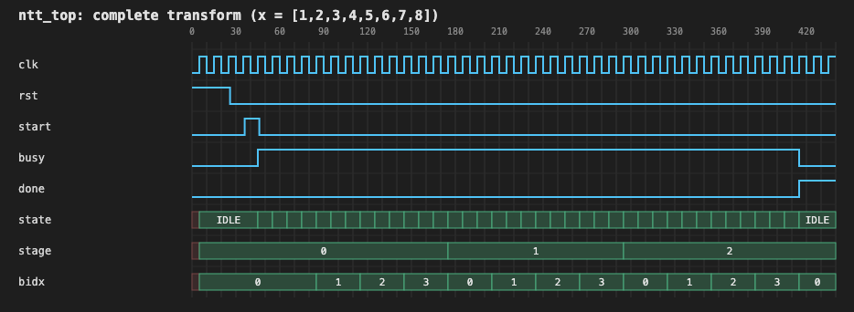
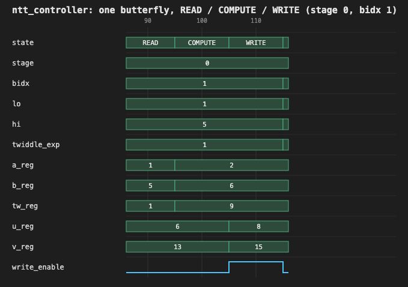
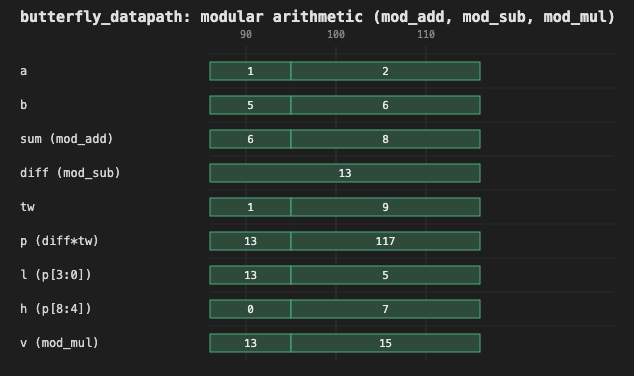

# Verification and Reproducibility

[← Back to main README](../README.md)

The baseline accelerator was verified using a combination of RTL simulation and independent mathematical validation. The RTL testbenches exercise the implemented hardware, while the Python validation checks the transform mathematics and reference results independently. All reported checks completed successfully with zero failures. This document covers the baseline (`rtl/`); each experiment has its own verification section in its `experiments/*/README.md`.

## Prerequisites

The project requires:

- Icarus Verilog (`iverilog` and `vvp`).
- Python 3.

**Tested versions:** Icarus Verilog 13.0 (stable) and Python 3.11.13.

## Running the baseline test suite

The complete RTL test suite can be executed using:

```bash
cd ntt_accelerator
./scripts/run_all_tests.sh
```

The script compiles and runs all four Verilog testbenches (`tb_modular_arithmetic`, `tb_ntt_top`, `tb_control`, `tb_negative`) and aggregates their pass/fail results.

The script resolves the repository root from its own location and changes into it before running, so it can be invoked from any working directory — for example, `bash /path/to/ntt_accelerator/scripts/run_all_tests.sh` from elsewhere works the same way. This matters because the testbenches open fixture and vector files using paths relative to the repository root, which the script's own `cd` guarantees regardless of where it was invoked from.

Successful output looks like this:

```text
=== NTT accelerator verification suite ===

--- tb_modular_arithmetic ---
...
PASSED: tb_modular_arithmetic

--- tb_ntt_top ---
...
PASSED: tb_ntt_top

--- tb_control ---
...
PASSED: tb_control

--- tb_negative ---
...
PASSED: tb_negative

=== summary ===
ALL TESTBENCHES PASSED
```

(each `...` stands for that testbench's own per-check output, left out here for space). Success means `ALL TESTBENCHES PASSED` and exit code `0`.

## Verification strategy

Verification is performed at four levels, from the mathematical transform to the behavior of the RTL controller: independent mathematical validation, independent reference-model comparison, RTL functional verification, and control/negative testing.

### Independent mathematical validation

`reference/ntt_math_validation.py` performs independent Python checks without involving the RTL. It validates:

- The multiplicative order of the selected root of unity.
- The radix-2 DIF butterfly schedule.
- The bit-reversal permutation.
- The modular arithmetic operations.
- The on-disk test vectors in `reference/test_vectors/`, checking each one's expected output against both the direct NTT definition and independently-derived DIF computations.

This establishes that the mathematical conventions and expected intermediate values used by the project are internally consistent. **It does not read `reference/stage_checkpoints/`**; those files are consumed only by `tb_ntt_top.v` for the RTL-level intermediate-stage checks described below.

It validates the primitive-root properties of the selected transform parameters, the DIF butterfly schedule, the bit-reversal mapping, and modular arithmetic behavior, performing **3,579 checks** independently of the RTL simulation.

Run it directly with:

```bash
cd ntt_accelerator/reference
python3 ntt_math_validation.py
```

This is read-only with respect to `test_vectors/`. It never regenerates or repairs a vector file; a missing or corrupted one just gets reported as a failure. Success means `RESULT: PASS (0 failures)` and exit code `0`.

### Independent reference-model comparison

`reference/ntt_reference_model.py` implements the NTT directly from its mathematical definition:

$$
X[k]=\sum_{j=0}^{7}x[j]\omega^{jk}\pmod{17}
$$

It does not implement the DIF butterfly schedule or reuse the RTL's address-generation logic.

The direct transform is compared against the DIF-based implementation for all 31 test vectors. Because the two approaches calculate the transform differently, their agreement provides an independent check of the algorithm and output ordering.

The mathematical validation and RTL simulation therefore provide complementary evidence: the Python checks validate the mathematical reference, while the RTL testbenches verify that the hardware implementation follows the intended operations and produces the expected results.

### RTL functional verification

The RTL verification is divided into four testbenches, each targeting a different part of the design.

**1. Modular arithmetic (`tb_modular_arithmetic.v`)**

The modular arithmetic unit is tested exhaustively over all possible pairs of canonical coefficients in the range 0 to 16. This gives 17 × 17 = 289 operand pairs.

Each pair is checked against six arithmetic conditions covering modular addition, subtraction, and multiplication, including the specialized modulo-17 reduction. This produces **1,734 checks** in total.

**2. Transform execution (`tb_ntt_top.v`)**

`tb/tb_ntt_top.v` exercises the actual `ntt_top` module through its external interface. For all 31 input vectors, it checks:

- The final NTT coefficients against the expected outputs.
- The coefficient memory contents after each of the three DIF stages.
- The coefficient addresses selected for every butterfly.
- The twiddle exponent used by every butterfly.
- The expected execution sequence and transform timing.

The intermediate-stage checks are particularly useful because they can identify errors in the butterfly schedule or address generation even when examining only the final output might not reveal where the error occurred.

Across the 31 transforms, the controller executes 12 butterflies per transform, giving 372 butterfly operations. All 372 operations are sequenced correctly, and the corresponding intermediate-stage and final results pass verification. This produces **3,511 checks** in total.

The testbench reads input and expected-output vectors from decimal text files, with one coefficient per line and eight lines per vector:

- `reference/test_vectors/input_<name>.txt`
- `reference/test_vectors/expected_<name>.txt`

The list of vector names is read from `tb/vector_names.txt`, which is generated from the input-vector files present rather than being hardcoded. For each vector, the testbench also reads the expected intermediate memory contents after each DIF stage:

- `reference/stage_checkpoints/stage1_<name>.txt`
- `reference/stage_checkpoints/stage2_<name>.txt`
- `reference/stage_checkpoints/stage3_<name>.txt`

This allows the testbench to check not only the final transform output but also the intermediate results produced at each stage. These stage-checkpoint files are generated separately by `export_stage_checkpoints.py` (see [Test-vector and stage-checkpoint generation](#test-vector-and-stage-checkpoint-generation) below) and are **not** read by `ntt_math_validation.py`.

### Control and negative testing

The remaining testbenches check behavior that is not covered by the normal transform-vector sweep.

**3. Control and handshake (`tb_control.v`)**

Directed scenarios exercise the controller's reset and handshake behavior: start acceptance, busy-state behavior, completion signaling, and the controller's response to reset. They verify that the control logic follows the expected state transitions and that `busy` and `done` behave correctly throughout a transform. This produces **111 checks** across 7 directed scenarios.

**4. Negative and setup-error tests (`tb_negative.v`)**

The negative tests cover missing files, malformed input, incorrect coefficient counts, out-of-range values, and timeout handling.

An important distinction is that the file-related cases exercise the **testbench's own** input-file handling logic, not the RTL. The hardware itself does not parse or validate input files. A separate reset-held scenario exercises the actual DUT and checks that `done` remains deasserted and the FSM stays in `IDLE` during a bounded polling window while reset is held. This produces **7 checks** across 6 scenarios.

Together, these tests cover both normal operation and the handling of invalid or incomplete test inputs.

## Test results and coverage

The following results were obtained from the current verification run:

| Check | Count | Failures |
|---|---:|---:|
| Exhaustive modular arithmetic (289 operand pairs, 6 checks per pair) | 1,734 | 0 |
| Test-vector outputs, intermediate-stage results, and sequencing | 3,511 | 0 |
| Control, reset, start, and done (7 directed scenarios) | 111 | 0 |
| Negative tests, testbench setup errors, and watchdog timeout checks (6 scenarios) | 7 | 0 |
| **RTL suite total** | **5,363** | **0** |
| Mathematical validation (`ntt_math_validation.py`) | **3,579** | **0** |

**Simulation environment:**
- Simulator: Icarus Verilog 13.0 (stable).
- Reference validation: Python 3.11.13.
- RTL language standard: Verilog-2001.

## Measured baseline transform latency

The implementation completes each transform in **37 busy cycles**, consistently across all 31 test vectors.

The latency follows directly from the controller's execution sequence:

| Operation | Cycles |
|---|---:|
| Initial input loading (`LOAD`) | 1 |
| Butterfly operations (`12 × 3 cycles`) | 36 |
| **Total busy cycles** | **37** |

Each butterfly uses three controller cycles: `READ`, `COMPUTE`, and `WRITE`. The same datapath is reused for all 12 operations rather than executing them in parallel.

The 37-cycle measurement is taken from the accepted start edge through the completion edge of the final `WRITE` operation. It represents the simulated controller latency for one transform, not a measured maximum operating frequency or physical hardware performance. See [Architecture: Latency](architecture.md#latency) for the derivation.

## Test-vector and stage-checkpoint generation

These are one-time generation steps. They're not run automatically by the validator or the test suite, and you don't need them to validate what's already committed. They do need to run in order, since each step depends on the previous one's output:

1. `ntt_reference_model.py` generates the `input_*.txt`/`expected_*.txt` vector files from the direct NTT definition.
2. `export_stage_checkpoints.py` reads those input files and generates the intermediate stage checkpoint files and the `tb/vector_names.txt` manifest.
3. `tb_ntt_top.v` (run via `run_all_tests.sh`) loads all of the above and verifies the actual RTL against them.

```bash
cd ntt_accelerator/reference
python3 ntt_reference_model.py          # (re)generates test_vectors/
python3 export_stage_checkpoints.py     # (re)generates stage_checkpoints/ and tb/vector_names.txt
```

## Waveform inspection

The waveform artifacts provide a signal-level view of the actual RTL execution. They complement the automated verification results by showing how the controller, memory, and arithmetic datapath behave during a transform.

### Capturing a transform

`waves/dump_waveforms.v` is a standalone simulation harness, separate from the four automated testbenches. It instantiates the actual `ntt_top` module and drives one complete transform using the worked-example input:

$$
x=[1,2,3,4,5,6,7,8]
$$

The harness records the signal transitions throughout the execution and writes them to `waves/ntt_top.vcd`. The same simulation also produces `waves/trace.log`, a per-cycle text trace of the execution.

The VCD is retained in the repository so that the recorded signal transitions can be independently inspected using GTKWave or another compatible waveform viewer.

### Complete transform



This waveform shows `clk`, `rst`, `start`, `busy`, `done`, and the controller's `state`, `stage`, and `bidx` signals across the complete transform.

It shows that:

- `busy` rises after the accepted start request and remains asserted throughout the 37-cycle execution.
- `done` is asserted on the final `WRITE` edge, when `busy` returns low.
- `stage` progresses through 0, 1, and 2.
- `bidx` progresses from 0 to 3 within each stage.

### Single butterfly operation



This waveform focuses on stage 0, `bidx = 1`, and shows the controller's `READ → COMPUTE → WRITE` sequence.

The signals include `state`, `stage`, `bidx`, `lo`, `hi`, `twiddle_exp`, `a_reg`, `b_reg`, `tw_reg`, `u_reg`, `v_reg`, and `write_enable`.

The sequence shows how the controller:

1. Captures the selected operands and twiddle factor during `READ`.
2. Captures the butterfly results during `COMPUTE`.
3. Asserts `write_enable` during `WRITE` to commit both results to memory.

The same registers and combinational butterfly datapath are reused for all 12 operations, illustrating the iterative reuse of the hardware rather than separate per-butterfly units.

### Modular arithmetic datapath



This waveform zooms into the arithmetic operations performed during the same butterfly.

It shows:

- `a` and `b`, the shared operands supplied to the adder and subtractor.
- `sum`, the result from `mod_add`.
- `diff`, the result from `mod_sub`.
- `tw`, the multiplier's twiddle-factor input.
- `p`, the raw 9-bit multiplication result.
- `l` and `h`, the lower-nibble and upper-bit portions of the product.
- `v`, the final modulo-17 multiplication result.

The waveform illustrates the specialized modulo-17 reduction:

$$
p=16h+l\equiv l-h\pmod{17}
$$

The final result is obtained from `l-h`, with 17 added when the difference is negative, rather than using a general-purpose modulo operation.

### Inspecting the recorded waveform

To inspect the recorded execution in GTKWave:

```bash
cd ntt_accelerator
gtkwave waves/ntt_top.vcd
```

To regenerate the waveform and trace artifacts, run the standalone simulation harness:

```bash
iverilog -g2001 -Wall -o /tmp/dump.vvp \
    rtl/*.v waves/dump_waveforms.v

vvp /tmp/dump.vvp
```

The accompanying `waves/trace.log` provides a textual view of the same execution. It contains 37 busy-cycle entries before the final output comparison, consistent with the measured transform latency. Its final `coef_out` also matches the worked example's natural-order NTT output.

## Reproduction commands at a glance

```bash
# Baseline RTL test suite
bash scripts/run_all_tests.sh

# Independent mathematical validation
cd reference && python3 ntt_math_validation.py && cd ..

# Regenerate test vectors / stage checkpoints (only if needed)
cd reference
python3 ntt_reference_model.py
python3 export_stage_checkpoints.py
cd ..

# Inspect the recorded waveform
gtkwave waves/ntt_top.vcd
```

---

[← Back to main README](../README.md) · [Architecture and design](architecture.md) · [Experiments and evaluation](experiments.md)
